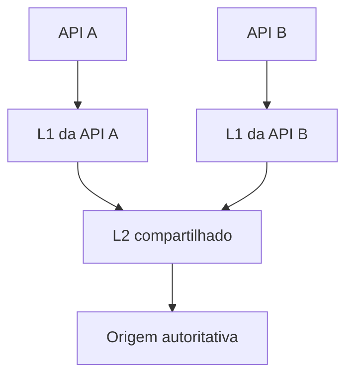
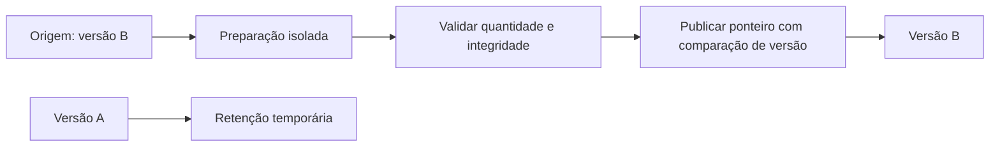

# C36 — Arquitetura de cache e consistência de dados

> **Nível:** Avançado
>
> **Objetivo:** escolher, dimensionar e validar uma estratégia de cache a partir de
> requisitos de consistência, disponibilidade, desempenho e custo.
>
> **Pré-requisitos:** [C05](../linguagem-e-runtime/c05-assincronicidade-concorrencia-controlada.md),
> [C07](c07-apis-http-integracoes-resilientes.md),
> [C10](c10-fundamentos-persistencia-sql-nosql.md) e
> [C17](../sistemas-distribuidos/c17-consistencia-eventual-sagas.md).
>
> **Última revisão:** 2026-11-25

Uma consulta lenta não justifica automaticamente um cache. Antes de criar uma
cópia dos dados, investigue o plano de execução, o padrão de acesso e a
capacidade da origem. Quando a leitura é frequente e a repetição tem custo
relevante, um cache pode reduzir trabalho. Em troca, surge outra representação
dos dados, com falhas, capacidade e ciclo de vida próprios.

Este capítulo trata caches de dados e respostas HTTP, atualização de conjuntos
completos e efeitos operacionais. Não propõe substituir a persistência
transacional nem apresenta resultados de desempenho sem medições.

## Contratos antes da tecnologia

Defina o que pode ser entregue quando a origem está indisponível. Uma descrição
de produto pode admitir atraso de minutos; uma autorização revogada ou um saldo
usado para autorizar uma transação pode exigir consulta à fonte autoritativa.

- **Frescor:** idade do dado em relação à origem; o contrato define a idade máxima aceitável.
- **TTL (time to live):** tempo de vida de uma entrada; não garante, sozinho,
  frescor nem consistência entre réplicas.
- **Evicção:** remoção para liberar capacidade, inclusive antes da expiração.
- **Cache hit e miss:** presença e ausência de uma entrada utilizável.
- **Origem:** sistema responsável pela verdade de negócio.

Uma entrada pode ser recente no cache e antiga na origem, por exemplo, se foi
reconstruída a partir de uma réplica atrasada. Registre a versão ou o instante
do dado na origem quando o requisito exigir comprovar sua atualidade.

## Estratégias de acesso e escrita

| Estratégia | Fluxo | Custo ou risco |
| --- | --- | --- |
| Cache-aside | Aplicação lê o cache; em caso de ausência, consulta a origem e preenche a entrada. | Invalidação e corridas são responsabilidade da aplicação. |
| Read-through | A abstração de cache carrega a origem quando necessário. | A lógica de carregamento fica vinculada à abstração. |
| Write-through | A camada de escrita atualiza a origem e o cache antes de confirmar sucesso. | Latência adicional e necessidade de tratar falhas entre operações. |
| Write-behind | A escrita é propagada à origem posteriormente. | Perda, duplicidade e reordenação sem persistência e recuperação adequadas. |
| Refresh-ahead | Atualiza entradas antes da expiração. | Pode consumir recursos com dados que não serão consultados. |
| Stale-while-revalidate | Entrega dado antigo dentro de uma janela explícita enquanto atualiza. | Exige limite de idade e política para falha de atualização. |

O cache-aside não é uma transação distribuída. Mesmo gravando primeiro na
origem e invalidando depois, uma leitura concorrente pode ter buscado o valor
antigo antes da gravação e repovoar o cache após a invalidação. Versões,
coordenação ou expiração podem limitar o problema, conforme o contrato.
Eventos de invalidação também precisam considerar duplicidade e perda, conforme
o [C16](../sistemas-distribuidos/c16-idempotencia-entrega-confiavel.md).

## Alternativas no ecossistema .NET

| Opção | Uso | Limitação |
| --- | --- | --- |
| `IMemoryCache` | Cache em processo (L1), sem rede. | Cada processo mantém sua própria cópia; a fábrica pode executar concorrentemente. |
| `IDistributedCache` | Abstração de cache compartilhado (L2), por exemplo Redis. | Não oferece coordenação de preenchimento nem operações atômicas arbitrárias. |
| `HybridCache` | L1 e L2 opcionais, serialização e coordenação local de preenchimento. | Não coordena fábricas entre instâncias diferentes do serviço. |
| `StackExchange.Redis` | Acesso às estruturas e operações do Redis. | Acopla a aplicação ao serviço e exige cuidar dos contratos de rede. |
| Output Cache | Cache de respostas no servidor ASP.NET Core. | Exige políticas de variação e invalidação adequadas à resposta. |
| CDN (Content Delivery Network) | Cache de conteúdo na borda da rede. | Exige políticas HTTP e isolamento apropriados para dados privados. |

O HybridCache, disponível desde o .NET 9, usa uma fábrica para preencher uma
chave quando os níveis configurados não possuem uma entrada válida. Seu
mecanismo contra preenchimentos concorrentes atua na mesma instância do
HybridCache. Invalidar uma chave ou uma etiqueta não remove imediatamente
as cópias L1 dos demais processos. A duração local deve refletir a tolerância
a dados antigos. Invalidação por etiquetas é lógica, não uma exclusão física
imediata de todas as entradas.

A figura descreve duas réplicas independentes, cada uma com sua memória local,
que compartilham um cache remoto e consultam a mesma origem.

As setas representam a ordem lógica da busca, não conexões diretas entre
o Redis e a origem.

### Uso do StackExchange.Redis em produção

Reutilize um `ConnectionMultiplexer` de longa duração por configuração de
conexão; em uma aplicação ASP.NET Core, registre-o como singleton e encerre-o
no desligamento do host. Não abra conexões por requisição. Use as APIs
assíncronas nos fluxos de I/O e deixe o cliente multiplexar os comandos.
Evite bloquear tarefas assíncronas com `Result` ou `Wait()`.

Configure os prazos de conexão e comando de acordo com o orçamento de latência,
observe reconexões e falhas do cliente e limite a fila de trabalho da aplicação.
Um prazo excedido não prova que o servidor deixou de executar o comando.
Antes de repetir uma escrita, determine se ela é idempotente ou reconcilie
seu resultado. Limite as tentativas e distribua os atrasos com jitter, sem
sobrepor indiscriminadamente a política de reconexão do cliente.

O cliente pode enfileirar operações enquanto a conexão está indisponível;
avalie a política de fila, os prazos e o custo de executar comandos atrasados.
Meça o custo da serialização e da desserialização, além do tamanho dos valores.
Essas recomendações não exigem múltiplas conexões por padrão; qualquer
separação adicional precisa de evidência de isolamento ou capacidade.

## Modos de falha e concorrência

| Sintoma | Causa provável | Alternativa a avaliar |
| --- | --- | --- |
| Cache stampede | Muitas consultas preenchem a mesma chave ausente. | Coordenação por chave, atualização antecipada ou limite de concorrência. |
| Cache avalanche | Muitas entradas expiram simultaneamente. | Distribuir expirações com variação aleatória (jitter). |
| Cache penetration | Consultas repetidas de chaves inexistentes. | Cache negativo com TTL curto, validação e limites de acesso. |
| Hot keys | Uma chave concentra grande parte das leituras. | Cache local, replicação ou revisão do particionamento. |
| Dados antigos | Invalidação atrasada ou carga fora de ordem. | Versões da origem e limite explícito de frescor. |
| Cache poisoning | Entrada adulterada ou compartilhada no contexto errado. | Validar dados, isolar chaves e restringir escrita. |
| Cold start | Inicialização sem dados em cache. | Aquecimento gradual e proteção da origem. |
| Evicção frequente | Capacidade insuficiente ou política inadequada. | Revisar tamanho, TTL, distribuição e política de memória. |

No Redis, políticas aproximadas de LRU (least recently used) ou LFU (least
frequently used) selecionam entradas para remoção sob pressão. A política
`noeviction` pode rejeitar escritas quando o limite é alcançado. Portanto,
expiração e evicção precisam ser consideradas separadamente.

| Política | Consequência para conjuntos versionados |
| --- | --- |
| `allkeys-lru`, `allkeys-lfu` | Qualquer chave pode ser removida, inclusive o ponteiro e dados ativos. |
| `volatile-lru`, `volatile-ttl` | Somente chaves com expiração são elegíveis; sem candidatas, novas escritas podem ser rejeitadas. |
| `noeviction` | Evita remoção por pressão de memória, mas pode rejeitar operações que aumentam o consumo. |

Para uma geração que precisa permanecer integralmente disponível, avalie
uma instância dedicada com `noeviction`, limite de memória explícito,
margem para a geração em preparação e tratamento de erros de escrita.
A política é da instância, não de cada chave. Ela não evita expiração,
exclusão explícita nem perda de dados após falhas. Não publique uma carga
que recebeu erros de escrita. Em caches de entradas independentes,
uma política de evicção pode ser mais adequada.

Planeje a expiração junto com a escrita. Um `SET` bem-sucedido substitui
o valor e remove o TTL anterior, salvo opções como `KEEPTTL` ou uma nova
expiração. Alterações de campos com `HSET` preservam o TTL da chave.
Não aplique TTL curto à geração ativa sem prever reconstrução e ausência
de dados. O laboratório verifica essas diferenças de comportamento.

Um bloqueio distribuído com prazo de validade (lease) não garante que o
proprietário antigo pare de executar quando o prazo termina. No Redis 7, a
obtenção pode usar `SET` com `NX` e `PX` e um valor exclusivo por aquisição.
A liberação precisa comparar esse valor e excluir a chave na mesma operação
atômica, por exemplo com Lua. Comparar e excluir em comandos separados permite
que o proprietário anterior remova o bloqueio de outro. Uma renovação também
precisa verificar a propriedade atomicamente; renovar não impede que uma
execução antiga continue após perder o bloqueio. Um fencing token é uma geração
crescente que o recurso protegido precisa validar para rejeitar operações
antigas. Um bloqueio local não substitui essa coordenação.
Em caso de partição de rede ou troca de primário, valide as garantias do
serviço em vez de presumir exclusão mútua global.

Se o cache falhar, consultar a origem indiscriminadamente pode causar uma
falha em cascata. Limite simultaneidade, aplique prazos e defina respostas
degradadas. Não sirva dados antigos quando a regra de negócio não permite.

## Atualização de conjuntos completos

Considere um catálogo fictício com 1,5 milhão de registros, atualizado a cada
12 horas. As consultas não devem enxergar uma geração parcialmente carregada.

| Alternativa | Benefício | Risco |
| --- | --- | --- |
| Apagar e reconstruir | Pouca lógica adicional. | Janela sem dados e pico de consultas à origem. |
| Atualizar entradas individualmente | Menor duplicação de memória. | Leitores podem observar versões misturadas. |
| Atualizar por eventos ou CDC | Menor atraso e trabalho incremental. | Requer tratamento de ordenação, exclusões e recuperação. |
| Publicar uma versão completa | Leitores podem usar um conjunto coerente. | Duas versões podem coexistir; exige coordenação e limpeza. |

CDC (Change Data Capture) captura mudanças da origem; não substitui a
necessidade de detectar lacunas nem garantir uma carga inicial consistente.

### Consistência da extração

Uma versão completa não é necessariamente consistente. Se a origem mudar
entre páginas da extração, a quantidade esperada pode estar correta e os
registros ainda assim representar instantes diferentes. A troca atômica do
ponteiro não corrige essa inconsistência.

No PostgreSQL, uma transação de leitura em `REPEATABLE READ` mantém a mesma
visão dos dados para consultas sucessivas a partir da primeira instrução que
estabelece a visão transacional. Avalie o custo de manter uma transação longa.
Para outras fontes, prefira uma exportação imutável e versionada ou um marco
de processamento associado a um protocolo que garanta a visão consistente.
Um horário de corte isolado não garante isso se os registros puderem mudar
ou chegar fora de ordem. Com CDC, coordene a carga inicial e a posição do
fluxo de mudanças para evitar lacunas.

Valide quantidade, identidade dos registros, versão da origem e, quando
aplicável, a integridade do conteúdo contra um manifesto produzido pela
extração. Uma contagem igual não detecta a troca de um registro por outro.

### Estrutura das chaves e carga em lotes

O laboratório usa um hash pequeno por geração para demonstrar a publicação
atômica. Não concentre 1,5 milhão de registros nesse mesmo hash por padrão.
Chaves grandes podem aumentar a latência de comandos, a pressão de memória
e o custo de migração, replicação e remoção. Considere o padrão de leitura:

| Estrutura | Vantagem | Restrição |
| --- | --- | --- |
| Uma chave por registro | Leitura e distribuição independentes. | Mais chaves e metadados. |
| Hashes por partição | Agrupa registros e reduz parte do custo por chave. | Partições precisam de limites e balanceamento. |
| Um hash por geração | Simplifica a demonstração e a contagem. | Uma única chave concentra capacidade e acesso. |

Use nomes com espaço de nomes, geração e partição. Em Redis Cluster, o texto
entre chaves de uma hash tag determina o slot quando segue o formato válido.
Por exemplo, `{catalogo}:ativo` e `{catalogo}:manifesto:42` compartilham
um slot; `catalogo:42:{particao-01}:dados` e
`catalogo:42:{particao-02}:dados` podem ocupar slots diferentes.
Confirme a distribuição real: tags distintas podem produzir o mesmo slot.
Não imponha a mesma tag a todos os dados apenas para obter atomicidade.

Carregue dados em lotes de tamanho e concorrência limitados. Pipelining
reduz esperas de rede ao enviar comandos sem aguardar cada resposta antes
do próximo envio. Não é uma transação: confirme todas as respostas, inclusive
erros individuais, antes de registrar a conclusão de uma partição.
Evite filas sem limite no cliente e buffers excessivos no servidor.
Dimensione os lotes por bytes, latência e capacidade medida, não por um
número universal de registros. Propague cancelamento entre etapas,
controle a pressão sobre a origem e permita limpar ou retomar uma carga
interrompida sem modificar a geração ativa.

### Publicação por versão

A versão A continua atendendo leitores enquanto B é preparada. O publicador
valida B e altera o ponteiro apenas se a geração esperada ainda estiver ativa.
Cada consulta resolve o ponteiro uma vez e usa a mesma geração até terminar.
Não misture uma versão lida no começo da consulta com outra durante a leitura.

A geração da publicação e a versão dos dados na origem são conceitos
distintos. Se duas cargas concorrem, a publicação deve rejeitar uma geração
obsoleta e, quando necessário, também rejeitar retrocesso da versão da origem.
Uma reversão deliberada para dados anteriores deve criar uma nova geração de
publicação, ser auditada e respeitar os requisitos de frescor.

No Redis, uma operação condicional em Lua pode comparar o ponteiro e publicar
uma nova versão sem intercalar comandos de outros clientes. Isso não torna
a carga inteira uma transação nem garante durabilidade após troca de primário.
Em Redis Cluster, todas as chaves acessadas pelo script devem estar no mesmo
slot. Evite concentrar todo o catálogo em um único slot apenas para obter
atomicidade: mantenha os metadados da publicação juntos e distribua os dados
quando necessário, validando a integridade e o protocolo de leitura.

Em uma carga particionada, um manifesto imutável registra a versão da
origem, a identidade das partições, as quantidades verificadas e, quando
aplicável, um resumo de integridade. O script publica apenas os metadados
de prontidão no mesmo slot do ponteiro. Ele não valida atomicamente dados
em slots diferentes. Se uma partição desaparecer após a validação, o leitor
deve tratar a geração como indisponível, sem combinar versões.

Os scripts executam sem intercalação de outros comandos no servidor.
Isso torna importante limitar seu trabalho: não percorra todo o catálogo
dentro de Lua. Declare chaves em `KEYS` e argumentos em `ARGV`; não
construa nomes de chaves acessadas dinamicamente. Atomicidade não significa
reversão automática de escritas anteriores quando ocorre um erro no script.

Use `SCRIPT LOAD` e `EVALSHA` para reutilizar um script; a ausência no
cache de scripts pode ocorrer após reinício, troca de primário ou
`SCRIPT FLUSH`. Trate `NOSCRIPT` carregando ou executando o script
novamente. Não confunda essa resposta explícita com um prazo excedido de
resultado desconhecido. Redis Functions, disponíveis desde Redis 7,
oferecem outra forma de administrar lógica reutilizável; sua implantação
também deve considerar cada primário do cluster.

Planeje a retenção da versão antiga para leitores em andamento. Quando as
leituras têm um prazo máximo conhecido, retenha a versão anterior por pelo
menos esse prazo após a troca, considerando propagação do ponteiro e margem
operacional. Caso contrário, use coordenação de leitores ou um protocolo de
repetição integral. A limpeza não deve excluir a geração ativa nem uma
versão ainda necessária para recuperação. Se uma
entrada desaparecer por evicção ou a versão inteira deixar de estar disponível,
a consulta deve falhar de forma controlada, repetir com uma nova versão
quando permitido ou usar uma origem coerente. Não misture gerações como
estratégia de recuperação.

### Limpeza e recuperação

Mantenha um registro de gerações em preparação, ativas e aposentadas, com
identidade imutável. Só remova uma geração depois de confirmar que ela não
está ativa, não será republicada e não possui leitores protegidos pela
política de retenção. A coordenação da limpeza deve considerar publicadores
concorrentes e reversões; um teste de ponteiro seguido de uma exclusão
independente não é uma proteção suficiente se a versão puder voltar a ser
ativa.

Prefira usar o manifesto para localizar as chaves. Se precisar descobrir
chaves, use `SCAN` com cursor até retornar a zero; ele pode repetir
resultados e não constitui uma visão transacional. Em Cluster, percorra
os primários pertinentes. Evite `KEYS` em fluxos operacionais de produção.
Torne a limpeza idempotente e limite sua taxa. `UNLINK` remove a chave
do espaço de nomes imediatamente e libera sua memória em trabalho
assíncrono; não espere recuperação instantânea da capacidade. `DEL`
pode exigir trabalho síncrono de acordo com o tipo e o tamanho do valor.

### Replicação, persistência e disponibilidade

No Redis, a replicação normalmente é assíncrona: o primário pode confirmar
uma publicação que ainda não chegou a uma réplica. Leituras de réplicas
podem retornar uma geração antiga. Para o ponteiro, prefira consultar o
primário quando o contrato exigir a versão mais recente disponível, sem
prometer consistência forte durante uma troca de primário.

O comando `WAIT` pode aguardar confirmações de réplicas para escritas
anteriores na mesma conexão, até um prazo; confira a quantidade retornada.
Isso reduz o risco de perda, mas não garante persistência em disco, eleição
da réplica confirmada nem consistência forte. Em um cluster com dados
distribuídos, não trata todos os primários como uma transação.

A persistência RDB (Redis Database) registra imagens periódicas do conjunto.
A AOF (Append Only File) registra operações de escrita; sua política de
sincronização em disco afeta a janela de perda e o custo. Alta disponibilidade,
replicação e persistência atendem necessidades diferentes. Defina RPO e RTO
conforme o [C28](../operacao-entrega-e-plataforma/c28-confiabilidade-resposta-incidentes.md)
e avalie se é mais eficiente reconstruir o cache a partir da origem.

Após um prazo excedido na publicação, consulte o ponteiro e a identidade
da geração para reconciliar o resultado: a escrita pode ter sido executada.
Após falha ou troca de primário, valide a disponibilidade e a integridade
da geração apontada antes de liberar consultas. Uma reconstrução segura
pode exigir nova geração, não a repetição cega da escrita anterior.

### Capacidade e custo

Com tamanho serializado hipotético de 1 KiB por registro, 1,5 milhão de
registros ocupam aproximadamente 1,43 GiB de conteúdo por versão. Durante
uma troca, duas versões exigem cerca de 2,86 GiB apenas de conteúdo, sem
chaves, metadados, fragmentação, buffers nem réplicas. Meça o consumo real e
dimensione também a capacidade durante falhas, retenção e reprocessamentos.

A memória é apenas uma dimensão: considere transferência, tempo de
reconstrução, trabalho na origem, custo de replicação e operação. O limite
`maxmemory` não representa todo o consumo residente do processo. Inclua
fragmentação, buffers de replicação e persistência, memória do sistema
operacional e picos durante operações de persistência. Meça o consumo
real por estrutura com `MEMORY USAGE`, incluindo a estratégia de amostragem,
e acompanhe o consumo total durante a coexistência de gerações.

## Segurança e isolamento

Uma chave precisa representar o contexto que altera a resposta: tenant,
recurso, versão e, quando aplicável, identidade ou escopo de autorização.
Nunca use dados sensíveis em nomes de chaves ou etiquetas de telemetria.
Normalizar entradas sem validar limites pode permitir consumo excessivo de
memória. Em entregas graduais, versões incompatíveis do formato serializado
precisam usar espaços de chaves distintos ou leitores compatíveis durante a
transição; a versão do formato não é a geração dos dados. Autorização não deve depender de uma cópia antiga sem um contrato
explícito de revogação. Consulte o
[C26](../qualidade-e-seguranca/c26-seguranca-fronteiras-aplicacao.md).

### Segurança específica do Redis

Mantenha o serviço em rede privada e restrinja acesso aos clientes autorizados.
Use TLS (Transport Layer Security) quando houver comunicação pela rede,
valide certificados e proteja credenciais fora do código e dos registros.
Não exponha a porta do Redis diretamente à Internet.

Configure ACLs (Access Control Lists) com privilégios mínimos: separe
identidades de leitores, publicadores e operadores de limpeza; limite
comandos e padrões de chaves de cada identidade. Não conceda permissões
administrativas à aplicação. Valide a autorização tanto no serviço quanto
na aplicação: prefixos de chave não são isolamento por si só. Se clientes
ou cargas exigirem isolamento mais forte, considere instâncias distintas.

O laboratório usa um Redis descartável sem portas publicadas e sem rede
externa. A ausência de autenticação nesse ambiente não é recomendação para
produção. O exercício verifica restrições de uma identidade de leitura,
mas não demonstra TLS, rotação de credenciais ou isolamento entre redes.

## Laboratório executável

O [laboratório C36](../../exemplos/c36-cache/README.md) usa o SDK .NET 11
fixado no repositório. Os testes locais demonstram publicação de conjuntos
imutáveis, retenção de uma referência para o leitor, rejeição de carga
incompleta, geração obsoleta e publicação concorrente.

O modelo em memória isola a regra de publicação; não simula a rede nem
as garantias do Redis. Um exercício separado usa Redis real via Docker,
sem publicar portas, para observar a troca condicional de um ponteiro. O
script publica a própria chave de dados validada e rejeita gerações antigas,
chaves inválidas e cargas incompletas. Dois clientes disputam a mesma base,
e cada rejeição verifica a preservação do estado ativo. O CI executa esse
exercício em um job separado, com imagem fixada por digest. Também verifica
o tratamento de `NOSCRIPT`, expiração, liberação condicional de bloqueios,
ausência de reversão automática em Lua, remoção de uma geração aposentada,
rejeição de escrita sob `noeviction` e permissões de leitura. Não substitui
testes de integração de uma aplicação distribuída.

## Como medir antes de decidir

| Métrica | Pergunta |
| --- | --- |
| Taxa de acertos | Quantas consultas foram atendidas pelo nível de cache? |
| Latência p50, p95 e p99 | O cache melhora também a cauda da distribuição? |
| Throughput e carga na origem | Quanto trabalho foi realmente evitado? |
| Memória e evicções | Há capacidade para dados, versões e picos? |
| Idade dos dados | A aplicação cumpre o limite de frescor? |
| Tempo de reconstrução | Quanto dura a janela de recuperação? |
| Custo por consulta | O benefício compensa infraestrutura e operação? |

Compare com uma execução sem cache, aquecimento, carga estável, expiração
simultânea e indisponibilidade. Fixe a distribuição das chaves, concorrência,
tamanho dos dados, ambiente, versões e duração. Registre também falhas e
respostas degradadas, não somente requisições bem-sucedidas. Agregue métricas
por operação ou região de cache, sem usar chaves individuais como etiquetas
de alta cardinalidade.
O [C04](../linguagem-e-runtime/c04-memoria-runtime-performance.md) trata
medições de desempenho em pequena escala; o [C25](../qualidade-e-seguranca/c25-cobertura-e2e-carga.md)
trata carga sistêmica. Não confunda resultados desses dois níveis.

### Indicadores nativos do Redis

| Indicador ou comando | Interpretação |
| --- | --- |
| `keyspace_hits`, `keyspace_misses` | Contadores de buscas de chaves no servidor; use diferenças no intervalo. |
| `evicted_keys`, `expired_keys` | Contadores de remoções por pressão e expiração. |
| `used_memory`, `used_memory_rss` | Memória alocada pelo Redis e memória residente do processo. |
| `mem_fragmentation_ratio` | Relação entre memória residente e alocada; interprete junto aos valores absolutos. |
| `mem_not_counted_for_evict` | Memória excluída do cálculo de evicção, como determinados buffers. |
| `MEMORY USAGE` | Estimativa de memória de uma chave, com amostragem para estruturas compostas. |
| `SLOWLOG GET` | Comandos com execução lenta no servidor, sem medir o tempo de rede. |

Consulte as seções de estatísticas e memória de `INFO` conforme as
permissões do ambiente. Uma taxa de acertos do Redis não representa
necessariamente a taxa de acertos de negócio, especialmente em caches
com L1 ou consultas com várias chaves. Trate reinícios de contadores,
agregue por instância e correlacione com latência, filas, erros e frescor
medidos no cliente. Restrinja acesso aos diagnósticos que exponham
argumentos de comandos.

## Matriz de decisão

| Contexto | Primeira alternativa a avaliar |
| --- | --- |
| Origem rápida e baixa repetição | Não adicionar cache. |
| Processo único e dados pequenos | Cache em memória. |
| Várias réplicas com cópia compartilhada | Cache distribuído. |
| Leituras frequentes e atraso local aceitável | Cache híbrido. |
| Conjunto analítico com atualização periódica | Publicação por versões. |
| Invariante transacional ou autorização sensível | Origem autoritativa. |
| Conteúdo HTTP público e estável | Output Cache ou CDN, conforme a fronteira. |

Reavalie se a taxa de acertos é baixa, a latência piora, o custo aumenta ou
o limite de frescor deixa de ser cumprido. O cache é um meio, não um requisito
arquitetural por si só.

## Relação com outros capítulos

- [C05](../linguagem-e-runtime/c05-assincronicidade-concorrencia-controlada.md)
  trata concorrência e limites de processamento.
- [C10](c10-fundamentos-persistencia-sql-nosql.md) orienta a escolha da origem
  e a investigação de consultas.
- [C17](../sistemas-distribuidos/c17-consistencia-eventual-sagas.md) trata
  consistência distribuída e limites de transação.
- [C27](../operacao-entrega-e-plataforma/c27-telemetria-diagnostico-distribuido.md)
  trata métricas, logs e rastreamento.
- [C28](../operacao-entrega-e-plataforma/c28-confiabilidade-resposta-incidentes.md)
  conecta indicadores a objetivos de confiabilidade.

## Referências

- [Cache-Aside pattern](https://learn.microsoft.com/en-us/azure/architecture/patterns/cache-aside)
  — Microsoft Azure Architecture Center, acesso em 25 novembro 2026.
- [Caching in .NET](https://learn.microsoft.com/en-us/dotnet/core/extensions/caching)
  — Microsoft Learn, acesso em 25 novembro 2026.
- [HybridCache library](https://learn.microsoft.com/pt-br/aspnet/core/performance/caching/hybrid?view=aspnetcore-10.0)
  — Microsoft Learn, ASP.NET Core 10, acesso em 25 novembro 2026.
- [Key eviction](https://redis.io/docs/latest/develop/reference/eviction/)
  — Redis, acesso em 25 novembro 2026.
- [Scripting with Lua](https://redis.io/docs/latest/develop/programmability/eval-intro/)
  — Redis, acesso em 25 novembro 2026.
- [Scale with Redis Cluster](https://redis.io/docs/latest/operate/oss_and_stack/management/scaling/)
  — Redis, acesso em 25 novembro 2026.
- [SET](https://redis.io/docs/latest/commands/set/)
  — Redis, acesso em 25 novembro 2026.
- [Distributed locks with Redis](https://redis.io/docs/latest/develop/clients/patterns/distributed-locks/)
  — Redis, acesso em 25 novembro 2026.
- [Transaction isolation](https://www.postgresql.org/docs/19/transaction-iso.html)
  — PostgreSQL 19, acesso em 25 novembro 2026.
- [Redis pipelining](https://redis.io/docs/latest/develop/using-commands/pipelining/)
  — Redis, acesso em 25 novembro 2026.
- [Diagnosing latency issues](https://redis.io/docs/latest/operate/oss_and_stack/management/optimization/latency/)
  — Redis, acesso em 25 novembro 2026.
- [Redis Functions](https://redis.io/docs/latest/develop/programmability/functions-intro/)
  — Redis, acesso em 25 novembro 2026.
- [SCAN](https://redis.io/docs/latest/commands/scan/)
  — Redis, acesso em 25 novembro 2026.
- [UNLINK](https://redis.io/docs/latest/commands/unlink/)
  — Redis, acesso em 25 novembro 2026.
- [EXPIRE](https://redis.io/docs/latest/commands/expire/)
  — Redis, acesso em 25 novembro 2026.
- [Redis replication](https://redis.io/docs/latest/operate/oss_and_stack/management/replication/)
  — Redis, acesso em 25 novembro 2026.
- [Redis persistence](https://redis.io/docs/latest/operate/oss_and_stack/management/persistence/)
  — Redis, acesso em 25 novembro 2026.
- [WAIT](https://redis.io/docs/latest/commands/wait/)
  — Redis, acesso em 25 novembro 2026.
- [StackExchange.Redis production usage](https://redis.io/docs/latest/develop/clients/dotnet/produsage/)
  — Redis, acesso em 25 novembro 2026.
- [Redis security](https://redis.io/docs/latest/operate/oss_and_stack/management/security/)
  — Redis, acesso em 25 novembro 2026.
- [Redis ACL](https://redis.io/docs/latest/operate/oss_and_stack/management/security/acl/)
  — Redis, acesso em 25 novembro 2026.
- [INFO](https://redis.io/docs/latest/commands/info/)
  — Redis, acesso em 25 novembro 2026.
- [MEMORY USAGE](https://redis.io/docs/latest/commands/memory-usage/)
  — Redis, acesso em 25 novembro 2026.
- [SLOWLOG GET](https://redis.io/docs/latest/commands/slowlog-get/)
  — Redis, acesso em 25 novembro 2026.
