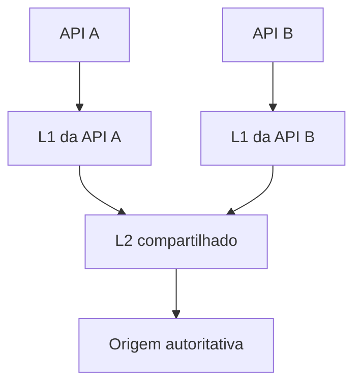
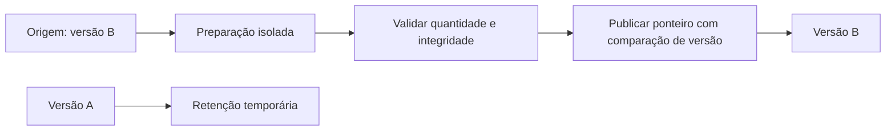

# C36 — Arquitetura de cache e consistência de dados

> **Nível:** Avançado
>
> **Objetivo:** escolher, dimensionar e validar uma estratégia de cache a partir de
> requisitos de consistência, disponibilidade, desempenho e custo.
>
> **Pré-requisitos:** [C05](../linguagem-e-runtime/c05-assincronicidade-concorrencia-controlada.md),
> [C07](c07-apis-http-integracoes-resilientes.md),
> [C10](c10-fundamentos-persistencia-sql-nosql.md) e
> [C17](../sistemas-distribuidos/c17-consistencia-eventual-sagas.md).
>
> **Última revisão:** 2026-11-25

Uma consulta lenta não justifica automaticamente um cache. Antes de criar uma
cópia dos dados, investigue o plano de execução, o padrão de acesso e a
capacidade da origem. Quando a leitura é frequente e a repetição tem custo
relevante, um cache pode reduzir trabalho. Em troca, surge outra representação
dos dados, com falhas, capacidade e ciclo de vida próprios.

Este capítulo trata caches de dados e respostas HTTP, atualização de conjuntos
completos e efeitos operacionais. Não propõe substituir a persistência
transacional nem apresenta resultados de desempenho sem medições.

## Contratos antes da tecnologia

Defina o que pode ser entregue quando a origem está indisponível. Uma descrição
de produto pode admitir atraso de minutos; uma autorização revogada ou um saldo
usado para autorizar uma transação pode exigir consulta à fonte autoritativa.

- **Frescor:** idade do dado em relação à origem; o contrato define a idade máxima aceitável.
- **TTL (time to live):** tempo de vida de uma entrada; não garante, sozinho,
  frescor nem consistência entre réplicas.
- **Evicção:** remoção para liberar capacidade, inclusive antes da expiração.
- **Cache hit e miss:** presença e ausência de uma entrada utilizável.
- **Origem:** sistema responsável pela verdade de negócio.

Uma entrada pode ser recente no cache e antiga na origem, por exemplo, se foi
reconstruída a partir de uma réplica atrasada. Registre a versão ou o instante
do dado na origem quando o requisito exigir comprovar sua atualidade.

## Estratégias de acesso e escrita

| Estratégia | Fluxo | Custo ou risco |
| --- | --- | --- |
| Cache-aside | Aplicação lê o cache; em caso de ausência, consulta a origem e preenche a entrada. | Invalidação e corridas são responsabilidade da aplicação. |
| Read-through | A abstração de cache carrega a origem quando necessário. | A lógica de carregamento fica vinculada à abstração. |
| Write-through | A camada de escrita atualiza a origem e o cache antes de confirmar sucesso. | Latência adicional e necessidade de tratar falhas entre operações. |
| Write-behind | A escrita é propagada à origem posteriormente. | Perda, duplicidade e reordenação sem persistência e recuperação adequadas. |
| Refresh-ahead | Atualiza entradas antes da expiração. | Pode consumir recursos com dados que não serão consultados. |
| Stale-while-revalidate | Entrega dado antigo dentro de uma janela explícita enquanto atualiza. | Exige limite de idade e política para falha de atualização. |

O cache-aside não é uma transação distribuída. Mesmo gravando primeiro na
origem e invalidando depois, uma leitura concorrente pode ter buscado o valor
antigo antes da gravação e repovoar o cache após a invalidação. Versões,
coordenação ou expiração podem limitar o problema, conforme o contrato.
Eventos de invalidação também precisam considerar duplicidade e perda, conforme
o [C16](../sistemas-distribuidos/c16-idempotencia-entrega-confiavel.md).

## Alternativas no ecossistema .NET

| Opção | Uso | Limitação |
| --- | --- | --- |
| `IMemoryCache` | Cache em processo (L1), sem rede. | Cada processo mantém sua própria cópia; a fábrica pode executar concorrentemente. |
| `IDistributedCache` | Abstração de cache compartilhado (L2), por exemplo Redis. | Não oferece coordenação de preenchimento nem operações atômicas arbitrárias. |
| `HybridCache` | L1 e L2 opcionais, serialização e coordenação local de preenchimento. | Não coordena fábricas entre instâncias diferentes do serviço. |
| `StackExchange.Redis` | Acesso às estruturas e operações do Redis. | Acopla a aplicação ao serviço e exige cuidar dos contratos de rede. |
| Output Cache | Cache de respostas no servidor ASP.NET Core. | Exige políticas de variação e invalidação adequadas à resposta. |
| CDN (Content Delivery Network) | Cache de conteúdo na borda da rede. | Exige políticas HTTP e isolamento apropriados para dados privados. |

O HybridCache, disponível desde o .NET 9, usa uma fábrica para preencher uma
chave quando os níveis configurados não possuem uma entrada válida. Seu
mecanismo contra preenchimentos concorrentes atua na mesma instância do
HybridCache. Invalidar uma chave ou uma etiqueta não remove imediatamente
as cópias L1 dos demais processos. A duração local deve refletir a tolerância
a dados antigos. Invalidação por etiquetas é lógica, não uma exclusão física
imediata de todas as entradas.

A figura descreve duas réplicas independentes, cada uma com sua memória local,
que compartilham um cache remoto e consultam a mesma origem.

As setas representam a ordem lógica da busca, não conexões diretas entre
o Redis e a origem.

## Modos de falha e concorrência

| Sintoma | Causa provável | Alternativa a avaliar |
| --- | --- | --- |
| Cache stampede | Muitas consultas preenchem a mesma chave ausente. | Coordenação por chave, atualização antecipada ou limite de concorrência. |
| Cache avalanche | Muitas entradas expiram simultaneamente. | Distribuir expirações com variação aleatória (jitter). |
| Cache penetration | Consultas repetidas de chaves inexistentes. | Cache negativo com TTL curto, validação e limites de acesso. |
| Hot keys | Uma chave concentra grande parte das leituras. | Cache local, replicação ou revisão do particionamento. |
| Dados antigos | Invalidação atrasada ou carga fora de ordem. | Versões da origem e limite explícito de frescor. |
| Cache poisoning | Entrada adulterada ou compartilhada no contexto errado. | Validar dados, isolar chaves e restringir escrita. |
| Cold start | Inicialização sem dados em cache. | Aquecimento gradual e proteção da origem. |
| Evicção frequente | Capacidade insuficiente ou política inadequada. | Revisar tamanho, TTL, distribuição e política de memória. |

No Redis, políticas aproximadas de LRU (least recently used) ou LFU (least
frequently used) selecionam entradas para remoção sob pressão. A política
`noeviction` pode rejeitar escritas quando o limite é alcançado. Portanto,
expiração e evicção precisam ser consideradas separadamente.

Um bloqueio distribuído com prazo de validade (lease) não garante que o
proprietário antigo pare de executar quando o prazo termina. No Redis 7, a
obtenção pode usar `SET` com `NX` e `PX` e um valor exclusivo por aquisição.
A liberação precisa comparar esse valor e excluir a chave na mesma operação
atômica, por exemplo com Lua. Comparar e excluir em comandos separados permite
que o proprietário anterior remova o bloqueio de outro. Uma renovação também
precisa verificar a propriedade atomicamente; renovar não impede que uma
execução antiga continue após perder o bloqueio. Um fencing token é uma geração
crescente que o recurso protegido precisa validar para rejeitar operações
antigas. Um bloqueio local não substitui essa coordenação.
Em caso de partição de rede ou troca de primário, valide as garantias do
serviço em vez de presumir exclusão mútua global.

Se o cache falhar, consultar a origem indiscriminadamente pode causar uma
falha em cascata. Limite simultaneidade, aplique prazos e defina respostas
degradadas. Não sirva dados antigos quando a regra de negócio não permite.

## Atualização de conjuntos completos

Considere um catálogo fictício com 1,5 milhão de registros, atualizado a cada
12 horas. As consultas não devem enxergar uma geração parcialmente carregada.

| Alternativa | Benefício | Risco |
| --- | --- | --- |
| Apagar e reconstruir | Pouca lógica adicional. | Janela sem dados e pico de consultas à origem. |
| Atualizar entradas individualmente | Menor duplicação de memória. | Leitores podem observar versões misturadas. |
| Atualizar por eventos ou CDC | Menor atraso e trabalho incremental. | Requer tratamento de ordenação, exclusões e recuperação. |
| Publicar uma versão completa | Leitores podem usar um conjunto coerente. | Duas versões podem coexistir; exige coordenação e limpeza. |

CDC (Change Data Capture) captura mudanças da origem; não substitui a
necessidade de detectar lacunas nem garantir uma carga inicial consistente.

### Consistência da extração

Uma versão completa não é necessariamente consistente. Se a origem mudar
entre páginas da extração, a quantidade esperada pode estar correta e os
registros ainda assim representar instantes diferentes. A troca atômica do
ponteiro não corrige essa inconsistência.

No PostgreSQL, uma transação de leitura em `REPEATABLE READ` mantém a mesma
visão dos dados para consultas sucessivas a partir da primeira instrução que
estabelece a visão transacional. Avalie o custo de manter uma transação longa.
Para outras fontes, prefira uma exportação imutável e versionada ou um marco
de processamento associado a um protocolo que garanta a visão consistente.
Um horário de corte isolado não garante isso se os registros puderem mudar
ou chegar fora de ordem. Com CDC, coordene a carga inicial e a posição do
fluxo de mudanças para evitar lacunas.

Valide quantidade, identidade dos registros, versão da origem e, quando
aplicável, a integridade do conteúdo contra um manifesto produzido pela
extração. Uma contagem igual não detecta a troca de um registro por outro.

### Publicação por versão

A versão A continua atendendo leitores enquanto B é preparada. O publicador
valida B e altera o ponteiro apenas se a geração esperada ainda estiver ativa.
Cada consulta resolve o ponteiro uma vez e usa a mesma geração até terminar.
Não misture uma versão lida no começo da consulta com outra durante a leitura.

A geração da publicação e a versão dos dados na origem são conceitos
distintos. Se duas cargas concorrem, a publicação deve rejeitar uma geração
obsoleta e, quando necessário, também rejeitar retrocesso da versão da origem.
Uma reversão deliberada para dados anteriores deve criar uma nova geração de
publicação, ser auditada e respeitar os requisitos de frescor.

No Redis, uma operação condicional em Lua pode comparar o ponteiro e publicar
uma nova versão sem intercalar comandos de outros clientes. Isso não torna
a carga inteira uma transação nem garante durabilidade após troca de primário.
Em Redis Cluster, todas as chaves acessadas pelo script devem estar no mesmo
slot. Evite concentrar todo o catálogo em um único slot apenas para obter
atomicidade: mantenha os metadados da publicação juntos e distribua os dados
quando necessário, validando a integridade e o protocolo de leitura.

Planeje a retenção da versão antiga para leitores em andamento. Quando as
leituras têm um prazo máximo conhecido, retenha a versão anterior por pelo
menos esse prazo após a troca, considerando propagação do ponteiro e margem
operacional. Caso contrário, use coordenação de leitores ou um protocolo de
repetição integral. A limpeza não deve excluir a geração ativa nem uma
versão ainda necessária para recuperação. Se uma
entrada desaparecer por evicção ou a versão inteira deixar de estar disponível,
a consulta deve falhar de forma controlada, repetir com uma nova versão
quando permitido ou usar uma origem coerente. Não misture gerações como
estratégia de recuperação.

### Capacidade e custo

Com tamanho serializado hipotético de 1 KiB por registro, 1,5 milhão de
registros ocupam aproximadamente 1,43 GiB de conteúdo por versão. Durante
uma troca, duas versões exigem cerca de 2,86 GiB apenas de conteúdo, sem
chaves, metadados, fragmentação, buffers nem réplicas. Meça o consumo real e
dimensione também a capacidade durante falhas, retenção e reprocessamentos.

A memória é apenas uma dimensão: considere transferência, tempo de
reconstrução, trabalho na origem, custo de replicação e operação.

## Segurança e isolamento

Uma chave precisa representar o contexto que altera a resposta: tenant,
recurso, versão e, quando aplicável, identidade ou escopo de autorização.
Nunca use dados sensíveis em nomes de chaves ou etiquetas de telemetria.
Normalizar entradas sem validar limites pode permitir consumo excessivo de
memória. Em entregas graduais, versões incompatíveis do formato serializado
precisam usar espaços de chaves distintos ou leitores compatíveis durante a
transição; a versão do formato não é a geração dos dados. Autorização não deve depender de uma cópia antiga sem um contrato
explícito de revogação. Consulte o
[C26](../qualidade-e-seguranca/c26-seguranca-fronteiras-aplicacao.md).

## Laboratório executável

O [laboratório C36](../../exemplos/c36-cache/README.md) usa o SDK .NET 11
fixado no repositório. Os testes locais demonstram publicação de conjuntos
imutáveis, retenção de uma referência para o leitor, rejeição de carga
incompleta, geração obsoleta e publicação concorrente.

O modelo em memória isola a regra de publicação; não simula a rede nem
as garantias do Redis. Um exercício separado usa Redis real via Docker,
sem publicar portas, para observar a troca condicional de um ponteiro. O
script publica a própria chave de dados validada e rejeita gerações antigas,
chaves inválidas e cargas incompletas. Dois clientes disputam a mesma base,
e cada rejeição verifica a preservação do estado ativo. O CI executa esse
exercício em um job separado, com imagem fixada por digest. Ele não substitui testes de integração de uma aplicação distribuída.

## Como medir antes de decidir

| Métrica | Pergunta |
| --- | --- |
| Taxa de acertos | Quantas consultas foram atendidas pelo nível de cache? |
| Latência p50, p95 e p99 | O cache melhora também a cauda da distribuição? |
| Throughput e carga na origem | Quanto trabalho foi realmente evitado? |
| Memória e evicções | Há capacidade para dados, versões e picos? |
| Idade dos dados | A aplicação cumpre o limite de frescor? |
| Tempo de reconstrução | Quanto dura a janela de recuperação? |
| Custo por consulta | O benefício compensa infraestrutura e operação? |

Compare com uma execução sem cache, aquecimento, carga estável, expiração
simultânea e indisponibilidade. Fixe a distribuição das chaves, concorrência,
tamanho dos dados, ambiente, versões e duração. Registre também falhas e
respostas degradadas, não somente requisições bem-sucedidas. Agregue métricas
por operação ou região de cache, sem usar chaves individuais como etiquetas
de alta cardinalidade.
O [C04](../linguagem-e-runtime/c04-memoria-runtime-performance.md) trata
medições de desempenho em pequena escala; o [C25](../qualidade-e-seguranca/c25-cobertura-e2e-carga.md)
trata carga sistêmica. Não confunda resultados desses dois níveis.

## Matriz de decisão

| Contexto | Primeira alternativa a avaliar |
| --- | --- |
| Origem rápida e baixa repetição | Não adicionar cache. |
| Processo único e dados pequenos | Cache em memória. |
| Várias réplicas com cópia compartilhada | Cache distribuído. |
| Leituras frequentes e atraso local aceitável | Cache híbrido. |
| Conjunto analítico com atualização periódica | Publicação por versões. |
| Invariante transacional ou autorização sensível | Origem autoritativa. |
| Conteúdo HTTP público e estável | Output Cache ou CDN, conforme a fronteira. |

Reavalie se a taxa de acertos é baixa, a latência piora, o custo aumenta ou
o limite de frescor deixa de ser cumprido. O cache é um meio, não um requisito
arquitetural por si só.

## Relação com outros capítulos

- [C05](../linguagem-e-runtime/c05-assincronicidade-concorrencia-controlada.md)
  trata concorrência e limites de processamento.
- [C10](c10-fundamentos-persistencia-sql-nosql.md) orienta a escolha da origem
  e a investigação de consultas.
- [C17](../sistemas-distribuidos/c17-consistencia-eventual-sagas.md) trata
  consistência distribuída e limites de transação.
- [C27](../operacao-entrega-e-plataforma/c27-telemetria-diagnostico-distribuido.md)
  trata métricas, logs e rastreamento.
- [C28](../operacao-entrega-e-plataforma/c28-confiabilidade-resposta-incidentes.md)
  conecta indicadores a objetivos de confiabilidade.

## Referências

- [Cache-Aside pattern](https://learn.microsoft.com/en-us/azure/architecture/patterns/cache-aside)
  — Microsoft Azure Architecture Center, acesso em 25 novembro 2026.
- [Caching in .NET](https://learn.microsoft.com/en-us/dotnet/core/extensions/caching)
  — Microsoft Learn, acesso em 25 novembro 2026.
- [HybridCache library](https://learn.microsoft.com/pt-br/aspnet/core/performance/caching/hybrid?view=aspnetcore-10.0)
  — Microsoft Learn, ASP.NET Core 10, acesso em 25 novembro 2026.
- [Key eviction](https://redis.io/docs/latest/reference/eviction/)
  — Redis, acesso em 25 novembro 2026.
- [Scripting with Lua](https://redis.io/docs/latest/develop/programmability/eval-intro/)
  — Redis, acesso em 25 novembro 2026.
- [Scale with Redis Cluster](https://redis.io/docs/latest/manual/scaling/)
  — Redis, acesso em 25 novembro 2026.
- [SET](https://redis.io/docs/latest/commands/set/)
  — Redis, acesso em 25 novembro 2026.
- [Distributed locks with Redis](https://redis.io/docs/latest/develop/clients/patterns/distributed-locks/)
  — Redis, acesso em 25 novembro 2026.
- [Transaction isolation](https://www.postgresql.org/docs/19/transaction-iso.html)
  — PostgreSQL 19, acesso em 25 novembro 2026.
