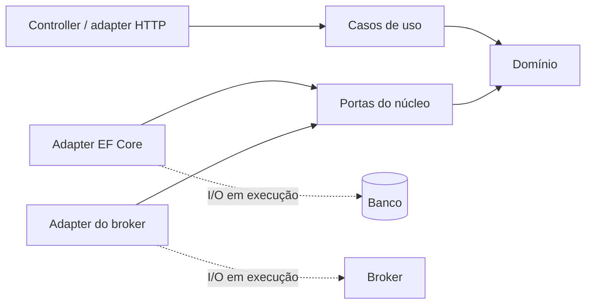

# C13 — Dependências, abstrações e padrões com propósito

> **Nível:** Fundamental
>
> **Objetivo:** avaliar responsabilidades, dependências e padrões pelo problema
> que resolvem e pelo custo que introduzem.
>
> **Pré-requisitos:** [C01 — Tipos, identidade e modelagem em C#](../linguagem-e-runtime/c01-tipos-identidade-modelagem.md)
> e [C11 — Entidades, value objects e agregados](c11-entidades-value-objects-agregados.md).
>
> **Última revisão:** 2026-11-18

SOLID, Clean Architecture e design patterns são vocabulários para discutir
forças de mudança. Não são uma meta de quantidade de interfaces, projetos ou
classes. Este capítulo parte de sintomas observáveis — alterações espalhadas,
contratos grandes e dependência de detalhes voláteis — e compara a abstração com
a alternativa direta. DDD e composição do ASP.NET Core permanecem nos capítulos
canônicos C11–C12 e C06.

## SOLID como diagnóstico

Os princípios se sobrepõem, mas fazem perguntas diferentes. Uma violação não é
provada pela forma isolada de uma classe: ela aparece quando uma mudança legítima
tem alcance, risco ou surpresa desproporcionais.

### SRP: responsabilidade perante um ator

O **Single Responsibility Principle** pede que um módulo reúna coisas que mudam
pela mesma razão. “Fazer uma coisa” é uma aproximação insuficiente: uma classe
`Pedido` pode validar e alterar várias propriedades para proteger uma única
política comercial. Já uma `PedidoService` que calcula desconto para Vendas,
formata relatório para Financeiro e persiste conforme DBA acopla atores com
motivações distintas.

Sintomas: conflitos frequentes entre equipes na mesma classe; testes de regra
precisando configurar I/O; alteração de relatório quebrando cálculo. A correção
pode ser extrair uma função ou tipo coeso, não criar três camadas genéricas. Uma
classe longa e coesa pode respeitar SRP; várias classes pequenas que mudam juntas
podem apenas fragmentar a responsabilidade.

### OCP: extensão em um eixo comprovado

O **Open/Closed Principle** procura permitir novas variações sem modificar a
política estável. A `IPoliticaDesconto` do laboratório é útil porque existem
políticas intercambiáveis. O consumidor depende do contrato e uma nova campanha
pode ser adicionada com impacto localizado.

OCP não exige antecipar todos os futuros. Um `switch` com dois casos estáveis é
mais legível que factory, interface e registro no container. Extraia o eixo de
variação quando mudanças repetidas ou requisitos simultâneos o demonstrarem.
Cada extensão cria também uma superfície que precisa permanecer compatível.

### LSP: substituição preserva o contrato

O **Liskov Substitution Principle** (LSP) exige que uma implementação possa
substituir outra sem enfraquecer pré-condições, fortalecer pós-condições ou
surpreender o consumidor. Uma implementação de `IRepositorioPedido.SalvarAsync`
que silenciosamente ignora pedidos grandes não é substituível, ainda que compile.

Sintomas: `if (x is ImplementacaoEspecial)` no consumidor; override que lança
`NotSupportedException`; subtipo que aceita menos entradas; fake de teste com
semântica diferente da produção. Prefira composição ou contratos separados
quando capacidades diferem. Herança não é o problema; contrato falso é.

### ISP: contratos pelo uso

O **Interface Segregation Principle** evita forçar consumidores a depender de
operações que não usam. Em vez de `IRepositorio<T>` com CRUD, paginação, cache e
transação para toda entidade, uma consulta pode depender apenas de
`IConsultaPedido.PorIdAsync`.

Interfaces muito grandes causam métodos sem suporte e mocks frágeis. Interfaces
microscópicas duplicadas sem consumidores distintos também custam navegação e
evolução. Segregue por capacidade e cliente real, não por uma regra de “um método
por interface”.

### DIP: política não conhece mecanismo

O **Dependency Inversion Principle** diz que política de alto nível e detalhe de
baixo nível dependem de abstrações adequadas à política. Em C#, o caso de uso pode
declarar `IBusEventos`; a infraestrutura implementa com o SDK do broker e o
composition root do [C06](../aplicacoes-e-dados/c06-composicao-pipeline-aspnet-core.md)
liga os dois.

Injeção de dependência é um mecanismo; DIP é a direção do código-fonte. Injetar
`DbContext` no domínio não inverte a dependência. Uma interface `IPedidoService`
idêntica a uma classe concreta, criada apenas para mock, também não cria uma
fronteira valiosa.

## Interfaces com uma implementação

Ter uma implementação não torna uma interface errada, nem a justifica. Ela pode
ser uma porta legítima para I/O, uma fronteira de ownership ou um eixo de teste
com semântica clara. Em contrapartida, `IClienteService` diante de
`ClienteService`, no mesmo módulo e sem variação prevista, adiciona nome, arquivo,
registro e compatibilidade sem reduzir acoplamento.

Antes de introduzir uma interface, pergunte:

1. qual consumidor precisa ser protegido de qual detalhe;
2. quais operações mínimas esse consumidor usa;
3. existe variação, fronteira de processo ou teste impossível por outra via;
4. quem manterá o contrato e quais mudanças serão compatíveis;
5. uma função, delegate, tipo concreto ou método `internal` é suficiente.

Mockabilidade isolada é evidência fraca. Testes podem instanciar tipos concretos
e usar banco efêmero real; uma porta é mais valiosa quando representa uma
capacidade externa e permite simular falhas relevantes.

## Clean Architecture: uma regra, não quatro projetos

Clean Architecture separa política de negócio de mecanismos de entrega e I/O.
Domínio contém invariantes; casos de uso coordenam intenções; adapters traduzem
HTTP, persistência e mensagens; infraestrutura contém frameworks e drivers. A
regra verificável é que dependências de código apontam para políticas internas.



As setas contínuas representam dependência de código apontando para dentro; as
pontilhadas mostram I/O em execução. Durante uma gravação, o caso de uso chama
uma porta e o adapter chama o banco na direção oposta à dependência entre núcleo
e implementação; DIP permite essa inversão.

### Estrutura .NET proporcional

Um sistema com limites estáveis pode usar:

```text
Pedidos.Domain/          # entidades e políticas
Pedidos.Application/     # casos de uso e portas
Pedidos.Infrastructure/  # EF Core, broker e adapters
Pedidos.Api/             # HTTP e composition root
```

Referências: `Application -> Domain`, `Infrastructure -> Application/Domain` e
`Api -> Application/Infrastructure` apenas para composição. Controllers
traduzem protocolo; DTOs HTTP e entidades EF não atravessam a fronteira sem
intenção.

Isso não é a definição da arquitetura. Uma aplicação pequena pode usar um único
projeto com namespaces `Domain`, `Application` e `Infrastructure`, tipos
`internal` e testes de dependência. Separe assemblies quando compilação,
ownership, reutilização ou enforcement justificarem. Cada projeto extra aumenta
tempo de build, referências e navegação.

Independência de framework significa que políticas importantes podem ser
executadas sem subir servidor ou banco, não que todo uso de framework deva ser
embrulhado. `DbContext`, controllers e SDKs pertencem à borda; envolver `List<T>`
ou `ILogger<T>` mecanicamente costuma apenas duplicar API.

## Cinco padrões, cinco problemas específicos

Os exemplos completos estão em `exemplos/c13-c17-arquitetura/Padroes.cs`.

### Strategy

- **Problema original:** variar um algoritmo independentemente do cliente.
- **Contexto:** políticas de desconto coexistem e são selecionadas em execução.
- **C#:** `IPoliticaDesconto.Calcular` tem `SemDesconto` e
  `DescontoClienteRecorrente`; o caso de uso recebe uma estratégia.
- **Alternativa simples:** função, delegate ou `switch` local.
- **Vantagem:** variação testável e composição explícita.
- **Custo:** mais tipos, seleção e contrato estável.
- **Não se justifica:** único algoritmo estável ou variação de poucas linhas que
  nunca é usada independentemente.

### Factory

- **Problema original:** criar famílias/objetos sem acoplar o consumidor às
  classes concretas e às regras de construção.
- **Contexto:** `PoliticaDescontoFactory` traduz a campanha configurada para uma
  estratégia válida.
- **C#:** método estático com expressão `switch`; não há “factory de factory”.
- **Alternativa simples:** construtor direto ou registro no container.
- **Vantagem:** decisão de criação e validação ficam num ponto.
- **Custo:** indireção e possível service locator disfarçado.
- **Não se justifica:** `new Tipo()` é estável, barato e já está no composition
  root.

### Decorator

- **Problema original:** adicionar responsabilidades a um objeto sem explosão de
  subclasses.
- **Contexto:** `ConsultaPedidoComAuditoria` envolve `IConsultaPedido` e registra
  consultas bem-sucedidas.
- **C#:** implementa o mesmo contrato e delega ao componente interno.
- **Alternativa simples:** chamada explícita no método ou middleware/filter
  quando a fronteira já oferece o ponto de extensão.
- **Vantagem:** combina telemetria, cache ou autorização sem alterar o núcleo.
- **Custo:** ordem dos decorators, stack traces e comportamento implícito.
- **Não se justifica:** regra é específica de um caso de uso ou a ordem não pode
  ser explicada e testada.

### Adapter

- **Problema original:** compatibilizar interfaces existentes.
- **Contexto:** `FreteLegadoAdapter` converte quilogramas para gramas e centavos
  para decimal, protegendo a aplicação do fornecedor.
- **C#:** implementa `ICalculadorFrete` e chama `IFreteLegado`.
- **Alternativa simples:** função de mapeamento junto à única chamada.
- **Vantagem:** concentra tradução mecânica e semântica.
- **Custo:** mais um contrato e testes de conversão.
- **Não se justifica:** formatos já coincidem e o wrapper apenas renomeia todos
  os métodos. Diferença semântica maior pode exigir a ACL do [C12](c12-servicos-dominio-integracao-modelos.md).

### Observer

- **Problema original:** avisar dependentes sem o sujeito conhecer cada ação.
- **Contexto:** `NotificadorPedido` chama observadores locais após confirmação.
- **C#:** coleção de `IObservadorPedido` e notificação assíncrona explícita.
- **Alternativa simples:** chamadas diretas quando há um ou dois efeitos fixos.
- **Vantagem:** novos handlers locais sem editar o publicador.
- **Custo:** ordem, tratamento de falhas e efeitos ficam menos visíveis.
- **Não se justifica:** entrega precisa sobreviver ao processo; observer em
  memória não substitui Outbox e broker.

## Avaliar abstrações economicamente

**YAGNI** evita construir variação sem demanda. **KISS** favorece a solução mais
simples que preserva os requisitos, não a menor quantidade de linhas. **DRY**
evita duplicar conhecimento: dois trechos parecidos que representam regras de
negócio diferentes podem divergir legitimamente; unificá-los cria acoplamento.

Coesão mede quanto elementos pertencem à mesma decisão. Acoplamento mede quanto
uma mudança atravessa limites. Abstração boa aumenta coesão e estabiliza uma
dependência relevante; abstração prematura esconde fluxo e cria complexidade
acidental — trabalho imposto pela solução, não pelo problema.

Introduza nova camada quando houver evidência de ao menos uma destas forças:

- políticas precisam ser testadas sem mecanismo volátil;
- duas implementações reais coexistem;
- ownership ou implantação exige fronteira;
- tradução externa já se espalha;
- mudança recorrente alcança módulos que deveriam permanecer estáveis.

Registre também custo: arquivos e contratos adicionais, onboarding, depuração,
alocação e chamadas em hot paths, versionamento e migração. O ganho de
extensibilidade só existe no eixo abstraído; outros tipos de mudança podem ficar
mais difíceis.

## Antipadrões e sinais de revisão

- repository genérico que esconde recursos úteis do EF Core e expõe
  `IQueryable` sem fronteira;
- handler, validator, mapper e factory para um CRUD sem política;
- entidade de domínio herdando de tipo do ORM;
- `NotSupportedException` em implementações de interface ampla;
- decorator cuja ordem altera segurança sem teste;
- evento em memória tratado como entrega durável;
- camada que apenas repassa cada método com o mesmo DTO;
- “arquitetura limpa” medida pela quantidade de projetos.

Verifique fan-in/fan-out, ciclos de projeto, tempo para seguir um caso de uso,
frequência de mudanças conjuntas e testes que atravessam infraestrutura. Métrica
não decide sozinha; ela aponta onde discutir coesão e custo.

## Laboratório executável

O laboratório compartilhado demonstra Strategy, Factory, Decorator, Adapter e
Observer, além dos padrões dos capítulos C14–C17:

```bash
dotnet test exemplos/c13-c17-arquitetura/C13C17.Arquitetura.Tests.csproj
```

Usa .NET 10 e SQLite em memória. O exemplo reduz infraestrutura para tornar
decisões observáveis; não é um template de solução nem mede performance.

## Relação com outros capítulos

- [C06](../aplicacoes-e-dados/c06-composicao-pipeline-aspnet-core.md) trata DI,
  lifetimes e composition root.
- [C08](../aplicacoes-e-dados/c08-consultas-ef-core.md) e
  [C09](../aplicacoes-e-dados/c09-fronteiras-concorrencia-ef-core.md) cobrem
  consultas, `DbContext`, transações e concorrência.
- [C11](c11-entidades-value-objects-agregados.md) e
  [C12](c12-servicos-dominio-integracao-modelos.md) são canônicos para DDD,
  serviços e ACL.
- [C14](c14-cqrs-modelos-orientados-uso.md) aplica separação de modelos sem
  pressupor bancos distintos.

## Referências

- [The Clean Architecture Dependency Rule](https://www.informit.com/articles/article.aspx?p=2832399)
  — Robert C. Martin, regra de dependência, acesso em 18 novembro 2026.
- [Design Patterns: Elements of Reusable Object-Oriented Software](https://www.pearson.com/en-us/subject-catalog/p/design-patterns-elements-of-reusable-object-oriented-software/P200000009480)
  — Gamma, Helm, Johnson e Vlissides, Addison-Wesley, acesso em 18 novembro 2026.
- [Reducing Coupling](https://www.martinfowler.com/ieeeSoftware/coupling.pdf)
  — Martin Fowler, IEEE Software, acesso em 18 novembro 2026.
- [Designing a DDD-oriented application](https://learn.microsoft.com/dotnet/architecture/microservices/microservice-ddd-cqrs-patterns/ddd-oriented-microservice)
  — .NET Architecture, separação lógica e estrutura proporcional, acesso em 18
  novembro 2026.
