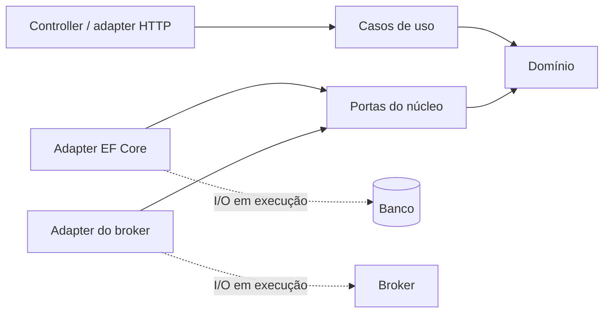
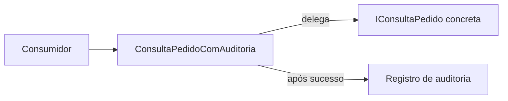
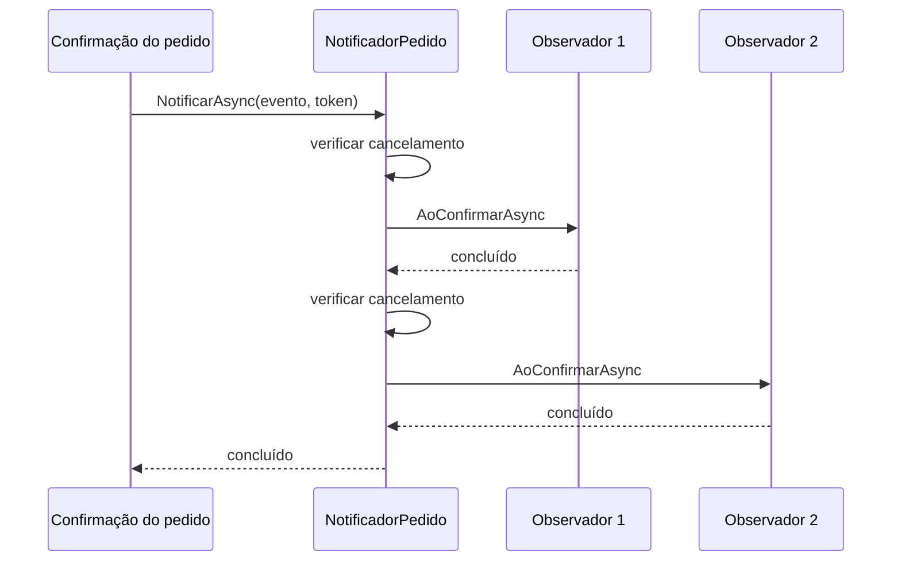
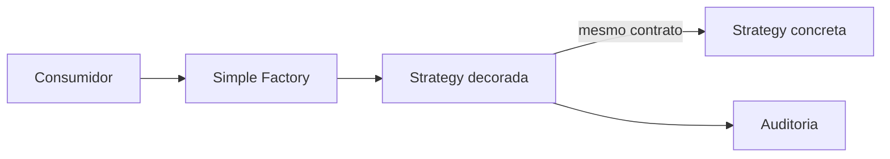

# C13 — Dependências, abstrações e padrões com propósito

> **Nível:** Fundamental
>
> **Objetivo:** avaliar responsabilidades, dependências e padrões pelo problema
> que resolvem e pelo custo que introduzem.
>
> **Pré-requisitos:** [C01 — Tipos, identidade e modelagem em C#](../linguagem-e-runtime/c01-tipos-identidade-modelagem.md)
> e [C11 — Entidades, value objects e agregados](c11-entidades-value-objects-agregados.md).
>
> **Última revisão:** 2026-11-26

SOLID, Clean Architecture e design patterns são vocabulários para discutir
forças de mudança. Não são uma meta de quantidade de interfaces, projetos ou
classes. Este capítulo parte de sintomas observáveis — alterações espalhadas,
contratos grandes e dependência de detalhes voláteis — e compara a abstração com
a alternativa direta. DDD e composição do ASP.NET Core permanecem nos capítulos
canônicos C11–C12 e C06.

## SOLID como diagnóstico

Os princípios se sobrepõem, mas fazem perguntas diferentes. Uma violação não é
provada pela forma isolada de uma classe: ela aparece quando uma mudança legítima
tem alcance, risco ou surpresa desproporcionais.

### SRP: responsabilidade perante um ator

O **Single Responsibility Principle** pede que um módulo reúna coisas que mudam
pela mesma razão. “Fazer uma coisa” é uma aproximação insuficiente: uma classe
`Pedido` pode validar e alterar várias propriedades para proteger uma única
política comercial. Já uma `PedidoService` que calcula desconto para Vendas,
formata relatório para Financeiro e persiste conforme DBA acopla atores com
motivações distintas.

Sintomas: conflitos frequentes entre equipes na mesma classe; testes de regra
precisando configurar I/O; alteração de relatório quebrando cálculo. A correção
pode ser extrair uma função ou tipo coeso, não criar três camadas genéricas. Uma
classe longa e coesa pode respeitar SRP; várias classes pequenas que mudam juntas
podem apenas fragmentar a responsabilidade.

### OCP: extensão em um eixo comprovado

O **Open/Closed Principle** procura permitir novas variações sem modificar a
política estável. A `IPoliticaDesconto` do laboratório é útil porque existem
políticas intercambiáveis. O consumidor depende do contrato e uma nova campanha
pode ser adicionada com impacto localizado.

OCP não exige antecipar todos os futuros. Um `switch` com dois casos estáveis é
mais legível que factory, interface e registro no container. Extraia o eixo de
variação quando mudanças repetidas ou requisitos simultâneos o demonstrarem.
Cada extensão cria também uma superfície que precisa permanecer compatível.

### LSP: substituição preserva o contrato

O **Liskov Substitution Principle** (LSP) exige que uma implementação possa
substituir outra sem enfraquecer pré-condições, fortalecer pós-condições ou
surpreender o consumidor. Uma implementação de `IRepositorioPedido.SalvarAsync`
que silenciosamente ignora pedidos grandes não é substituível, ainda que compile.

Sintomas: `if (x is ImplementacaoEspecial)` no consumidor; override que lança
`NotSupportedException`; subtipo que aceita menos entradas; fake de teste com
semântica diferente da produção. Prefira composição ou contratos separados
quando capacidades diferem. Herança não é o problema; contrato falso é.

### ISP: contratos pelo uso

O **Interface Segregation Principle** evita forçar consumidores a depender de
operações que não usam. Em vez de `IRepositorio<T>` com CRUD, paginação, cache e
transação para toda entidade, uma consulta pode depender apenas de
`IConsultaPedido.PorIdAsync`.

Interfaces muito grandes causam métodos sem suporte e mocks frágeis. Interfaces
microscópicas duplicadas sem consumidores distintos também custam navegação e
evolução. Segregue por capacidade e cliente real, não por uma regra de “um método
por interface”.

### DIP: política não conhece mecanismo

O **Dependency Inversion Principle** diz que política de alto nível e detalhe de
baixo nível dependem de abstrações adequadas à política. Em C#, o caso de uso pode
declarar `IBusEventos`; a infraestrutura implementa com o SDK do broker e o
composition root do [C06](../aplicacoes-e-dados/c06-composicao-pipeline-aspnet-core.md)
liga os dois.

Injeção de dependência é um mecanismo; DIP é a direção do código-fonte. Injetar
`DbContext` no domínio não inverte a dependência. Uma interface `IPedidoService`
idêntica a uma classe concreta, criada apenas para mock, também não cria uma
fronteira valiosa.

## Interfaces com uma implementação

Ter uma implementação não torna uma interface errada, nem a justifica. Ela pode
ser uma porta legítima para I/O, uma fronteira de ownership ou um eixo de teste
com semântica clara. Em contrapartida, `IClienteService` diante de
`ClienteService`, no mesmo módulo e sem variação prevista, adiciona nome, arquivo,
registro e compatibilidade sem reduzir acoplamento.

Antes de introduzir uma interface, pergunte:

1. qual consumidor precisa ser protegido de qual detalhe;
2. quais operações mínimas esse consumidor usa;
3. existe variação, fronteira de processo ou teste impossível por outra via;
4. quem manterá o contrato e quais mudanças serão compatíveis;
5. uma função, delegate, tipo concreto ou método `internal` é suficiente.

Mockabilidade isolada é evidência fraca. Testes podem instanciar tipos concretos
e usar banco efêmero real; uma porta é mais valiosa quando representa uma
capacidade externa e permite simular falhas relevantes.

## Clean Architecture: uma regra, não quatro projetos

Clean Architecture separa política de negócio de mecanismos de entrega e I/O.
Domínio contém invariantes; casos de uso coordenam intenções; adapters traduzem
HTTP, persistência e mensagens; infraestrutura contém frameworks e drivers. A
regra verificável é que dependências de código apontam para políticas internas.



As setas contínuas representam dependência de código apontando para dentro; as
pontilhadas mostram I/O em execução. Durante uma gravação, o caso de uso chama
uma porta e o adapter chama o banco na direção oposta à dependência entre núcleo
e implementação; DIP permite essa inversão.

### Estrutura .NET proporcional

Um sistema com limites estáveis pode usar:

```text
Pedidos.Domain/          # entidades e políticas
Pedidos.Application/     # casos de uso e portas
Pedidos.Infrastructure/  # EF Core, broker e adapters
Pedidos.Api/             # HTTP e composition root
```

Referências: `Application -> Domain`, `Infrastructure -> Application/Domain` e
`Api -> Application/Infrastructure` apenas para composição. Controllers
traduzem protocolo; DTOs HTTP e entidades EF não atravessam a fronteira sem
intenção.

Isso não é a definição da arquitetura. Uma aplicação pequena pode usar um único
projeto com namespaces `Domain`, `Application` e `Infrastructure`, tipos
`internal` e testes de dependência. Separe assemblies quando compilação,
ownership, reutilização ou enforcement justificarem. Cada projeto extra aumenta
tempo de build, referências e navegação.

Independência de framework significa que políticas importantes podem ser
executadas sem subir servidor ou banco, não que todo uso de framework deva ser
embrulhado. `DbContext`, controllers e SDKs pertencem à borda; envolver `List<T>`
ou `ILogger<T>` mecanicamente costuma apenas duplicar API.

## Antes de escolher um padrão

Um design pattern nomeia uma organização recorrente de objetos e
responsabilidades. Ele não substitui a análise do problema. Padrões
arquiteturais, como arquitetura em camadas, tratam a estrutura de partes maiores
do sistema. Padrões de integração, como Outbox e Idempotent Consumer, tratam a
comunicação entre fronteiras e seus modos de falha. As categorias podem se
relacionar, mas não são sinônimos.

Também não existe correspondência obrigatória entre um padrão e uma letra de
SOLID. Strategy pode ajudar a localizar um eixo de extensão associado a OCP;
Adapter pode inverter uma dependência em direção a uma porta; Decorator pode
manter responsabilidades separadas. Ainda assim, qualquer um deles pode gerar
contratos ruins, abstrações prematuras ou violações de substituição. SOLID ajuda
a avaliar consequências; não serve como justificativa automática.

As implementações iniciais a seguir são **fragmentos didáticos deliberadamente
locais**. Elas não estão erradas por não usar um padrão e não são anunciadas como
programas completos. Os trechos refatorados são **snippets contextuais** copiados
do laboratório .NET 11; os exemplos de consumo usam seus contratos públicos. A
[implementação completa](../../exemplos/c13-c17-arquitetura/Padroes.cs) e os
[testes automatizados](../../exemplos/c13-c17-arquitetura/ArquiteturaTests.cs)
são a evidência compilável.

## Strategy: políticas comerciais que variam

### Contexto, problema e alternativa direta

Uma loja começa com desconto de 5% para clientes recorrentes. A regra cabe no
caso de uso e uma condicional deixa o fluxo evidente:

<!-- snippet-csharp: id=c13-01; categoria=fragmento -->
```csharp
decimal CalcularDesconto(ContextoDesconto contexto)
{
    return contexto.ClienteRecorrente ? contexto.Total * 0.05m : 0m;
}
```

Essa implementação é adequada enquanto há uma única política curta e estável.
O problema aparece quando recorrência e campanha sazonal precisam coexistir,
possuem elegibilidades independentes e mudam por calendários diferentes. Um
`switch` ainda pode ser suficiente, mas cálculo, seleção e caso de uso passam a
mudar pelas mesmas adições.

Strategy não elimina condicionais por definição. Ele encapsula algoritmos que
precisam variar de modo independente do consumidor. A escolha de qual estratégia
usar é outra responsabilidade: pode continuar em um `switch`, em configuração
ou no composition root.

### Refatoração e implementação em C# na prática

O contrato representa somente o cálculo. Cada política decide sua elegibilidade:

<!-- snippet-csharp: id=c13-02; categoria=contexto -->
```csharp
public interface IPoliticaDesconto
{
    decimal Calcular(ContextoDesconto contexto);
}

public sealed class DescontoClienteRecorrente : IPoliticaDesconto
{
    public decimal Calcular(ContextoDesconto contexto) =>
        contexto.ClienteRecorrente ? contexto.Total * 0.05m : 0m;
}

public sealed class DescontoCampanhaSazonal : IPoliticaDesconto
{
    public decimal Calcular(ContextoDesconto contexto) =>
        contexto.Total >= 200m ? contexto.Total * 0.10m : 0m;
}
```

O consumidor opera contra a estratégia recebida, sem conhecer sua classe:

<!-- snippet-csharp: id=c13-03; categoria=contexto -->
```csharp
IPoliticaDesconto politica = new DescontoClienteRecorrente();
var contexto = new ContextoDesconto(Total: 100m, ClienteRecorrente: true);
var desconto = politica.Calcular(contexto);

// desconto == 5m
```

O resultado esperado é `5m`. Para o mesmo total e um cliente não recorrente, o
resultado é `0m`; na campanha sazonal, `199m` não é elegível e `200m` produz
`20m`. Os testes verificam esses limites e não inspecionam a implementação.

**Benefícios:** políticas podem coexistir, ser testadas isoladamente e evoluir
sem alterar o consumidor. **Custos:** surgem contrato, tipos e uma decisão de
seleção; o significado de `Calcular` precisa permanecer compatível.

Use Strategy quando houver algoritmos reais intercambiáveis, com regras ou
ciclos de mudança distintos. Não use para esconder uma condicional curta e
estável, nem quando as supostas estratégias nunca são consumidas de forma
intercambiável. Consulte a [implementação](../../exemplos/c13-c17-arquitetura/Padroes.cs)
e os [testes de elegibilidade](../../exemplos/c13-c17-arquitetura/ArquiteturaTests.cs).

## Simple Factory: selecionar e construir a política

### Contexto, problema e alternativa direta

Depois de separar as políticas, um endpoint recebe o identificador da campanha.
Instanciar no próprio endpoint é direto e legível:

<!-- snippet-csharp: id=c13-04; categoria=fragmento -->
```csharp
IPoliticaDesconto politica = campanha switch
{
    "recorrencia" => new DescontoClienteRecorrente(),
    "sazonal" => new DescontoCampanhaSazonal(),
    _ => new SemDesconto()
};
```

O limite observável surge se API, importação em lote e processamento agendado
repetem a seleção. Pior: o fallback silencioso transforma erro de configuração
em ausência de desconto. Centralizar a decisão dá ao identificador desconhecido
um único contrato de falha.

### Qual tipo de factory está sendo usado

O laboratório implementa uma **Simple Factory**: um método concentra seleção e
`new`, normalmente com condicional. Esse nome é difundido, mas não corresponde a
um dos padrões de criação catalogados pelo GoF.

- **Factory Method** define um método de criação cuja implementação pode ser
  escolhida por subclasses ou implementadores.
- **Abstract Factory** oferece uma interface para criar uma família de objetos
  relacionados e compatíveis.
- **Simple Factory** é suficiente aqui porque há um produto, construção trivial
  e um mapeamento central. Não há hierarquia de criadores nem família de
  produtos.

### Refatoração e implementação em C# na prática

<!-- snippet-csharp: id=c13-05; categoria=contexto -->
```csharp
public static class PoliticaDescontoFactory
{
    public static IPoliticaDesconto Criar(string campanha) => campanha switch
    {
        "recorrencia" => new DescontoClienteRecorrente(),
        "sazonal" => new DescontoCampanhaSazonal(),
        "nenhuma" => new SemDesconto(),
        _ => throw new ArgumentOutOfRangeException(
            nameof(campanha), campanha, "Campanha desconhecida.")
    };
}
```

<!-- snippet-csharp: id=c13-06; categoria=contexto -->
```csharp
var politica = PoliticaDescontoFactory.Criar("sazonal");
var desconto = politica.Calcular(
    new ContextoDesconto(Total: 200m, ClienteRecorrente: false));

// desconto == 20m
// PoliticaDescontoFactory.Criar("inexistente") lança
// ArgumentOutOfRangeException.
```

**Benefícios:** seleção, construção e rejeição de campanhas desconhecidas ficam
em um ponto reutilizável. **Custos:** toda campanha ainda modifica a factory;
ela conhece tipos concretos e pode crescer. Isso não é OCP “resolvido”, apenas
uma decisão localizada.

Use uma factory quando a criação ou seleção se repete, exige validação ou precisa
esconder dependências concretas de consumidores. Prefira construtor direto ou
registro no composition root quando `new Tipo()` é estável e aparece em um único
lugar. Não transforme a factory em service locator. Consulte a
[implementação](../../exemplos/c13-c17-arquitetura/Padroes.cs) e os
[testes de seleção e erro](../../exemplos/c13-c17-arquitetura/ArquiteturaTests.cs).

## Decorator: auditoria de consultas bem-sucedidas

### Contexto, problema e alternativa direta

Uma consulta de pedidos passa a registrar quais pedidos foram consultados. A
chamada explícita é a alternativa com menor indireção:

<!-- snippet-csharp: id=c13-07; categoria=fragmento -->
```csharp
var pedido = await consulta.ObterAsync(pedidoId, cancellationToken);
registrarConsulta(pedidoId);
return pedido;
```

Ela continua adequada se apenas esse caso de uso audita. A força de mudança
aparece quando várias implementações de `IConsultaPedido` precisam do mesmo
comportamento, consumidores esquecem de registrar ou auditoria deve ser
composta sem editar cada consulta.

### Refatoração e composição

O decorator implementa o mesmo contrato do componente, guarda outro componente
e delega a chamada. Neste exemplo, somente sucesso é auditado; falha ou
cancelamento da consulta não gera registro. Se a auditoria falhar depois da
consulta, a falha é propagada ao consumidor. Essa é uma escolha explícita do
contrato, não uma regra universal do padrão.



O consumidor chama o mesmo contrato; o decorator envolve a implementação e
preserva seu resultado antes de acrescentar o efeito de auditoria.

<!-- snippet-csharp: id=c13-08; categoria=contexto -->
```csharp
public sealed class ConsultaPedidoComAuditoria(
    IConsultaPedido inner,
    Action<Guid> registrarConsulta) : IConsultaPedido
{
    public async Task<string> ObterAsync(
        Guid pedidoId,
        CancellationToken cancellationToken)
    {
        var resultado = await inner.ObterAsync(pedidoId, cancellationToken);
        registrarConsulta(pedidoId);
        return resultado;
    }
}
```

<!-- snippet-csharp: id=c13-09; categoria=contexto -->
```csharp
var auditados = new List<Guid>();
IConsultaPedido consulta = new ConsultaPedidoComAuditoria(
    inner,
    auditados.Add);

var resultado = await consulta.ObterAsync(pedidoId, cancellationToken);

// O resultado da consulta é preservado e auditados contém pedidoId.
```

Decorator difere de **Proxy** pela intenção: o proxy controla acesso a outro
objeto, possivelmente remoto ou caro; o decorator acrescenta responsabilidades
componíveis. Middleware atua em um pipeline de requisição; interceptadores
dependem de um mecanismo que captura chamadas. Eles podem produzir efeitos
parecidos, mas não são automaticamente decorators.

**Benefícios:** comportamento transversal reutilizável e composição explícita
sem subclasses. **Custos:** ordem de composição, stack traces e modos de falha
ficam menos óbvios; efeitos após uma operação bem-sucedida exigem política de
consistência.

Use quando vários componentes com o mesmo contrato recebem uma responsabilidade
ortogonal e a ordem pode ser testada. Prefira chamada explícita ou extensão do
pipeline existente quando o comportamento pertence a um único fluxo ou à
fronteira HTTP. Consulte a [implementação](../../exemplos/c13-c17-arquitetura/Padroes.cs)
e os [testes de delegação, sucesso, falhas e token](../../exemplos/c13-c17-arquitetura/ArquiteturaTests.cs).

## Adapter: contrato local para o frete legado

### Contexto, problema e alternativa direta

A aplicação calcula frete em quilogramas e reais, mas o fornecedor legado aceita
gramas e devolve centavos. Converter no único consumidor começa simples:

<!-- snippet-csharp: id=c13-10; categoria=fragmento -->
```csharp
var gramas = decimal.ToInt32(
    decimal.Round(pesoEmKg * 1_000m, 0, MidpointRounding.AwayFromZero));
var centavos = legado.CotarEmCentavos(cep, gramas);
var valor = centavos / 100m;
```

Essa opção é suficiente para uma chamada controlada. O problema surge quando
conversões se repetem, arredondamentos divergem, pesos excedem o `int` do legado
ou um retorno negativo atravessa a fronteira sem validação.

### Refatoração e implementação em C# na prática

O adapter apresenta o contrato desejado pela aplicação e concentra tradução e
validação da fronteira. O laboratório arredonda meio grama afastando de zero,
aceita apenas pesos que resultem em pelo menos um grama e sejam representáveis
por `int`, e rejeita valor negativo retornado pelo fornecedor.

<!-- snippet-csharp: id=c13-11; categoria=contexto -->
```csharp
public sealed class FreteLegadoAdapter(IFreteLegado legado) : ICalculadorFrete
{
    public decimal Calcular(string cep, decimal pesoEmKg)
    {
        ArgumentException.ThrowIfNullOrWhiteSpace(cep);

        if (pesoEmKg <= 0m || pesoEmKg > int.MaxValue / 1_000m)
            throw new ArgumentOutOfRangeException(
                nameof(pesoEmKg),
                pesoEmKg,
                "O peso deve ser positivo e representável em gramas.");

        var pesoEmGramas = decimal.ToInt32(
            decimal.Round(pesoEmKg * 1_000m, 0, MidpointRounding.AwayFromZero));

        if (pesoEmGramas == 0)
            throw new ArgumentOutOfRangeException(
                nameof(pesoEmKg),
                pesoEmKg,
                "O peso deve resultar em pelo menos um grama.");

        var valorEmCentavos = legado.CotarEmCentavos(cep, pesoEmGramas);

        if (valorEmCentavos < 0)
            throw new InvalidOperationException(
                "O fornecedor legado retornou um valor de frete negativo.");

        return valorEmCentavos / 100m;
    }
}
```

<!-- snippet-csharp: id=c13-12; categoria=contexto -->
```csharp
ICalculadorFrete calculador = new FreteLegadoAdapter(freteLegado);
var valor = calculador.Calcular("01001-000", 1.2345m);

// O legado recebe 1_235 gramas.
// Se ele devolver 1_234 centavos, valor == 12.34m.
```

Adapter converte uma interface existente para outra. **Facade** oferece uma
entrada mais simples para um subsistema, sem necessariamente adaptar contratos.
Uma **Anti-Corruption Layer** (ACL) protege um modelo de outro e pode combinar
vários adapters, serviços e traduções semânticas; o [C12](c12-servicos-dominio-integracao-modelos.md)
é o capítulo canônico dessa fronteira maior.

**Benefícios:** conversão, precisão e limites ficam consistentes; consumidores
dependem do contrato local. **Custos:** mais uma abstração e testes de fronteira;
o adapter precisa acompanhar mudanças do fornecedor.

Use quando contratos incompatíveis coexistem e a tradução tem regras que
merecem uma fronteira. Prefira uma função local quando há uma chamada simples e
estável. Não crie wrapper que apenas renomeia métodos equivalentes. Consulte a
[implementação](../../exemplos/c13-c17-arquitetura/Padroes.cs) e os
[testes de conversão, precisão e entradas inválidas](../../exemplos/c13-c17-arquitetura/ArquiteturaTests.cs).

## Observer: efeitos locais após confirmar um pedido

### Contexto, problema e alternativa direta

Após confirmar um pedido, a aplicação atualiza uma projeção e envia uma
notificação local. Chamadas diretas tornam ordem e falha visíveis:

<!-- snippet-csharp: id=c13-13; categoria=fragmento -->
```csharp
await atualizarProjecao.AoConfirmarAsync(evento, cancellationToken);
await enviarNotificacao.AoConfirmarAsync(evento, cancellationToken);
```

Esse desenho é bom para poucos efeitos fixos. Ele começa a limitar a evolução
quando módulos locais adicionam ou removem reações com frequência e o publicador
passa a conhecer cada participante.

### Refatoração e semântica adotada

O observer desacopla o publicador dos tipos concretos. No laboratório, a
notificação é sequencial e segue a ordem da coleção. O cancelamento é conferido
antes de cada observador. A primeira falha é propagada e impede os seguintes;
uma coleção vazia conclui normalmente.

<!-- snippet-csharp: id=c13-14; categoria=contexto -->
```csharp
public sealed class NotificadorPedido(
    IEnumerable<IObservadorPedido> observadores)
{
    public async Task NotificarAsync(
        PedidoConfirmado evento,
        CancellationToken cancellationToken)
    {
        foreach (var observador in observadores)
        {
            cancellationToken.ThrowIfCancellationRequested();
            await observador.AoConfirmarAsync(evento, cancellationToken);
        }
    }
}
```

<!-- snippet-csharp: id=c13-15; categoria=contexto -->
```csharp
var notificador = new NotificadorPedido(
    new IObservadorPedido[] { atualizarProjecao, enviarNotificacao });

await notificador.NotificarAsync(
    new PedidoConfirmado(pedidoId),
    cancellationToken);

// Os observadores são chamados em sequência enquanto não houver falha
// nem cancelamento.
```



O diagrama mostra o caminho de sucesso. Em uma falha, a sequência termina no
observador que lançou a exceção.

Observer em memória não é **Publish/Subscribe distribuído**. Não há broker,
persistência, redelivery, isolamento entre processos ou garantia de entrega. Se
o efeito precisa sobreviver à queda do processo, use os mecanismos de
[mensageria](../sistemas-distribuidos/c15-comunicacao-mensageria-resiliente.md)
e [entrega confiável](../sistemas-distribuidos/c16-idempotencia-entrega-confiavel.md)
adequados ao requisito.

**Benefícios:** o publicador deixa de conhecer reações concretas e novos
observadores locais podem ser compostos. **Custos:** ordem, falhas e efeitos
ficam menos visíveis; paralelizar mudaria a semântica e exigiria outra política
de exceções.

Use para reações locais variáveis quando perda junto com o processo é aceitável.
Prefira chamadas diretas para poucos efeitos fixos. Não use como substituto de
mensageria durável. Consulte a [implementação](../../exemplos/c13-c17-arquitetura/Padroes.cs)
e os [testes de múltiplos observadores, vazio, falha e cancelamento](../../exemplos/c13-c17-arquitetura/ArquiteturaTests.cs).

## Comparar antes de combinar

| Padrão | Problema resolvido | Eixo de variação | Responsabilidade principal | Alternativa simples |
|---|---|---|---|---|
| Strategy | Algoritmos coexistentes | Política comercial | Executar uma política intercambiável | Função, delegate ou `switch` |
| Simple Factory | Seleção e criação repetidas | Campanha selecionada | Mapear entrada válida para uma política | `new` no composition root |
| Decorator | Responsabilidade ortogonal repetida | Composição de comportamentos | Envolver o mesmo contrato e delegar | Chamada explícita ou pipeline existente |
| Adapter | Contratos incompatíveis | Formato e semântica externos | Traduzir a fronteira para o contrato local | Função de mapeamento |
| Observer | Publicador acoplado às reações | Conjunto de assinantes locais | Notificar dependentes sem conhecê-los | Chamadas diretas |

| Padrão | Custo de manutenção | Evidência que justifica adoção | Sinal de utilização inadequada |
|---|---|---|---|
| Strategy | Tipos e contrato estável | Políticas coexistem e mudam separadamente | Interface para uma regra estável |
| Simple Factory | Ponto central muda a cada campanha | Seleção repetida ou construção relevante | Service locator ou factory para `new` trivial |
| Decorator | Ordem e modos de falha da cadeia | Mesmo comportamento em vários componentes | Cadeia longa com efeitos ocultos |
| Adapter | Tradução acompanha o fornecedor | Conversão repetida ou divergente | Wrapper que só renomeia métodos |
| Observer | Ordem e política de falhas | Assinantes locais variam | Expectativa de entrega durável |

Strategy, Simple Factory e Decorator podem coexistir no mesmo fluxo sem resolver
o mesmo problema. A factory seleciona uma política; a strategy calcula o
desconto; um decorator poderia auditar a execução preservando
`IPoliticaDesconto`. A composição fica justificável apenas se seleção, variação
do algoritmo e auditoria forem necessidades reais e independentes:



As setas mostram criação e chamadas, não uma recomendação de combinar padrões.
Se uma função e uma chamada explícita resolvem o cenário, a composição acima
apenas aumenta o custo de navegação.

## Avaliar abstrações economicamente

**YAGNI** evita construir variação sem demanda. **KISS** favorece a solução mais
simples que preserva os requisitos, não a menor quantidade de linhas. **DRY**
evita duplicar conhecimento: dois trechos parecidos que representam regras de
negócio diferentes podem divergir legitimamente; unificá-los cria acoplamento.

Coesão mede quanto elementos pertencem à mesma decisão. Acoplamento mede quanto
uma mudança atravessa limites. Abstração boa aumenta coesão e estabiliza uma
dependência relevante; abstração prematura esconde fluxo e cria complexidade
acidental — trabalho imposto pela solução, não pelo problema.

Introduza nova camada quando houver evidência de ao menos uma destas forças:

- políticas precisam ser testadas sem mecanismo volátil;
- duas implementações reais coexistem;
- ownership ou implantação exige fronteira;
- tradução externa já se espalha;
- mudança recorrente alcança módulos que deveriam permanecer estáveis.

Registre também custo: arquivos e contratos adicionais, onboarding, depuração,
alocação e chamadas em hot paths, versionamento e migração. O ganho de
extensibilidade só existe no eixo abstraído; outros tipos de mudança podem ficar
mais difíceis.

## Antipadrões e sinais de revisão

- repository genérico que esconde recursos úteis do EF Core e expõe
  `IQueryable` sem fronteira;
- handler, validator, mapper e factory para um CRUD sem política;
- entidade de domínio herdando de tipo do ORM;
- `NotSupportedException` em implementações de interface ampla;
- decorator cuja ordem altera segurança sem teste;
- evento em memória tratado como entrega durável;
- camada que apenas repassa cada método com o mesmo DTO;
- “arquitetura limpa” medida pela quantidade de projetos.

Verifique fan-in/fan-out, ciclos de projeto, tempo para seguir um caso de uso,
frequência de mudanças conjuntas e testes que atravessam infraestrutura. Métrica
não decide sozinha; ela aponta onde discutir coesão e custo.

## Autoavaliação

As questões partem do problema antes do nome do padrão. Em cada uma, escolha a
alternativa mais proporcional às evidências apresentadas.

### Questões

1. Uma aplicação possui uma única regra de desconto de três linhas. Ela não
   mudou em dois anos e é usada por um caso de uso. Qual decisão é mais
   justificável agora?
   a. Criar `IPoliticaDesconto` e uma factory para cumprir OCP.
   b. Manter a regra direta e extrair quando surgir variação independente.
   c. Adotar Abstract Factory para permitir novas campanhas.
   d. Criar um observer para desacoplar o cálculo.
2. Três entradas da aplicação repetem um `switch` de campanhas. Uma campanha
   desconhecida ora remove o desconto, ora lança exceção. Qual mudança ataca o
   problema observado com menor escopo?
   a. Uma Simple Factory com contrato único para seleção inválida.
   b. Uma Abstract Factory com uma família de campanhas.
   c. Um decorator para cada entrada.
   d. Substituir os identificadores por reflexão.
3. A auditoria deve envolver todas as implementações de `IConsultaPedido`,
   preservar o resultado e ocorrer apenas após sucesso. Qual evidência favorece
   Decorator em vez de uma chamada local?
   a. A palavra “auditoria” é transversal.
   b. A equipe quer aplicar SOLID.
   c. O mesmo contrato e a mesma regra aparecem em múltiplas implementações.
   d. Decorator sempre tem menor custo que middleware.
4. Um fornecedor de frete usa unidades diferentes, mas há uma única chamada e
   a conversão é uma expressão estável. Qual alternativa deve ser considerada
   antes de criar um adapter?
   a. Um mapeamento local testado junto à chamada.
   b. Um broker para isolar o fornecedor.
   c. Uma ACL com projeto separado.
   d. Uma Abstract Factory para unidades.
5. Um e-mail precisa ser enviado mesmo se o processo cair logo após confirmar o
   pedido. Por que o observer em memória do laboratório é insuficiente?
   a. Ele executa observadores em sequência.
   b. Ele não oferece persistência nem garantia de entrega entre processos.
   c. Ele usa `CancellationToken`.
   d. Ele propaga a primeira falha.
6. Uma factory seleciona a campanha, uma strategy calcula o desconto e um
   decorator registra a execução. Quando essa composição é defensável?
   a. Sempre que três padrões puderem compartilhar uma interface.
   b. Quando cada elemento responde a uma força real e independente, coberta por
      testes.
   c. Quando reduz o número total de classes.
   d. Quando elimina toda condicional do sistema.

### Respostas comentadas

1. **b.** A solução direta preserva clareza; não há eixo de variação comprovado.
   As demais alternativas antecipam abstrações ou tratam outro problema.
2. **a.** A inconsistência está na seleção repetida e na falha; Simple Factory
   localiza ambas sem inventar famílias de objetos.
3. **c.** Repetição da mesma responsabilidade em componentes substituíveis é
   evidência concreta. O rótulo “transversal” e SOLID, isoladamente, não decidem.
4. **a.** Uma função ou expressão local pode ser a fronteira proporcional até
   que repetição, divergência ou evolução do fornecedor justifique o adapter.
5. **b.** O processo pode terminar antes do efeito, sem registro para retomada.
   O requisito aponta para mensageria e entrega confiável, não para observer
   local.
6. **b.** Seleção, algoritmo e auditoria são responsabilidades distintas somente
   quando o cenário demonstra as três. Combinar padrões por demonstração aumenta
   indireção sem benefício.

## Laboratório executável

O laboratório compartilhado demonstra Strategy, Factory, Decorator, Adapter e
Observer, além dos padrões dos capítulos C14–C17:

```bash
dotnet test exemplos/c13-c17-arquitetura/C13C17.Arquitetura.Tests.csproj
```

Os [testes arquiteturais](../../exemplos/testes-arquiteturais/README.md)
complementam o laboratório ao validar o grafo real de projetos, o isolamento do
núcleo DDD e a direção de camadas declaradas explicitamente. Fixtures positivas
e negativas mostram quais mudanças são aceitas e quais reprovam o gate.

Os testes dos cinco padrões cobrem políticas elegíveis e inelegíveis, campanhas
válidas e desconhecidas, delegação e falhas de auditoria, conversão e limites do
frete, múltiplos ou nenhum observador, propagação de falha e cancelamento. Eles
validam resultados, exceções e efeitos públicos, sem depender de campos privados
das implementações.

O laboratório usa .NET 11 e SQLite em memória para os exemplos dos capítulos
C14–C17; os padrões deste capítulo não acessam banco nem rede. A infraestrutura
é reduzida para tornar decisões observáveis. O código não é um template de
solução nem mede performance.

## Relação com outros capítulos

- [C06](../aplicacoes-e-dados/c06-composicao-pipeline-aspnet-core.md) trata DI,
  lifetimes e composition root.
- [C08](../aplicacoes-e-dados/c08-consultas-ef-core.md) e
  [C09](../aplicacoes-e-dados/c09-fronteiras-concorrencia-ef-core.md) cobrem
  consultas, `DbContext`, transações e concorrência.
- [C11](c11-entidades-value-objects-agregados.md) e
  [C12](c12-servicos-dominio-integracao-modelos.md) são canônicos para DDD,
  serviços e ACL.
- [C14](c14-cqrs-modelos-orientados-uso.md) aplica separação de modelos sem
  pressupor bancos distintos.

## Referências

- [The Clean Architecture Dependency Rule](https://www.informit.com/articles/article.aspx?p=2832399)
  — Robert C. Martin, regra de dependência, acesso em 18 novembro 2026.
- [Design Patterns: Elements of Reusable Object-Oriented Software](https://www.pearson.com/en-us/subject-catalog/p/design-patterns-elements-of-reusable-object-oriented-software/P200000009480)
  — Gamma, Helm, Johnson e Vlissides, Addison-Wesley, acesso em 18 novembro 2026.
- [Reducing Coupling](https://www.martinfowler.com/ieeeSoftware/coupling.pdf)
  — Martin Fowler, IEEE Software, acesso em 18 novembro 2026.
- [Designing a DDD-oriented application](https://learn.microsoft.com/dotnet/architecture/microservices/microservice-ddd-cqrs-patterns/ddd-oriented-microservice)
  — .NET Architecture, separação lógica e estrutura proporcional, acesso em 18
  novembro 2026.
