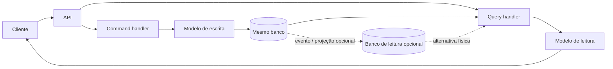

# C14 — CQRS e modelos orientados ao uso

> **Nível:** Avançado
>
> **Objetivo:** separar comandos e consultas apenas no grau exigido por suas
> regras, carga e consistência.
>
> **Pré-requisitos:** [C08 — Consultas eficientes com EF Core](../aplicacoes-e-dados/c08-consultas-ef-core.md),
> [C11 — Entidades, value objects e agregados](c11-entidades-value-objects-agregados.md)
> e [C13 — Dependências, abstrações e padrões com propósito](c13-dependencias-abstracoes-padroes.md).
>
> **Última revisão:** 2026-11-18

Command Query Responsibility Segregation (CQRS) separa o modelo que aceita e
valida mudanças do modelo que responde perguntas. A separação pode ser apenas de
tipos dentro do mesmo processo e banco. Filas, Event Sourcing, dois bancos e
consistência eventual são decisões adicionais, não requisitos do padrão.

## O problema

Um único modelo CRUD pode funcionar bem. Ele se torna custoso quando escritas
precisam proteger invariantes ricas, enquanto telas pedem projeções, filtros e
joins que não correspondem a agregados. Carregar o agregado apenas para listar
pedidos desperdiça dados; devolver entidades persistidas para a UI expõe detalhes
e incentiva mutação fora do caso de uso.

CQRS lógico permite que o comando `CriarPedido` use comportamento e transação,
enquanto `ConsultarPedido` projeta diretamente `PedidoResumo`. Ambos podem usar o
mesmo `PedidosDbContext` e a mesma base.



As linhas contínuas mostram CQRS lógico. As pontilhadas mostram a evolução
física opcional.

## Comandos e consultas

Um comando expressa intenção (`ConfirmarPedido`), pode alterar estado e deve
deixar explícito sucesso, rejeição ou falha. Uma consulta não muda estado de
negócio e retorna um modelo adequado ao consumidor. Auditoria técnica de leitura
não transforma conceitualmente uma query em command, mas seu efeito precisa ser
tratado separadamente para não surpreender retry e cache.

O laboratório usa EF Core:

```csharp
public Task<PedidoResumo?> PorIdAsync(Guid id, CancellationToken ct) =>
    db.Pedidos.AsNoTracking()
        .Where(x => x.Id == id)
        .Select(x => new PedidoResumo(x.Id, x.ClienteId, x.Total, x.Status))
        .SingleOrDefaultAsync(ct);
```

A leitura não passa por repository genérico nem materializa o agregado. O
command handler adiciona `Pedido` e `EventoOutbox` e chama `SaveChangesAsync` uma
vez. Isso usa as forças diferentes sem criar infraestrutura duplicada.

## Separação lógica versus física

| Nível | Forma | Consistência | Custo |
| --- | --- | --- | --- |
| CQS local | métodos que leem não alteram estado | imediata no objeto | mínimo |
| CQRS lógico | handlers e modelos distintos, mesmo banco | normalmente imediata | tipos e fluxos separados |
| schemas/tabelas distintas | projeção no mesmo servidor | depende da atualização | jobs, versão e rebuild |
| bancos/processos distintos | leitura atualizada por eventos | eventual | broker, lag, replay, operação e reconciliação |

Comece no menor nível que resolve o conflito. Separar banco de leitura pode
permitir escala e esquema independentes, mas cria atraso: um POST aceito pode não
aparecer imediatamente no GET. A API deve então oferecer estado pendente,
read-your-own-writes quando necessário ou comunicar a janela ao usuário.

## Consistência e falhas

Com uma base e uma transação, comando e dados consultados compartilham a
consistência do banco. Com projeção assíncrona, o evento precisa ser persistido
confiavelmente, a projeção deve ser idempotente e o sistema precisa medir lag.
Uma projeção pode parar, receber duplicata ou processar eventos fora de ordem.
Outbox reduz perda entre commit e publicação, mas não elimina duplicidade.

Não faça validação decisiva consultando uma projeção atrasada. A regra que
autoriza a escrita deve usar a fonte consistente de escrita ou tolerar
explicitamente o atraso.

## Quando usar e quando evitar

CQRS é adequado quando:

- leitura e escrita têm modelos ou carga realmente assimétricos;
- invariantes de escrita não devem limitar consultas;
- permissões e evolução dos lados diferem;
- projeções específicas reduzem consultas comprovadamente problemáticas.

Evite quando o sistema é CRUD simples, equipe e operação são pequenas, a
consistência imediata é obrigatória e um modelo único permanece claro. Dois
handlers para cada propriedade não produzem CQRS útil; apenas duplicam código.
Antes de dois bancos, tente projeção LINQ, `AsNoTracking`, índice e DTO dedicado.

CQRS também não implica mediator. Chamadas diretas são claras; pipeline de
handlers só se justifica por cross-cutting concerns reais. Event Sourcing é outra
decisão com custos próprios de versionamento, replay e armazenamento.

## Verificação e operação

Teste comandos por transições e invariantes e queries pelo shape e SQL. Para
separação física, teste idempotência, rebuild da projeção, eventos desconhecidos
e versões. Observe lag máximo/percentis, idade do evento mais antigo, falhas por
handler, backlog e divergência amostrada entre fonte e projeção.

O laboratório compartilhado usa SQLite relacional em memória e prova que
command e Outbox entram juntos e que query retorna DTO sem tracking:

```bash
dotnet test exemplos/c13-c17-arquitetura/C13C17.Arquitetura.Tests.csproj
```

SQLite não demonstra escala independente nem lag; esses comportamentos exigem
teste de integração com a topologia escolhida.

## Relação com outros capítulos

- [C08](../aplicacoes-e-dados/c08-consultas-ef-core.md) é canônico para projeção,
  tracking, SQL e índices; [C09](../aplicacoes-e-dados/c09-fronteiras-concorrencia-ef-core.md)
  cobre unidade de trabalho e concorrência.
- [C13](c13-dependencias-abstracoes-padroes.md) explica o custo das camadas.
- [C16](../sistemas-distribuidos/c16-idempotencia-entrega-confiavel.md) cobre
  Outbox e consumidores idempotentes para projeções assíncronas.

## Referências

- [CQRS pattern](https://learn.microsoft.com/azure/architecture/patterns/cqrs)
  — Azure Architecture Center, benefícios, problemas e consistência, acesso em
  18 novembro 2026.
- [Applying simplified CQRS and DDD patterns](https://learn.microsoft.com/dotnet/architecture/microservices/microservice-ddd-cqrs-patterns/apply-simplified-microservice-cqrs-ddd-patterns)
  — .NET Architecture, modelos lógicos no mesmo banco, acesso em 18 novembro
  2026.
- [Implementing reads/queries in a CQRS microservice](https://learn.microsoft.com/dotnet/architecture/microservices/microservice-ddd-cqrs-patterns/cqrs-microservice-reads)
  — .NET Architecture, projeções de leitura, acesso em 18 novembro 2026.
