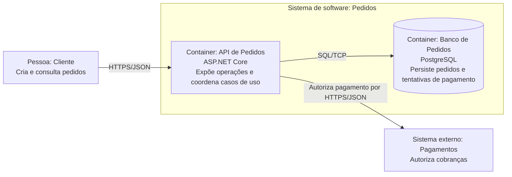

# C19 — Documentação arquitetural viva

> **Nível:** Fundamental
>
> **Objetivo:** comunicar a arquitetura no nível de detalhe necessário e
> preservar o contexto das decisões sem transformar documentação em inventário
> burocrático.
>
> **Pré-requisitos:** [C13 — Dependências, abstrações e padrões com
> propósito](c13-dependencias-abstracoes-padroes.md).
>
> **Última revisão:** 2026-11-18

Uma arquitetura que existe apenas na memória da equipe não pode ser revisada,
operada nem transmitida com segurança. O problema oposto também existe: um
repositório de diagramas e páginas sem público, decisão ou rotina de atualização
cria falsa confiança. Este capítulo combina o modelo C4, Architecture Decision
Records (ADRs) e documentação como código para registrar somente o que ajuda a
compreender, decidir ou operar.

O escopo é a documentação da estrutura estática e das decisões arquiteturais.
Diagramas dinâmicos, de implantação e de paisagem podem complementar as visões,
mas não são detalhados aqui. O capítulo não substitui documentação de API,
runbooks, modelo de ameaças ou telemetria.

## O problema de comunicação

Pessoas diferentes fazem perguntas diferentes. Uma liderança de produto quer
saber quem usa o sistema e de quais serviços ele depende; quem desenvolve uma
API precisa enxergar processos, bancos e limites internos; quem investiga uma
decisão antiga precisa saber por que uma alternativa foi rejeitada. Um único
desenho com classes, filas, regiões, protocolos e objetivos de negócio mistura
níveis de abstração e responde mal a todos esses públicos.

Documentação arquitetural útil tem três propriedades:

- **público e pergunta explícitos:** cada artefato existe para apoiar uma
  conversa ou decisão;
- **abstrações consistentes:** elementos no mesmo desenho pertencem ao mesmo
  nível de zoom;
- **vínculo com a mudança:** código, infraestrutura, diagramas e decisões são
  revisados no mesmo fluxo quando se afetam.

Ela não precisa descrever tudo. Precisa tornar visíveis limites, dependências,
responsabilidades, restrições e decisões cujo custo de redescoberta é relevante.

## Modelo C4: mapas em níveis de zoom

O C4 é um modelo de abstrações para representar a estrutura estática de software.
Ele organiza pessoas, sistemas de software, containers, componentes e elementos
de código em níveis progressivos de zoom. **Container**, nesse contexto, é uma
aplicação ou armazenamento executável/implantável separadamente; não significa
necessariamente container OCI ou Docker.

As abstrações são hierárquicas: pessoas usam sistemas; um sistema contém um ou
mais containers; um container contém componentes; componentes são implementados
por elementos de código. Cada diagrama deve contar uma história coerente em um
único nível de abstração.

| Nível | Pergunta principal | Público frequente | Elementos no escopo | Limite útil |
| --- | --- | --- | --- | --- |
| **System Context** | Como o sistema se encaixa no mundo? | negócio, produto, segurança, operação e desenvolvimento | sistema em foco, pessoas e sistemas externos | não mostra containers, classes nem detalhes de implantação |
| **Container** | Quais unidades executáveis ou armazenamentos formam o sistema? | arquitetura, desenvolvimento, plataforma e operação | aplicações, processos, filas e bancos dentro do sistema; pessoas e sistemas externos relevantes | não transforma cada namespace, biblioteca ou pod em container |
| **Component** | Quais responsabilidades principais existem dentro de um container? | quem mantém ou altera esse container | componentes com interfaces e responsabilidades coesas, mais dependências relevantes | não espelha todas as classes ou camadas por convenção |
| **Code** | Como um componente é implementado? | pessoas que modificam aquela área | classes, interfaces, funções, tabelas ou outros elementos de código | só vale para trechos complexos ou críticos; IDE e código costumam ser melhores para o restante |

System Context e Container costumam ser suficientes para muitas equipes.
Component é justificável quando reduz o custo de compreender um container
complexo. Code é seletivo e deve ser descartado se apenas reproduzir uma
estrutura que a IDE revela melhor e com menos risco de desatualização. Usar os
quatro níveis por obrigação confunde completude com valor.

### Elementos, relacionamentos e legenda

Um elemento deve declarar seu **tipo**, nome e responsabilidade curta. Containers
e componentes também precisam indicar a tecnologia quando ela altera a conversa.
Uma caixa chamada “Backend” e uma seta chamada “usa” escondem justamente as
informações que deveriam comunicar.

Relacionamentos são direcionais. O rótulo descreve a intenção e, entre
containers, o protocolo ou mecanismo: “consulta catálogo por HTTPS/JSON” é mais
útil que “usa”. A seta registra dependência ou fluxo no sentido declarado; não
presuma reciprocidade. Cor, posição e formato são auxiliares e precisam de
legenda quando carregam significado. Evite depender apenas de cor, por
acessibilidade e por impressão monocromática.

Cada diagrama deve ter título, escopo e legenda suficientes para ser entendido
sem uma apresentação oral. Se uma relação é incerta, marque a incerteza no texto
em vez de fabricar precisão.

## Exemplo: API .NET, banco e serviço externo

O exemplo representa um sistema de pedidos. O modelo fonte é a descrição dos
elementos e relações; os diagramas são duas visões desse modelo.

### Visão de contexto


**Legenda:** retângulos identificam explicitamente Pessoa ou Sistema; setas
representam relações unidirecionais e seus rótulos informam intenção e protocolo.
Banco e API não aparecem porque são detalhes internos do sistema Pedidos.

### Visão de containers



**Legenda:** o subgrafo marca o limite do sistema; caixas tipadas como Container
identificam unidades executáveis ou armazenamento e mostram tecnologia e
responsabilidade. O provedor de pagamentos continua externo.

Esses blocos usam o tipo genérico `flowchart` do Mermaid para aumentar a
portabilidade na renderização do GitHub. Eles preservam as abstrações e o nível
de zoom do C4, mas não alegam usar a sintaxe C4 nativa do Mermaid. A sintaxe
`C4Context`, `C4Container` e `C4Component` oferece macros próprias, porém ainda
tem limitações de layout e de legenda. C4 é independente de ferramenta: trocar
a sintaxe não corrige elementos sem tipo, relações vagas ou mistura de níveis.

Uma visão de Component poderia ampliar somente a API e mostrar, por exemplo,
`PedidosEndpoint`, `ProcessadorDePedido` e `GatewayDePagamento`, desde que sejam
responsabilidades reais com interfaces identificáveis. Uma visão de Code só
seria criada para uma parte difícil — como a máquina de estados de pagamento —
e poderia usar UML, diagrama entidade-relacionamento ou outra notação adequada.

### Mermaid genérico não é sinônimo de C4

Mermaid é uma linguagem de diagramas como código; C4 é um modelo de abstrações.
Um `flowchart` com caixas e setas não se torna C4 por receber esse título. Para
ser uma visão C4, o desenho precisa manter o nível de zoom, os tipos, os limites
e as relações do modelo. Por outro lado, o C4 não exige uma aparência específica:
uma notação genérica pode comunicar o modelo se tornar sua semântica explícita.

Diagramas de sequência, estados e fluxo são úteis, mas respondem a perguntas
dinâmicas e não devem ser chamados de System Context, Container ou Component.
Use a notação que corresponde à pergunta e identifique-a corretamente.

## Atualização e propriedade dos diagramas

Um diagrama fica desatualizado quando muda uma fronteira, responsabilidade,
dependência ou tecnologia relevante para seu público. Renomear um método interno
normalmente não exige atualizar Context ou Container; separar a API em dois
processos exige. A definição de pronto de uma mudança arquitetural deve perguntar
quais visões e ADRs foram afetados.

Uma rotina leve inclui:

1. manter a fonte textual próxima do sistema documentado;
2. atribuir proprietário por área, não uma pessoa central para toda a empresa;
3. revisar diagramas no pull request que altera a arquitetura;
4. validar sintaxe, links e renderização no pipeline;
5. revisar periodicamente artefatos de alto impacto contra a realidade;
6. remover uma visão quando ninguém consegue apontar seu público ou uso.

Geração automática ajuda a descobrir dependências, mas não escolhe abstração,
responsabilidade nem relevância. Trate diagramas gerados como evidência para
revisão, não como narrativa arquitetural pronta.

## Architecture Decision Records

Um Architecture Decision Record registra uma decisão arquitetural significativa
e o raciocínio disponível naquele momento. Ele não é ata de reunião, especificação
completa ou aprovação genérica. Vale registrar escolhas que afetam estrutura,
atributos de qualidade, dependências, interfaces ou formas de construir e operar
o sistema — especialmente quando são caras de reverter.

Um ADR curto pode usar esta estrutura:

- **título e status:** identificador estável e estado como Proposto, Aceito,
  Rejeitado, Obsoleto ou Supersedido;
- **contexto e problema:** fatos, restrições, forças em tensão e a pergunta que
  exige decisão, sem antecipar a solução;
- **alternativas consideradas:** opções reais, incluindo manter a situação,
  com benefícios, custos, riscos e motivo da rejeição;
- **decisão:** escolha em voz ativa, escopo e condições;
- **consequências:** efeitos positivos, negativos e neutros, inclusive trabalho
  operacional e novas decisões necessárias;
- **trade-offs e riscos:** o que foi favorecido, o que se aceitou perder, sinais
  para reavaliar e, quando útil, prazo ou experimento de validação.

### Exemplo: comunicação síncrona ou assíncrona

```markdown
# ADR-0007 — Publicar confirmação de pedido de forma assíncrona

## Status

Aceito em 2026-11-18.

## Contexto e problema

A API confirma o pedido depois de persistir a transação. E-mail e atualização
do programa de fidelidade pertencem a outros sistemas e apresentam picos e
indisponibilidades. O cliente precisa receber a confirmação em até 500 ms, mas
esses efeitos podem convergir em minutos. Como desacoplar a disponibilidade dos
consumidores sem perder pedidos confirmados?

## Alternativas consideradas

1. HTTP síncrono antes da resposta: simples de rastrear, porém acopla latência e
   disponibilidade e pode deixar efeitos parciais.
2. Publicação direta no broker após o commit: reduz latência, mas há uma janela
   entre commit e publicação na qual o evento pode ser perdido.
3. Outbox transacional e consumidores idempotentes: fecha essa janela e permite
   retry, ao custo de armazenamento, relay, atraso e operação do broker.

## Decisão

Adotaremos a alternativa 3 para `PedidoConfirmado`. A API gravará pedido e
mensagem de outbox na mesma transação. Um relay publicará pelo menos uma vez;
consumidores deduplicarão pelo identificador do evento. Consultas que exigem
resposta imediata permanecem síncronas.

## Consequências e trade-offs

- A resposta da API deixa de depender de e-mail e fidelidade.
- O estado externo será eventualmente consistente e a interface deve comunicá-lo.
- Duplicatas são esperadas; ordering global não é garantido.
- A equipe passa a operar broker, backlog, retry, dead-letter e relay.
- Reavaliar se p95 de convergência exceder 2 minutos por sete dias ou se o custo
  operacional superar o impacto das indisponibilidades evitadas.
```

O exemplo não afirma que comunicação assíncrona é superior em geral. Uma consulta
que precisa do resultado para continuar, baixo volume e dependência confiável
podem favorecer HTTP síncrono. A decisão explicita onde cada propriedade importa.
Os mecanismos de entrega pertencem ao [C16 — Idempotência e entrega
confiável](../sistemas-distribuidos/c16-idempotencia-entrega-confiavel.md), em vez
de serem repetidos aqui.

### Status, supersessão e histórico

Depois de aceito, um ADR é registro histórico. Corrija apenas erros editoriais
que não alterem seu sentido. Quando contexto ou escolha mudar, crie outro ADR,
marque o antigo como `Supersedido por ADR-0012` e faça o novo apontar para
`Supersede ADR-0007`. Assim, o histórico informa qual decisão vigorou e por quê.

`Obsoleto` pode indicar que o sistema ou problema deixou de existir;
`Supersedido` indica uma nova decisão que substitui a anterior. Defina a taxonomia
no repositório para evitar status ambíguos. Um índice de ADRs por número, título e
status melhora descoberta, mas não deve duplicar todo o conteúdo.

Versionar ADRs com Git associa proposta, debate, implementação e mudança. O pull
request deve incluir pessoas afetadas e verificar contexto, alternativas,
consequências operacionais, segurança e critérios de reavaliação. Comentários do
PR ajudam o debate, mas a justificativa final precisa estar no ADR: threads podem
ser ocultadas, apagadas ou inacessíveis no futuro.

ADRs não devem aprovar decisões triviais nem justificar retrospectivamente uma
preferência já imposta. Se toda atualização de pacote exige um registro, o sinal
é ruído. Se decisões relevantes continuam apenas em chat, o histórico será
incompleto.

## Documentação como código

Documentação como código aplica ao texto o fluxo usado para código: arquivos
texto, versionamento, revisão, validação e entrega automatizada. Markdown reduz a
barreira de edição e funciona bem em diffs. Mermaid mantém diagramas revisáveis
ao lado do texto. Git preserva autoria e evolução; pull requests colocam a
mudança diante das pessoas afetadas.

Proximidade não exige que tudo esteja no mesmo diretório. A regra útil é manter
o artefato no repositório e na área cuja mudança deve disparar sua revisão. Links
relativos conectam capítulo, ADR, código e runbook sem depender de URL de branch.
Evite links para arquivos planejados e valide âncoras e destinos no pipeline.

Automação proporcional pode executar:

- lint de Markdown e YAML;
- verificação de links internos e âncoras;
- parse/renderização de Mermaid;
- validação de schemas, snippets e exemplos executáveis;
- busca de credenciais e dados sensíveis;
- regra que pede revisão documental quando fronteiras conhecidas mudam.

Automação comprova forma e consistência parcial, não atualidade semântica. Um
diagrama válido pode estar errado e um link verde pode apontar para conteúdo
obsoleto. Revisão humana continua responsável pelo modelo e pela decisão.

Os [testes arquiteturais dos exemplos](../../exemplos/testes-arquiteturais/README.md)
aplicam essa ideia ao grafo da solução: a fronteira é declarada no projeto, a
regra e sua justificativa ficam versionadas próximas do código, e fixtures
positivas e negativas comprovam o comportamento do gate. As limitações
documentadas evitam tratar a automação como prova completa da arquitetura.

### Critério de suficiência

Antes de criar um artefato, responda:

1. qual decisão ou tarefa ele melhora;
2. quem o consultará;
3. qual mudança o torna inválido;
4. onde essa mudança será revisada;
5. se código, teste ou telemetria já responde melhor à pergunta.

Se essas respostas não existem, um comentário curto, nome melhor ou teste pode
ser a documentação correta. Se o artefato existe, mas não tem proprietário nem
gatilho de atualização, prefira removê-lo a mantê-lo como autoridade falsa.

## Dicas de engenharia

- Comece por Context e Container; adicione zoom apenas quando uma pergunta real
  não estiver respondida.
- Mantenha relações específicas e unidirecionais.
- Registre a decisão antes ou durante a implementação, enquanto alternativas e
  restrições ainda podem ser revisadas.
- Inclua no ADR a alternativa de não mudar.
- Vincule PR, ADR e diagramas sem transformar o ADR em changelog.
- Revise consequências depois da implantação; uma nova evidência pode justificar
  supersessão, não reescrita do passado.

## Armadilhas comuns

- misturar classes, sistemas externos e nós de implantação no mesmo desenho;
- chamar qualquer diagrama de caixas e setas de C4;
- usar “serviço” ou “container” sem declarar o significado;
- criar Component e Code para cada área sem público que os consulte;
- registrar apenas a opção escolhida e apagar os trade-offs;
- alterar silenciosamente um ADR aceito;
- confiar nos comentários do PR como registro permanente da decisão;
- manter diagramas separados do fluxo de mudança;
- medir qualidade documental por páginas produzidas.

## Trade-offs

C4 oferece vocabulário pequeno e múltiplos públicos, mas não representa sozinho
tempo, implantação, segurança ou dados. ADRs preservam raciocínio e tornam
trade-offs revisáveis, mas perdem valor quando longos, tardios ou aplicados a
decisões triviais. Markdown e Mermaid dão diffs e automação, enquanto editores
visuais podem ser melhores para exploração colaborativa; exportar apenas uma
imagem perde a fonte revisável.

Centralizar documentação facilita descoberta e pode afastá-la da mudança.
Distribuí-la junto dos componentes melhora ownership e pode fragmentar a busca.
Um índice pequeno, links relativos e convenções comuns conciliam os dois lados.

## Quando utilizar e quando evitar

Use C4 para comunicar estrutura estática a públicos distintos; use ADR para uma
escolha significativa que alguém precisará compreender depois; use documentação
como código quando o artefato evolui com o sistema e se beneficia de revisão e
automação.

Evite os quatro níveis completos quando Context e Container respondem às
perguntas. Evite ADR para detalhes locais reversíveis e evite Mermaid quando um
desenho exploratório temporário resolve a conversa — desde que a decisão final
relevante seja registrada. Não use documentação para compensar código sem limites,
nomes ou testes compreensíveis.

## Relação com outros capítulos

- [C13](c13-dependencias-abstracoes-padroes.md) define limites, dependências e o
  custo das abstrações representadas nos diagramas.
- [C15](../sistemas-distribuidos/c15-comunicacao-mensageria-resiliente.md) oferece
  critérios para a decisão síncrona versus assíncrona do ADR de exemplo.
- [C16](../sistemas-distribuidos/c16-idempotencia-entrega-confiavel.md) detalha
  Outbox, duplicatas e entrega pelo menos uma vez.
- [C20 — Infraestrutura como código e controle de
  drift](../operacao-entrega-e-plataforma/c20-infraestrutura-como-codigo-drift.md)
  aplica versionamento, revisão e estado desejado à infraestrutura.

## Referências

- [C4 model — Abstractions](https://c4model.com/abstractions) — Simon Brown,
  abstrações de pessoa, sistema, container, componente e código, acesso em 18
  novembro 2026.
- [C4 model — Diagrams](https://c4model.com/diagrams) — Simon Brown, níveis de
  zoom e orientação para usar somente diagramas que agregam valor, acesso em 18
  novembro 2026.
- [C4 model — Notation](https://c4model.com/diagrams/notation) — Simon Brown,
  elementos, relacionamentos, títulos e legendas, acesso em 18 novembro 2026.
- [C4 diagrams](https://mermaid.js.org/syntax/c4.html) — Mermaid, sintaxe C4 e
  limitações de implementação, acesso em 18 novembro 2026.
- [Architecture Decision Record](https://martinfowler.com/bliki/ArchitectureDecisionRecord.html)
  — Martin Fowler, estrutura, status e supersessão de ADRs, acesso em 18 novembro
  2026.
