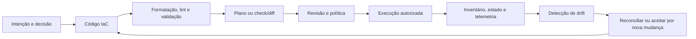

# C20 — Infraestrutura como código e controle de drift

> **Nível:** Intermediário
>
> **Objetivo:** manter infraestrutura e configuração reproduzíveis, revisáveis e
> governáveis com estado desejado, Terraform, Ansible e reconciliação de drift.
>
> **Pré-requisitos:** [C19 — Documentação arquitetural
> viva](../dominio-e-arquitetura/c19-documentacao-arquitetural-viva.md) e
> [C29 — Entrega compatível e gestão de risco no
> pipeline](c29-entrega-compativel-risco-pipeline.md).
>
> **Última revisão:** 2026-11-18

Ambientes criados por cliques, comandos não registrados e memória operacional não
são reproduzíveis. Infrastructure as Code (IaC) descreve infraestrutura e
configuração em artefatos versionados, revisáveis e automatizáveis. O ganho não é
apenas velocidade: é tornar intenção, mudança e responsabilidade auditáveis.

Este capítulo distingue provisionamento e configuração, apresenta Terraform e
Ansible e trata drift como um problema de governança. Os exemplos operam somente
em arquivos locais e `localhost`; não criam contas, redes, máquinas ou custos e
não usam credenciais reais.

## Fundamentos de Infrastructure as Code

Infraestrutura declarativa descreve o **estado desejado** — recursos e
propriedades que devem existir — e delega à ferramenta o cálculo ou a execução
das mudanças necessárias. Isso contrasta com um roteiro puramente imperativo de
passos, cujo resultado depende mais do estado inicial e da ordem dos comandos.
Ferramentas reais podem combinar os dois estilos; o contrato de convergência é
mais importante que a sintaxe.

Dois trabalhos se sobrepõem, mas são diferentes:

- **provisionamento:** cria e relaciona recursos como redes, identidades, bancos,
  máquinas, clusters e serviços gerenciados;
- **configuração:** instala pacotes, distribui arquivos, habilita serviços e
  ajusta o sistema operacional ou a aplicação em hosts existentes.

Reprodutibilidade significa conseguir partir de pré-condições declaradas e
chegar a um resultado equivalente. Não significa que IDs, horários ou endereços
serão idênticos. Idempotência significa que repetir a operação depois da
convergência não produz mudança relevante. Ela reduz risco de repetição, mas não
garante que a declaração esteja correta, que uma migração seja reversível nem que
um provider não tenha efeitos colaterais.

### Ciclo de vida governado

Um fluxo de mudança seguro conecta todo o ciclo:



Versionamento registra intenção e histórico; pull request separa autoria de
revisão; validação elimina erros mecânicos; plano mostra efeito previsto;
políticas podem bloquear regiões, tipos, exposição pública ou tags proibidas;
execução usa identidade de automação de menor privilégio; observação compara
intenção e realidade. Um plano aprovado não é autorização eterna: concorrência,
drift ou mudança de dados podem alterar o efeito, por isso a execução deve usar
o plano salvo quando suportado ou recalculá-lo e revisar diferenças.

### Segurança e segredos

Código IaC não deve conter senha, token, chave privada ou certificado real.
Valores sensíveis vêm de um gerenciador de segredos ou de identidade de curta
duração no momento da execução. A automação recebe apenas as permissões necessárias
ao ambiente e mantém trilha de auditoria.

Marcar uma variável como `sensitive` reduz exposição na interface, mas não impede
que o valor apareça em state ou plan. Proteja backend e artefatos com criptografia,
controle de acesso, retenção e logs; não publique plan nem state em Git ou como
artefato irrestrito. Em Ansible, Vault cifra dados em repouso no repositório, mas
a senha do Vault precisa vir de canal separado e os valores descriptografados
ainda exigem proteção em memória, logs e host destino.

## Terraform: infraestrutura declarativa com estado

Terraform lê configuração, consulta providers e mantém state para mapear
endereços declarados a objetos reais. O state não é apenas cache: contém
identidades, metadados e valores necessários para planejar mudanças.

### Blocos e fluxo

- **providers** são plugins que traduzem recursos e data sources para APIs;
- **resources** declaram objetos cujo ciclo de vida o Terraform gerencia;
- **data sources** consultam objetos sem assumir seu ciclo de vida;
- **variables** formam a entrada tipada do módulo; validações recusam combinações
  inválidas cedo;
- **outputs** expõem valores para pessoas, automação ou módulos chamadores e não
  são um canal seguro por si só;
- **modules** agrupam recursos sob uma interface; o diretório executado é o root
  module e módulos chamados devem ter responsabilidade e versão controladas;
- **dependencies** normalmente são inferidas quando uma expressão referencia
  outro objeto; `depends_on` é reservado a dependência que não pode ser expressa
  pelos dados.

`terraform plan` atualiza a visão dos objetos, compara configuração, state e
realidade e propõe ações. `terraform apply` executa um plano. Os símbolos `+`,
`~`, `-` e `-/+` indicam criação, atualização, destruição e substituição. Uma
substituição pode causar indisponibilidade ou perda de dados; nome, região,
imutabilidade de atributo e mudança de índice são causas comuns. Revise o recurso
inteiro, dependentes, backups e estratégia de migração, não apenas a contagem no
rodapé.

O plan é uma previsão sob o estado observado naquele momento. APIs podem mudar,
valores podem ser desconhecidos até apply e outra execução pode ocorrer depois.
Em automação, salve e aplique o mesmo plano aprovado, proteja-o como potencialmente
sensível e mantenha locking.

### State remoto, locking e ambientes

State local serve ao aprendizado isolado, não à colaboração. Um backend remoto
deve oferecer acesso restrito, criptografia, histórico/recuperação e **state
locking** compatível. O lock evita dois escritores simultâneos quando o backend o
suporta; desabilitá-lo ou usar `force-unlock` sem provar que o escritor anterior
terminou pode corromper o state.

Separe states por limite de falha, permissão, frequência e ownership. Um state
único para toda a empresa amplia blast radius e lock contention; dezenas de
states minúsculos criam acoplamento por outputs e coordenação. Ambientes com
credenciais, contas ou políticas diferentes normalmente merecem roots e states
distintos. Workspaces podem servir a instâncias equivalentes, mas não substituem
limites fortes de acesso nem justificam condicionais extensas por ambiente.

Não leia diretamente o arquivo de state de outra stack. Exponha contratos mínimos
por outputs, catálogo, DNS ou data sources e reconheça que `terraform_remote_state`
pode exigir acesso ao snapshot inteiro, inclusive valores não publicados.

### Credenciais e cadeia de fornecimento

Providers devem ter origem explícita e restrição de versão; o lock file registra
seleções e checksums. Revise upgrades como código. Prefira workload identity,
OIDC ou credenciais temporárias às chaves estáticas. Não coloque credenciais no
bloco do provider, `tfvars`, linha de comando ou output. Variáveis de ambiente e
integrações oficiais reduzem persistência, mas ainda precisam de mascaramento e
menor privilégio.

## Exemplo Terraform mínimo e seguro

O laboratório em
[`exemplos/c20-iac/terraform`](../../exemplos/c20-iac/terraform/) usa o provider
`local` para ler um template versionado e escrever um manifesto em `saida/`. Ele
não acessa cloud, não usa credenciais e não gera custo. Demonstra provider,
resource, data source, variável, validação, output e dependência por referência.

```hcl
terraform {
  required_version = ">= 1.10.0, < 2.0.0"

  required_providers {
    local = {
      source  = "hashicorp/local"
      version = "~> 2.6"
    }
  }
}

variable "ambiente" {
  type        = string
  description = "Ambiente lógico do manifesto."
  default     = "desenvolvimento"

  validation {
    condition     = contains(["desenvolvimento", "homologacao"], var.ambiente)
    error_message = "Use desenvolvimento ou homologacao neste laboratório."
  }
}

data "local_file" "modelo" {
  filename = "${path.module}/modelo.txt"
}

resource "local_file" "manifesto" {
  filename        = "${path.module}/saida/manifesto.txt"
  content         = replace(data.local_file.modelo.content, "$${ambiente}", var.ambiente)
  file_permission = "0644"
}

output "manifesto" {
  description = "Caminho do arquivo gerenciado pelo laboratório."
  value       = local_file.manifesto.filename
}
```

Validação segura, sem `apply`:

```bash
terraform -chdir=exemplos/c20-iac/terraform fmt -check
terraform -chdir=exemplos/c20-iac/terraform init -backend=false
terraform -chdir=exemplos/c20-iac/terraform validate
terraform -chdir=exemplos/c20-iac/terraform plan -out=tfplan
terraform -chdir=exemplos/c20-iac/terraform show tfplan
```

O plan e eventual state contêm conteúdo completo e não devem ser commitados. O
laboratório não configura backend remoto porque isso exigiria serviço e
credenciais; em equipe, o backend local seria inadequado.

## Ansible: convergência da configuração

Ansible executa módulos em hosts selecionados por inventory. Um **playbook** é
uma sequência de plays; cada play associa hosts, variáveis e **tasks**. Cada task
invoca um **module**, como `package`, `template`, `file` ou `service`. **Roles**
organizam tasks, handlers, templates, defaults e variáveis para reuso com uma
interface conhecida.

Inventories podem ser estáticos ou dinâmicos. Eles expressam hosts e grupos, não
devem virar depósito de segredos. Variáveis em múltiplas precedências dão
flexibilidade e também tornam o valor efetivo difícil de rastrear; mantenha
defaults seguros, nomes específicos e poucas camadas de sobrescrita.

Idempotência depende do módulo e dos parâmetros. `ansible.builtin.file` e
`template` com estado desejado conseguem detectar diferenças; `shell: echo x >>
arquivo` repete efeito a cada execução. Antes de usar `command` ou `shell`, procure
um módulo específico. Quando inevitável, declare condições (`creates`, `removes`,
`changed_when`) e teste repetição, falha parcial e check mode.

Ansible é adequado para configurar hosts, distribuir arquivos, gerenciar serviços
e automatizar rotinas operacionais em frotas existentes. Não é necessário para
imagens imutáveis que já carregam toda a configuração ou para uma tarefa simples
que o serviço gerenciado resolve. Também pode provisionar cloud por módulos, mas
isso muda o modelo de estado e deve ser uma escolha consciente.

### Segredos com Ansible

Use Ansible Vault ou integração com um gerenciador de segredos para valores
sensíveis. Cifre o arquivo de variáveis, nunca o arquivo de senha. Restrinja o
escopo da variável, marque tasks inevitavelmente sensíveis com `no_log: true` e
evite interpolar segredos em comandos. `no_log` reduz exposição no output, mas
não corrige permissões do arquivo destino nem remove segredos de backups e fatos.

## Exemplo Ansible reproduzível

O laboratório em
[`exemplos/c20-iac/ansible`](../../exemplos/c20-iac/ansible/) usa inventory
explícito com `localhost`, conexão local e uma role. Ele cria somente um arquivo
de configuração em diretório informado por variável; não contata ambiente
externo e não requer privilégios elevados.

```yaml
---
- name: Configurar API de exemplo
  hosts: laboratorio
  gather_facts: false

  roles:
    - role: api_config
```

A role usa `ansible.builtin.file` e `ansible.builtin.template`, ambos orientados
ao estado. Uma segunda execução sem alteração deve resultar em `changed=0`.

Em uma máquina de controle Linux com `ansible-core`:

```bash
ansible-playbook \
  -i exemplos/c20-iac/ansible/inventory.ini \
  exemplos/c20-iac/ansible/playbook.yml \
  --syntax-check

ansible-playbook \
  -i exemplos/c20-iac/ansible/inventory.ini \
  exemplos/c20-iac/ansible/playbook.yml \
  --check --diff \
  -e output_dir=/tmp/engenharia-dotnet-c20
```

Check mode é simulação e depende do suporte dos módulos; não prova que a execução
real terá sucesso. Diff pode expor conteúdo sensível e deve ser desabilitado ou
protegido nesses arquivos.

## Terraform versus Ansible

| Critério | Terraform | Ansible |
| --- | --- | --- |
| foco predominante | provisionar e relacionar recursos por declaração | configurar hosts e automatizar operações |
| estado | state explícito mapeia configuração a objetos | normalmente consulta o host a cada execução; inventory não é state equivalente |
| mudança prevista | grafo e plan antes do apply | ordem de tasks, check mode e diff quando suportados |
| unidade principal | resource em provider | task que chama module sobre hosts |
| dependências | grafo inferido por referências | ordem, handlers, condições e includes |
| força | ciclo de vida e dependências entre APIs de infraestrutura | convergência e orquestração da configuração do sistema |
| custo recorrente | backend, locking, providers, módulos e upgrades | inventories, precedência de variáveis, roles, coleções e compatibilidade de hosts |

“Terraform provisiona e Ansible configura” é um bom ponto de partida, não uma
fronteira absoluta. Providers podem configurar serviços e módulos Ansible podem
criar recursos de cloud. Sobreposição é aceitável se houver **um owner por
propriedade**. Se ambos gerenciam o mesmo firewall, arquivo ou recurso, cada
execução pode desfazer a outra.

Em cloud, use Terraform quando o problema envolve ciclo de vida, grafo e state de
recursos. Use Ansible quando envolve estado interno de hosts ou operação
coordenada. Combine-os quando Terraform cria hosts e publica um inventário
controlado, e Ansible configura o sistema; a passagem entre eles deve ser um
contrato versionado, não leitura improvisada do state.

Escolha também pelo custo da equipe. Uma imagem imutável pode reduzir runs de
Ansible; um serviço gerenciado pode remover ambos; um script pequeno e idempotente
pode ser suficiente para escopo local. Quantidade de ferramentas, plugins,
credenciais e pipelines faz parte da decisão.

## Infrastructure drift

Drift é a diferença relevante entre a intenção versionada, o estado conhecido
pela ferramenta e a realidade. Pode surgir por:

- alteração manual em console, SSH ou API;
- automações concorrentes com ownership sobreposto;
- resposta emergencial ainda não incorporada ao código;
- default ou comportamento alterado por provider/plataforma;
- recurso substituído, removido ou modificado fora do fluxo;
- execução parcial ou state perdido/importado incorretamente;
- variáveis, versões ou políticas diferentes entre ambientes.

Divergência entre ambientes nem sempre é drift: capacidade distinta pode ser
intencional. É drift quando a diferença não está expressa e aprovada na fonte de
verdade. Copiar configuração de produção para homologação sem considerar dados,
escala e políticas também não é objetivo; busque equivalência das propriedades
que sustentam o teste.

### Detectar, classificar e reconciliar

Detecção deve ser periódica e também ocorrer antes de mudanças. Para Terraform,
um plan normal compara configuração e realidade; `plan -refresh-only` mostra
atualizações necessárias ao state para aceitar mudanças externas, mas não é uma
correção automática. Para Ansible, `--check --diff` sinaliza o que módulos
suportados mudariam. Inventário de cloud, políticas, scanners e auditoria de APIs
complementam pontos que as ferramentas não gerenciam.

Ao encontrar drift:

1. preserve plan/diff, logs de auditoria, identidade e horário;
2. classifique impacto, urgência, owner e se a alteração foi intencional;
3. contenha risco antes de buscar uniformidade cega;
4. se a declaração continua correta, execute reconciliação revisada;
5. se a realidade é a nova decisão, altere/importa/refatore o código e aprove a
   mudança antes de aceitar o state;
6. elimine a causa: permissão ampla, automação concorrente ou runbook incompleto;
7. confirme nova convergência e registre exceções com prazo.

Nunca aplique automaticamente toda correção em produção sem classificar ações
destrutivas. Um plan pode propor apagar o recurso criado para conter um incidente.
O objetivo é recuperar controle com segurança, não fazer a tela voltar a zero.

### Exemplo de identificação e tratamento

Depois de um `apply` autorizado do laboratório Terraform, alguém edita
`saida/manifesto.txt` manualmente e troca o ambiente. O próximo plan lê o arquivo
via provider e propõe restaurar o conteúdo declarado:

```text
Código:     ambiente = "homologacao"
Realidade:  arquivo contém ambiente = "producao"
Plan:       ~ atualizar local_file.manifesto para homologacao
```

Tratamento A: a edição foi acidental; preserve a evidência e aplique o plano
revisado para restaurar homologação. Tratamento B: produção é a nova intenção;
não aceite apenas a edição. Altere a variável/configuração em PR, revise as
consequências e então execute o plano aprovado. Editar state manualmente não é
reconciliação.

Em infraestrutura real, o mesmo raciocínio exige verificar se restaurar a
declaração remove uma mitigação, reduz capacidade ou recria um banco. Ações `-`
e `-/+`, mudanças de identidade, rede, criptografia e retenção merecem bloqueio e
revisão especializada.

### Governança e prevenção

- limite mudanças manuais por RBAC e identidades temporárias;
- ofereça caminho de emergência rápido, auditado e com obrigação de reconciliação;
- atribua owner exclusivo por recurso e propriedade;
- execute detecção agendada e antes do apply;
- proteja branches, separe autoria/aprovação e aplique políticas automáticas;
- fixe versões e revise providers, módulos, roles e coleções;
- monitore taxa, idade e reincidência de drift, não só contagem instantânea;
- teste recuperação de state e mantenha backups conforme criticidade.

Proibir console sem oferecer resposta a incidente incentiva canais paralelos.
Governança eficaz reduz o tempo entre mudança necessária, revisão e execução e
torna exceções visíveis.

## Dicas de engenharia

- Comece pelo menor root/playbook que tenha owner e ciclo de vida claros.
- Faça plan, check e diff artefatos de revisão, protegendo dados sensíveis.
- Trate state como dado operacional crítico, nunca como arquivo descartável.
- Teste idempotência executando novamente e esperando ausência de mudança.
- Prefira referências que expressem dependência a `depends_on` genérico.
- Use módulos e roles para interfaces estáveis, não apenas para reduzir linhas.
- Separe ambientes por acesso e blast radius antes de buscar reaproveitamento.

## Armadilhas comuns

- commitar state, plan, chave, senha de Vault ou `.tfvars` sensível;
- considerar `sensitive = true` como criptografia do state;
- executar apply automático sem revisar destruições e substituições;
- compartilhar state sem locking;
- usar o mesmo recurso como propriedade de Terraform e Ansible;
- usar `shell` não idempotente quando existe módulo declarativo;
- assumir que check mode prova a execução;
- aceitar drift no state sem incorporar a decisão ao código;
- criar módulo ou role para cada três linhas sem contrato reutilizável.

## Trade-offs

IaC aumenta repetibilidade, revisão e auditoria, ao custo de manter ferramentas,
estado, pipelines e competências. Terraform oferece grafo, plan e ciclo de vida,
mas state concentra risco e providers mudam. Ansible opera bem dentro de hosts e
em rotinas, mas ordem, variáveis e módulos imperativos podem esconder o estado
final. Imutabilidade reduz drift interno e aumenta custo de construir e promover
imagens.

Detecção contínua reduz tempo de exposição e consome APIs, execução e triagem.
Reconciliação automática acelera correção de baixo risco e pode desfazer resposta
emergencial. A política deve variar por recurso, ambiente e ação, com aprovação
mais forte onde o blast radius é maior.

## Quando utilizar e quando evitar

Use IaC quando ambientes precisam ser recriados, revisados, auditados ou operados
por mais de uma pessoa. Use Terraform para recursos com ciclo de vida e
dependências em APIs; use Ansible para convergir configuração e automatizar
operações em hosts. Combine-os com ownership explícito.

Evite introduzir uma plataforma de IaC para recurso temporário sem repetição nem
risco relevante. Evite Terraform para sequência operacional altamente dinâmica
que não representa estado durável e evite Ansible como state store improvisado.
Se um serviço gerenciado, imagem ou configuração nativa resolve com menor custo,
essa é uma alternativa válida.

## Como verificar

No pull request:

- execute formatação, validação, lint e busca de segredos;
- gere plan ou check/diff no ambiente correto com identidade somente leitura
  quando possível;
- destaque criação, destruição, substituição, exposição, permissão e custo;
- revise mudanças em lock files, módulos, providers, roles e inventories;
- assegure que nenhum artefato sensível foi publicado.

Depois da execução, confirme convergência com novo plan/check, saúde do serviço,
políticas e telemetria. Agende detecção de drift e teste periodicamente restauração
de state e procedimento de emergência.

## Relação com outros capítulos

- [C19](../dominio-e-arquitetura/c19-documentacao-arquitetural-viva.md) define
  documentação como código, revisão e registro de decisões.
- [C13](../dominio-e-arquitetura/c13-dependencias-abstracoes-padroes.md) ajuda a
  definir limites de módulos e ownership.
- [C24](../qualidade-e-seguranca/c24-integracao-real-testes-legado.md) trata
  ambientes isolados e reproduzíveis para testes.
- C29 — Entrega compatível e gestão de risco no pipeline aprofundará promoção,
  rollback e políticas quando publicado.

## Referências

- [Terraform language](https://developer.hashicorp.com/terraform/language) —
  HashiCorp, providers, resources, data sources, variables, outputs e modules,
  versão 1.17.x, acesso em 18 novembro 2026.
- [Terraform state](https://developer.hashicorp.com/terraform/language/state) —
  HashiCorp, mapeamento de objetos, armazenamento e proteção do state, versão
  1.17.x, acesso em 18 novembro 2026.
- [State locking](https://developer.hashicorp.com/terraform/language/state/locking)
  — HashiCorp, locking e riscos de `force-unlock`, versão 1.17.x, acesso em 18
  novembro 2026.
- [`terraform plan`](https://developer.hashicorp.com/terraform/cli/commands/plan)
  — HashiCorp, fluxo, símbolos, planos salvos e modos, versão 1.17.x, acesso em 18
  novembro 2026.
- [Manage sensitive data](https://developer.hashicorp.com/terraform/language/manage-sensitive-data)
  — HashiCorp, valores sensíveis e proteção de state/plan, versão 1.17.x, acesso
  em 18 novembro 2026.
- [Ansible playbooks](https://docs.ansible.com/projects/ansible/latest/playbook_guide/playbooks_intro.html)
  — Ansible Community Documentation, plays, tasks, modules e idempotência, acesso
  em 18 novembro 2026.
- [Ansible inventory](https://docs.ansible.com/projects/ansible/latest/inventory_guide/intro_inventory.html)
  — Ansible Community Documentation, hosts, grupos e inventories, acesso em 18
  novembro 2026.
- [Ansible roles](https://docs.ansible.com/projects/ansible/latest/playbook_guide/playbooks_reuse_roles.html)
  — Ansible Community Documentation, estrutura e reuso de roles, acesso em 18
  novembro 2026.
- [Ansible Vault](https://docs.ansible.com/projects/ansible/latest/vault_guide/index.html)
  — Ansible Community Documentation, proteção de variáveis e arquivos, acesso em
  18 novembro 2026.
- [Check mode e diff mode](https://docs.ansible.com/projects/ansible/latest/playbook_guide/playbooks_checkmode.html)
  — Ansible Community Documentation, simulação e limites, acesso em 18 novembro
  2026.
