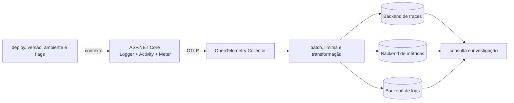
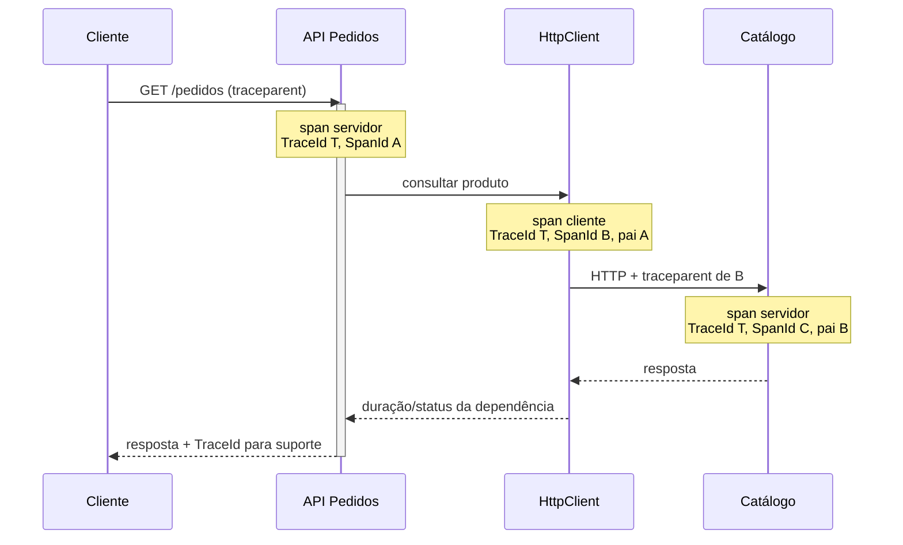

# C27 — Telemetria e diagnóstico distribuído

> **Nível:** Intermediário
>
> **Objetivo:** instrumentar aplicações .NET com sinais úteis e investigar falhas
> distribuídas por evidências, controlando custo, volume, cardinalidade e exposição
> de dados.
>
> **Pré-requisitos:** [C07 — APIs HTTP e integrações resilientes](../aplicacoes-e-dados/c07-apis-http-integracoes-resilientes.md),
> [C15 — Comunicação entre serviços e mensageria resiliente](../sistemas-distribuidos/c15-comunicacao-mensageria-resiliente.md)
> e [C26 — Segurança nas fronteiras da aplicação](../qualidade-e-seguranca/c26-seguranca-fronteiras-aplicacao.md).
>
> **Última revisão:** 2026-11-20

Monitoramento responde perguntas conhecidas: a taxa de erro ultrapassou o limite?
Há fila acumulada? Observabilidade é a capacidade de investigar estados internos a
partir das evidências emitidas pelo sistema, inclusive quando a pergunta ainda não
era conhecida. Um painel não torna um sistema observável; é preciso contexto que
permita sair do sintoma, formular hipóteses e distinguir causas concorrentes.

Logs, métricas e traces são sinais complementares. Métricas mostram tendência e
amplitude, traces preservam o caminho causal de uma operação e logs registram
eventos discretos com detalhes. Deploys, flags, configuração, ownership, topologia
e objetivos de serviço formam o **contexto operacional** sem o qual os sinais podem
ser tecnicamente corretos e ainda induzir a decisão errada.

## De perguntas operacionais à telemetria

Instrumentar tudo produz custo, não compreensão. Comece por perguntas:

- qual jornada do usuário está degradada, desde quando e em quais regiões ou versões;
- se o tempo foi gasto na aplicação, fila, banco ou dependência externa;
- se a falha acompanha um deploy, flag, volume, tenant ou tipo de operação;
- se CPU, memória, conexões, threads ou capacidade de downstream estão saturados;
- qual evidência confirmaria ou refutaria a hipótese mais provável.

Uma telemetria útil tem owner, propósito, unidade, semântica estável, dimensões
limitadas, política de retenção e ação possível. O evento “algo falhou” sem nome da
operação, resultado e correlação pouco ajuda. Em sentido oposto, registrar payloads,
headers e objetos inteiros aumenta volume e risco sem garantir diagnóstico.



O OpenTelemetry (OTel) padroniza APIs, SDK, convenções e protocolo de exportação;
não é o banco nem a interface de consulta. Na aplicação, a instrumentação produz
telemetria, o SDK agrega, amostra e exporta, e um **exporter** envia o sinal. Um
Collector entre aplicações e backends concentra batching, retry, filtragem,
enriquecimento e roteamento. Isso reduz acoplamento, mas adiciona componente que
precisa de capacidade, health, atualização e proteção de rede.

## Logs estruturados que preservam significado

Um log estruturado mantém mensagem e propriedades separadas. Com `ILogger<T>`, o
template é constante e os valores viram campos consultáveis:

<!-- snippet-csharp: id=c27-01; categoria=contexto -->
```csharp
logger.LogInformation(
    new EventId(2702, "ConsultaConcluida"),
    "Consulta do pedido concluída com {QuantidadeItens} item(ns)",
    quantidade);
```

Interpolar `$"Pedido {id}"` transforma valores em texto, piora agrupamento e pode
formatar dados mesmo quando o nível está desabilitado. Para caminhos muito quentes,
source-generated logging com `LoggerMessage` reduz alocações; primeiro confirme a
necessidade por profiling.

### Níveis, eventos e contexto

| Nível | Uso operacional | Erro frequente |
| --- | --- | --- |
| `Trace`/`Debug` | diagnóstico temporário e detalhe de desenvolvimento | permanecer ligado globalmente em produção |
| `Information` | marcos esperados e mudanças relevantes de estado | registrar cada linha ou cada retry |
| `Warning` | anomalia recuperada ou degradação que merece atenção | tratar toda resposta 4xx como falha do servidor |
| `Error` | operação falhou e exige investigação ou ação | registrar e relançar em todas as camadas |
| `Critical` | processo ou capacidade crítica sem condição segura | usar como sinônimo de qualquer exceção |

`EventId` dá identidade estável ao tipo de evento; a mensagem pode evoluir. Escopos
acrescentam propriedades comuns durante uma operação. O runtime já correlaciona
logs com `TraceId` e `SpanId` quando o provider preserva scopes; não invente outro
identificador para substituir o trace. Um `Correlation-ID` de negócio pode coexistir
quando sua vida ultrapassa uma requisição, mas precisa de validação, tamanho máximo
e geração interna se vier de uma fronteira não confiável.

Capture exceção no argumento próprio de `ILogger`, preservando tipo e stack trace.
Registre-a na fronteira que sabe o resultado operacional; registrar em repositório,
serviço e middleware cria três eventos para uma falha. Cancelamento solicitado pelo
cliente não é automaticamente erro. Mensagens de domínio esperadas, falhas
transitórias e bugs precisam de níveis e resultados distintos.

### Dados sensíveis e excesso

Não registre senha, token, cookie, chave, connection string, documento, cartão,
payload completo ou header de autorização. “Mascarar depois” é uma defesa adicional,
não autorização para capturar. Prefira allowlist de propriedades, pseudonimização
quando necessária, acesso restrito, criptografia, retenção curta e teste de ausência.
IDs podem ser dados pessoais e ainda causam alto volume; avalie finalidade.

Logs excessivos consomem CPU, I/O, rede, indexação e atenção. Probes, retries e
sucessos de alta frequência são candidatos a filtro, agregação em métrica ou
amostragem. Limitar por nível sem conhecer categorias pode ocultar a única evidência
útil; faça mudanças reversíveis e com janela de diagnóstico definida.

## Métricas: tendências com dimensões controladas

Métricas são medições numéricas ao longo do tempo. Contadores representam totais
monotônicos, gauges valores atuais e histogramas distribuições. Em .NET, bibliotecas
e aplicações usam `System.Diagnostics.Metrics`; ASP.NET Core, `HttpClient` e runtime
já publicam instrumentos que podem ser coletados pelo SDK OTel ou por ferramentas
de diagnóstico.

Os quatro sinais de ouro ajudam a começar:

- **throughput:** requisições, mensagens ou operações por segundo;
- **latência:** distribuição de duração, não apenas média;
- **erros:** proporção de resultados que não cumpriram o contrato do usuário;
- **saturação:** proximidade do limite de CPU, memória, ThreadPool, conexões, filas
  ou concorrência do downstream.

Percentis respondem “quanto demorou para uma fração das operações”. `p95 = 400 ms`
significa que 95% das observações ficaram em até 400 ms na janela e agregação
considerada; não significa que um usuário específico sempre verá isso. A média
esconde caudas, mas percentis também dependem de buckets, janela, volume e método de
agregação. Não calcule média de percentis de instâncias.

Métricas técnicas incluem CPU, working set, heap, taxa e pausas de Garbage Collector
(GC), fila do ThreadPool, conexões ativas, pool de banco, backlog, I/O e duração de
dependências. Métricas de negócio representam resultados como pedidos aceitos,
pagamentos autorizados e idade de processos pendentes. Uma não substitui a outra:
CPU normal não prova que clientes conseguem comprar, e queda de vendas pode não ser
falha técnica.

### Cardinalidade e custo

Cada combinação de valores de atributos pode criar uma série. `metodo=GET` e
`resultado=sucesso` têm conjunto limitado; `usuario.id`, URL bruta, `pedido.id` ou
mensagem de exceção podem criar uma série por operação. O produto de dimensões
explode rapidamente memória, armazenamento e custo de consulta.

Use rota normalizada em vez de path, classe de resultado em vez de texto livre e
dependência lógica em vez de host efêmero. Mantenha IDs nos traces/logs quando forem
necessários para investigação e permitidos pela política. Antes de adicionar uma
dimensão, estime valores possíveis, combinações, taxa, retenção e consulta que ela
habilita. O custo de instrumentação inclui também SDK, serialização, buffers,
exportação, Collector, backend, dashboards, alertas e manutenção semântica.

## Distributed tracing e propagação de contexto

Um **trace** representa uma operação distribuída. Cada **span** representa uma
unidade de trabalho e contém tempo, status, atributos e eventos. `TraceId` liga todos
os spans; `SpanId` identifica um span. A relação pai-filho descreve causalidade e
permite decompor latência; links modelam relações não hierárquicas, úteis em fan-in
e processamento assíncrono.



O W3C Trace Context define `traceparent` e `tracestate`. Instrumentações de ASP.NET
Core e `HttpClient` criam spans e propagam contexto automaticamente. Não copie
headers manualmente quando a biblioteca já o faz. Mensageria exige injetar/extrair
contexto conforme a instrumentação e preservar a origem confiável; baggage atravessa
processos e não deve carregar segredo ou dado volumoso.

Uma chamada lenta pode ser localizada comparando duração do span servidor, spans de
dependência e lacunas. Um trace mostra uma amostra causal, não prova tendência;
confirme com métricas. Erros precisam de status coerente e atributos de baixa
cardinalidade. Grave exceção apenas quando contribui para diagnosticar a falha e
evite duplicá-la em cada span.

### Sampling

Head sampling decide no início do trace e é barato, mas pode descartar a falha rara.
Parent-based sampling mantém a decisão ao longo da árvore. Tail sampling decide
depois de observar spans no Collector e pode preservar erros ou traces lentos, ao
custo de buffer, latência e capacidade. Sampling reduz volume de traces; não torna
seguro coletar dados sensíveis e não deve distorcer métricas, que normalmente são
agregadas separadamente.

Calibre taxa por volume e valor diagnóstico. Registre a política, monitore perda do
exporter e preserve propagação mesmo quando um span não é gravado. “100% em produção”
é decisão de capacidade, não requisito de correlação.

## OpenTelemetry em ASP.NET Core

O laboratório [C27/C28](../../exemplos/c27-c28-observabilidade/) usa OpenTelemetry
.NET 1.21.0 e .NET 11. Ele demonstra:

- logs JSON estruturados com `EventId`, scopes e exceção sem payload sensível;
- spans automáticos de ASP.NET Core e `HttpClient`, além de span de domínio;
- propagação W3C em uma chamada HTTP para dependência simulada;
- métricas HTTP/runtime e contador/histograma de negócio com tags limitadas;
- resource attributes de serviço, versão e ambiente;
- exporter de console para aprendizado e OTLP opcional para Collector;
- liveness independente e readiness com uma dependência deliberadamente escolhida.

Semantic conventions estabilizam nomes e unidades entre instrumentações. Atributos
de resource descrevem o produtor (`service.name`, versão e ambiente), enquanto
atributos do span ou ponto métrico descrevem a operação. Não coloque `trace.id` como
resource nem IDs de instância como dimensão de negócio indiscriminadamente.

O exporter de console é didático e não é pipeline de produção. OTLP envia ao
Collector sem acoplar a aplicação a um backend. Quando o endpoint OTLP está
configurado, o exemplo também exporta logs estruturados, mantendo scopes; o console
JSON continua disponível para a execução local. O arquivo `otel-collector.yaml` usa
apenas receiver OTLP, limites de memória, batch e exporter `debug`; ele demonstra os
três pipelines, não persistência, alta disponibilidade ou segurança de produção.

### Como executar

```powershell
dotnet restore exemplos/c27-c28-observabilidade/C27C28.Observabilidade.csproj
$env:ASPNETCORE_URLS = "http://localhost:5080"
dotnet run --project exemplos/c27-c28-observabilidade/C27C28.Observabilidade.csproj
```

Em outro terminal:

```powershell
Invoke-RestMethod http://localhost:5080/pedidos/11111111-1111-1111-1111-111111111111?atrasoMs=350
Invoke-WebRequest http://localhost:5080/health/live
Invoke-WebRequest http://localhost:5080/health/ready
```

Os `350 ms`, o produto e a dependência são **simulados** para tornar o caminho
visível. Não são benchmark nem evidência de desempenho. Para usar um Collector
local compatível com OTLP, desabilite console e configure o endpoint:

```powershell
$env:Telemetry__ConsoleExporter = "false"
$env:OTEL_EXPORTER_OTLP_ENDPOINT = "http://localhost:4317"
dotnet run --project exemplos/c27-c28-observabilidade/C27C28.Observabilidade.csproj
```

Valide o comportamento central:

```powershell
dotnet test exemplos/c27-c28-observabilidade/C27C28.Observabilidade.Tests.csproj --configuration Release
```

Os testes confirmam que liveness não herda a disponibilidade do catálogo, readiness
detecta indisponibilidade e encerramento, falhas e timeouts viram 503, operações
observam os tokens de parada e a métrica de negócio não usa ID de pedido como
dimensão. Também validam a separação configurada entre stdout e stderr.

### Executar em container

O mesmo laboratório inclui um `Dockerfile` multi-stage. O estágio de build usa o
SDK .NET 11.0.100; a imagem final contém apenas o runtime ASP.NET Core e as
dependências publicadas. A variante Ubuntu chiseled não inclui shell nem gerenciador
de pacotes, e o processo executa com o usuário não privilegiado fornecido pela
imagem oficial.

Na raiz do repositório, construa e execute a imagem:

```powershell
docker build --file exemplos/c27-c28-observabilidade/Dockerfile `
  --tag engenharia-dotnet-observabilidade:local .
docker run --rm --name observabilidade --publish 8080:8080 `
  engenharia-dotnet-observabilidade:local
```

Para executar build e todos os smoke tests com limpeza automática dos containers:

```powershell
pwsh ./scripts/testar-container-observabilidade.ps1
```

O script cria containers com nomes e labels exclusivos, usa portas efêmeras e
valida imagem, usuário, `STOPSIGNAL`, limites, health checks, falha da dependência e
shutdown. Para repetir apenas a execução com uma imagem já construída:

```powershell
pwsh ./scripts/testar-container-observabilidade.ps1 `
  -Image engenharia-dotnet-observabilidade:smoke -SkipBuild
```

O job `Validar laboratório Docker` executa o mesmo script em `ubuntu-latest` no
GitHub Actions. Assim, a validação automatizada não depende das particularidades do
Docker Desktop usado no desenvolvimento local.

Em outro terminal, confira a identidade do processo e os contratos HTTP:

```powershell
docker inspect observabilidade --format '{{.Config.User}}'
Invoke-WebRequest http://localhost:8080/health/live
Invoke-WebRequest http://localhost:8080/health/ready
Invoke-RestMethod http://localhost:8080/pedidos/11111111-1111-1111-1111-111111111111
```

O valor exibido por `docker inspect` é um UID diferente de zero. O arquivo
`.dockerignore` da raiz restringe o contexto de build aos arquivos necessários e
impede que artefatos locais `bin/` e `obj/` sejam enviados ao daemon.

A configuração segue a convenção do ASP.NET Core para variáveis hierárquicas, com
dois sublinhados no lugar de `:`. Estes são os valores definidos pela imagem e
podem ser substituídos com `docker run --env` ou pelo orquestrador:

| Variável | Padrão no container | Finalidade |
| --- | --- | --- |
| `ASPNETCORE_ENVIRONMENT` | `Production` | seleciona a configuração do ambiente |
| `ASPNETCORE_HTTP_PORTS` | `8080` | define a porta HTTP interna do Kestrel |
| `Dependencias__Catalogo` | `http://127.0.0.1:8080` | aponta para a dependência simulada na mesma aplicação |
| `Dependencias__CatalogoTimeout` | `00:00:03` | limita cada chamada ao catálogo simulado |
| `HostOptions__ShutdownTimeout` | `00:00:08` | limita a etapa de encerramento do Generic Host |
| `Telemetry__ConsoleExporter` | `false` | evita duplicar telemetria detalhada nos logs do container |
| `Telemetry__SamplingRatio` | `0.25` | reduz o volume de traces no ambiente `Production` |
| `OTEL_EXPORTER_OTLP_ENDPOINT` | não definido | habilita OTLP somente quando um endpoint for fornecido |
| `OTEL_SERVICE_NAME` | `engenharia-dotnet-observabilidade` | identifica o serviço na telemetria |

A porta publicada no host é independente da porta interna. Por exemplo,
`--publish 5090:8080` expõe a aplicação em `localhost:5090` sem alterar o Kestrel.
Para mudar também a porta interna, mantenha a URL da dependência simulada coerente:

```powershell
docker run --rm --publish 9090:9090 `
  --env ASPNETCORE_HTTP_PORTS=9090 `
  --env Dependencias__Catalogo=http://127.0.0.1:9090 `
  engenharia-dotnet-observabilidade:local
```

O container recebe apenas HTTP. Em um ambiente real, HTTPS costuma terminar no
proxy reverso ou ingress, com políticas de rede e certificados fora desta imagem.
O exemplo não exige credenciais, backend de telemetria nem infraestrutura em nuvem.

#### Viva não significa pronta

`/health/live` verifica somente se o processo consegue responder. `/health/ready`
também verifica se a aplicação ainda aceita trabalho e se o catálogo necessário ao
fluxo está acessível. Uma falha dessa dependência deixa a aplicação viva, mas não
pronta:

```powershell
docker run --detach --name observabilidade-degradada --publish 8081:8080 `
  --env Dependencias__Catalogo=http://127.0.0.1:1 `
  engenharia-dotnet-observabilidade:local

Invoke-WebRequest http://localhost:8081/health/live   # 200
Invoke-WebRequest http://localhost:8081/health/ready  # 503
Invoke-WebRequest `
  http://localhost:8081/pedidos/11111111-1111-1111-1111-111111111111 # 503
```

O endereço `127.0.0.1:1` representa deliberadamente uma dependência inacessível
dentro deste container. Não simula rede, balanceador ou serviço real. A liveness
permanece saudável porque reiniciar um processo funcional não recupera uma
dependência indisponível. A readiness falha para impedir a admissão de trabalho que
depende do catálogo.

#### Shutdown gracioso e cancelamento

O `Dockerfile` declara `STOPSIGNAL SIGTERM`. Ao executar `docker stop`, o daemon
envia esse sinal ao processo principal. O Generic Host inicia o encerramento,
aciona `ApplicationStopping`, deixa de aceitar novas conexões e aguarda as atuais
dentro do timeout configurado. O laboratório registra essa transição e liga o token
da aplicação ao de cada operação em andamento.

Inicie um container sem `--rm`, para preservar os logs após a parada:

```powershell
docker run --detach --name observabilidade-encerramento `
  --publish 8082:8080 --stop-timeout 10 `
  engenharia-dotnet-observabilidade:local
```

No primeiro terminal, inicie um atraso local controlado:

```powershell
Invoke-WebRequest `
  'http://localhost:8082/operacoes/demorada?duracaoMs=30000'
```

Enquanto a requisição estiver em andamento, solicite a parada em outro terminal:

```powershell
docker stop --time 10 observabilidade-encerramento
docker logs observabilidade-encerramento
docker rm observabilidade-encerramento
```

Os logs mostram o recebimento do sinal, `ApplicationStopping=True`, o cancelamento
da operação e a conclusão do encerramento da aplicação. O atraso é apenas uma tarefa
local cancelável; não representa fila, transação, persistência ou chamada externa.
O código também observa `RequestAborted` quando o cliente encerra a requisição. Os
dois estados são registrados separadamente: observar um token cancelado não prova,
sozinho, qual evento originou uma `OperationCanceledException`.

O timeout de 10 segundos do Docker é maior que os 8 segundos do host para deixar
margem ao encerramento da aplicação. Se o processo não terminar nesse intervalo, o
Docker envia `SIGKILL`; esse sinal não permite executar limpeza, callbacks ou blocos
`finally`. Shutdown gracioso reduz interrupções, mas não substitui idempotência nem
transações para trabalho que não pode ser perdido.

#### Stdout, stderr, recursos e timeouts

O provider de console emite JSON sem gravar arquivos dentro da camada gravável do
container. Mensagens até `Information` vão para stdout; `Warning`, `Error` e
`Critical` vão para stderr. O comando do cenário degradado produz logs nos dois
fluxos, que podem ser separados pelo cliente Docker:

```powershell
docker logs observabilidade-degradada 1>stdout.log 2>stderr.log
docker rm --force observabilidade-degradada
```

O Docker combina esses fluxos em `docker logs` quando não há redirecionamento. Em
produção, o runtime de containers normalmente coleta ambos; o laboratório não
adiciona arquivo de log, agente proprietário ou backend externo.

Limites de CPU e memória pertencem à execução, pois a mesma imagem pode receber
capacidades diferentes em ambientes distintos:

```powershell
docker run --detach --name observabilidade-limitada --publish 8083:8080 `
  --memory 256m --cpus 1 --stop-timeout 10 `
  engenharia-dotnet-observabilidade:local
docker stats --no-stream observabilidade-limitada
docker rm --force observabilidade-limitada
```

Esses valores servem para observar configuração e consumo, não são recomendação de
capacidade nem evidência de desempenho. Um limite de memória insuficiente pode
encerrar o processo; CPU limitada pode aumentar latência e fazer timeouts expirarem.
Dimensionamento exige carga representativa e medição no ambiente alvo.

Há dois timeouts com responsabilidades diferentes:

- `Dependencias__CatalogoTimeout` limita uma chamada HTTP ao catálogo. Falha de
  conexão ou timeout resulta em 503 e log `Warning`, sem derrubar a liveness.
- `HostOptions__ShutdownTimeout` limita quanto o host aguarda serviços e requisições
  durante a parada. `--stop-timeout` precisa conceder ao processo tempo suficiente
  antes de o Docker recorrer a `SIGKILL`.

O endpoint `/dependencia-simulada` continua no mesmo processo apenas para produzir
respostas e atrasos determinísticos. Ele não demonstra isolamento, disponibilidade,
DNS, rede ou comportamento de uma dependência implantada separadamente.

#### Relação com operação, observabilidade e entrega

Este laboratório conecta três perspectivas sem tratá-las como equivalentes:

- neste capítulo, C27, logs, traces, métricas e health checks tornam transições e
  falhas observáveis, mas não recuperam a aplicação por conta própria;
- [C28 — Confiabilidade e resposta a incidentes](c28-confiabilidade-resposta-incidentes.md)
  usa liveness, readiness, timeout e shutdown como parte do comportamento
  operacional que precisa ser monitorado e testado;
- [C29 — Entrega compatível e gestão de risco](c29-entrega-compativel-risco-pipeline.md)
  relaciona a imagem reproduzível e o smoke test no CI a critérios de entrega. O teste
  reduz risco, mas não prova compatibilidade de ambiente, capacidade ou rollback.

O escopo termina na construção e execução local da imagem. Não há publicação em
registry, deploy, Kubernetes, TLS, descoberta de serviços ou garantia de alta
disponibilidade. Esses mecanismos exigem contratos e ambientes próprios; adicioná-los
ao exemplo atual esconderia o comportamento de processo que ele pretende ensinar.

## Health checks como contrato do orquestrador

**Liveness** responde se o processo deve ser reiniciado. Ela deve ser barata e não
falhar porque banco, DNS ou API externa estão indisponíveis; reiniciar todas as
réplicas durante falha do banco amplia o incidente. **Readiness** responde se a
instância deve receber novo tráfego e pode verificar apenas dependências necessárias
àquela capacidade. **Startup** dá tempo a inicializações legitimamente longas sem
confundi-las com travamento; não deve esconder boot ilimitado.

Probes frequentes geram carga e logs. Defina timeout, período, limiar e resposta sem
detalhes sensíveis. Uma dependência degradada pode permitir tráfego parcial ou
resposta cacheada; retirar toda instância pode ser pior. Health check não substitui
SLI: um endpoint verde sintético não prova que jornadas reais funcionam.

## Troubleshooting orientado por hipóteses

Investigar não é abrir painéis aleatoriamente. Preserve evidência e mantenha uma
linha do tempo:

1. defina impacto em usuários, capacidades, regiões, versões e duração;
2. alinhe relógios e marque o início, mudanças recentes, flags e eventos externos;
3. compare taxa, erro, latência e saturação com baseline e grupo não afetado;
4. formule hipótese falsificável, evidência esperada e consulta de menor custo;
5. encontre traces representativos e decomponha latência por dependência;
6. use `TraceId`, `EventId` e propriedades para buscar logs relacionados;
7. verifique pool, queries, locks e planos no banco sem assumir que “banco lento” é causa;
8. verifique timeouts, rate limits, DNS, conexões e saúde de dependências;
9. mitigue quando o impacto exigir, meça o efeito e atualize a hipótese;
10. registre lacunas de telemetria sem alterar dezenas de sinais durante o incidente.

Correlação temporal não prova causalidade. Um deploy próximo é hipótese forte, mas
volume, certificado, mudança de downstream ou tarefa agendada podem coincidir. Um
rollback que recupera o serviço é evidência importante, não necessariamente a causa
raiz completa.

## Performance em produção

Uma baseline precisa registrar versão, configuração, carga, distribuição de entrada,
ambiente e janela. Compare antes/depois sob condições equivalentes e instrumente a
mudança. Não anuncie ganho a partir de uma única requisição ou do laboratório deste
capítulo.

Para CPU alta, confirme processo e janela com métricas e colete profile pelo menor
tempo que responda à hipótese. Para memória, diferencie working set, heap gerenciado,
taxa de alocação, gerações, Large Object Heap, pausas e memória nativa; crescimento
não é vazamento até que retenção indevida seja demonstrada. Para latência com CPU
baixa, verifique I/O, conexões, locks, filas e dependências.

Starvation do ThreadPool aparece como fila e crescimento lento de threads, muitas
vezes por bloqueio síncrono sobre operações assíncronas. Contenção exige stacks e
tempo bloqueado, não apenas contagem de threads. GC frequente pode ser efeito de alta
alocação; aumentar heap sem entender retenção apenas desloca o limite.

Ferramentas abertas do SDK incluem `dotnet-counters` para triagem, `dotnet-trace`
para profile/eventos, `dotnet-gcdump` para heap e `dotnet-dump` para snapshot. Coleta
pode pausar, consumir CPU, gerar arquivos grandes e capturar dados; limite acesso,
duração, armazenamento e transferência. Observabilidade sempre ativa orienta a
hipótese; diagnóstico especializado coleta detalhe temporário.

## Armadilhas e decisões

- dashboard sem pergunta, owner ou ação não é observabilidade;
- alerta por CPU isolada tende a notificar sintoma sem impacto;
- URL, usuário ou erro como label de métrica cria cardinalidade sem controle;
- logar e relançar em toda camada multiplica um único erro;
- trace sem propagação vira ilhas e correlação por timestamp vira aproximação;
- sampling sem política pode eliminar exatamente a classe de falha procurada;
- readiness que consulta todas as dependências cria falha em cascata;
- Collector único e sem buffer pode se tornar ponto de perda ou pressão;
- instrumentação automática não conhece resultado de negócio; complemente-a com
  poucos spans e métricas de domínio.

Comece com telemetria nativa do framework, jornadas críticas e convenções comuns.
Adicione sinal customizado quando uma pergunta real permanecer sem resposta. Remova
sinais sem uso e trate mudanças de nome, unidade e atributo como evolução de contrato.

## Relação com outros capítulos

- [C18](../sistemas-distribuidos/c18-limites-microservicos-evolucao-monolitos.md)
  aplica correlação e traces a limites de microserviços.
- [C25](../qualidade-e-seguranca/c25-cobertura-e2e-carga.md) usa throughput,
  latência e saturação em testes de carga controlados.
- [C26](../qualidade-e-seguranca/c26-seguranca-fronteiras-aplicacao.md) define a
  proteção de segredos, dados e fronteiras usada pela telemetria.
- [C28](c28-confiabilidade-resposta-incidentes.md) transforma sinais em SLIs,
  alertas, decisões de entrega e resposta a incidentes.
- [C04](../linguagem-e-runtime/c04-memoria-runtime-performance.md) aprofunda
  runtime, memória, profiling e benchmarks.

## Referências

- [Diagnostics tools overview](https://learn.microsoft.com/en-us/dotnet/core/diagnostics/)
  — Microsoft, sinais, coleta e ferramentas de diagnóstico .NET, acesso em 18 novembro 2026.
- [Introduction to Docker and .NET](https://learn.microsoft.com/en-us/dotnet/core/docker/)
  — Microsoft, imagens chiseled e usuário não privilegiado, acesso em 20 novembro 2026.
- [.NET Generic Host](https://learn.microsoft.com/en-us/dotnet/core/extensions/generic-host)
  — Microsoft, ciclo de vida, sinais e shutdown gracioso, acesso em 20 novembro 2026.
- [IHostApplicationLifetime](https://learn.microsoft.com/en-us/dotnet/api/microsoft.extensions.hosting.ihostapplicationlifetime)
  — Microsoft, tokens do ciclo de vida da aplicação, acesso em 20 novembro 2026.
- [Configure endpoints for Kestrel](https://learn.microsoft.com/en-us/aspnet/core/fundamentals/servers/kestrel/endpoints)
  — Microsoft, configuração de portas HTTP por ambiente, acesso em 20 novembro 2026.
- [docker container stop](https://docs.docker.com/reference/cli/docker/container/stop/)
  — Docker, `SIGTERM`, período de tolerância e `SIGKILL`, acesso em 20 novembro 2026.
- [Resource constraints](https://docs.docker.com/engine/containers/resource_constraints/)
  — Docker, limites de CPU e memória, acesso em 20 novembro 2026.
- [ConsoleLoggerOptions.LogToStandardErrorThreshold](https://learn.microsoft.com/en-us/dotnet/api/microsoft.extensions.logging.console.consoleloggeroptions.logtostandarderrorthreshold)
  — Microsoft, separação de níveis em stderr, acesso em 20 novembro 2026.
- [Logging in C# and .NET](https://learn.microsoft.com/en-us/dotnet/core/extensions/logging/overview)
  — Microsoft, `ILogger`, logging estruturado e providers, acesso em 18 novembro 2026.
- [Creating metrics](https://learn.microsoft.com/en-us/dotnet/core/diagnostics/metrics-instrumentation)
  — Microsoft, `System.Diagnostics.Metrics` e `IMeterFactory`, acesso em 18 novembro 2026.
- [Adding distributed tracing instrumentation](https://learn.microsoft.com/en-us/dotnet/core/diagnostics/distributed-tracing-instrumentation-walkthroughs)
  — Microsoft, `ActivitySource`, `Activity` e instrumentação, acesso em 18 novembro 2026.
- [Health checks in ASP.NET Core 10](https://learn.microsoft.com/en-us/aspnet/core/host-and-deploy/health-checks?view=aspnetcore-10.0)
  — Microsoft, endpoints, filtros e custo de probes, acesso em 18 novembro 2026.
- [Getting started with traces — ASP.NET Core](https://opentelemetry.io/docs/languages/dotnet/traces/getting-started-aspnetcore/)
  — OpenTelemetry, SDK e instrumentação ASP.NET Core, acesso em 18 novembro 2026.
- [OpenTelemetry .NET exporters](https://opentelemetry.io/docs/languages/dotnet/exporters/)
  — OpenTelemetry, console e OTLP exporters, acesso em 18 novembro 2026.
- [Collector configuration](https://opentelemetry.io/docs/collector/configuration/)
  — OpenTelemetry, receivers, processors, exporters e pipelines, acesso em 18 novembro 2026.
- [Sampling](https://opentelemetry.io/docs/concepts/sampling/)
  — OpenTelemetry, head, tail e parent-based sampling, acesso em 18 novembro 2026.
- [Semantic conventions for .NET](https://opentelemetry.io/docs/specs/semconv/dotnet/)
  — OpenTelemetry, convenções de traces e métricas .NET, acesso em 18 novembro 2026.
- [W3C Trace Context](https://www.w3.org/TR/trace-context/)
  — W3C Recommendation, `traceparent` e `tracestate`, acesso em 18 novembro 2026.
