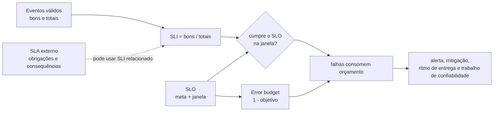
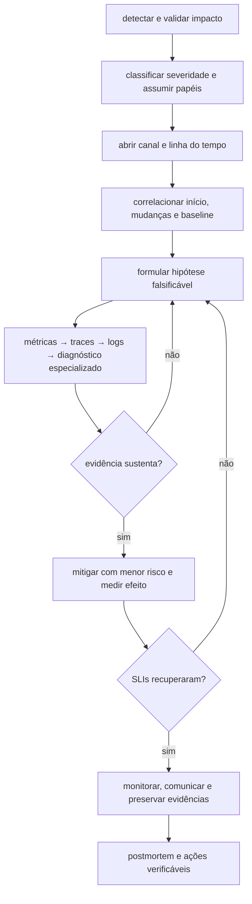

# C28 — Confiabilidade de serviço e resposta a incidentes

> **Nível:** Avançado
>
> **Objetivo:** definir confiabilidade pela experiência do usuário, transformar
> objetivos em decisões operacionais e responder a incidentes com mitigação,
> comunicação e aprendizado verificáveis.
>
> **Pré-requisito:** [C27 — Telemetria e diagnóstico distribuído](c27-telemetria-diagnostico-distribuido.md).
>
> **Última revisão:** 2026-11-18

Confiabilidade não é ausência absoluta de falhas. É a capacidade de entregar o
resultado prometido dentro de limites explícitos e de recuperar o serviço quando
esses limites são rompidos. Metas impossíveis incentivam esconder incidentes ou
paralisar mudanças; metas frouxas normalizam dano. Service Level Indicators (SLIs),
Service Level Objectives (SLOs) e error budgets tornam a conversa mensurável.

O capítulo usa exemplos numéricos **hipotéticos** para explicar cálculo. Eles não são
medidas deste repositório nem metas universais.

## SLI, SLO e SLA

Um **SLI** é a medida de uma experiência relevante: proporção de requisições válidas
ou duração das operações. Um **SLO** é a meta interna para o SLI em uma janela. Um
**SLA** é um acordo com consequências explícitas, frequentemente comerciais ou
contratuais. SLA não deve ser usado como sinônimo de painel operacional.



Defina a perspectiva antes da fórmula. Medir no servidor pode ignorar DNS, gateway
ou resposta perdida; medir no cliente pode incluir rede fora do controle. Use a
fronteira mais próxima da experiência que ainda permita ação e documente exclusões.

### Escolhendo indicadores

Um SLI de disponibilidade baseado em eventos pode ser:

```text
SLI = eventos bons / eventos válidos totais
```

“Bom” deve refletir contrato. Um `404` esperado pode ser resposta correta; um `200`
com resultado inútil pode ser ruim. Exclua tráfego sintético e abuso somente por regra
prévia, auditável, não depois de ver o resultado. Para latência, conte como bom cada
evento abaixo do limite adequado à jornada, possivelmente com classes diferentes.

Para filas, SLIs úteis incluem idade do item mais antigo e proporção processada dentro
do prazo, não apenas profundidade. Para jobs, sucesso até o deadline. Para dados,
atualidade e completude podem ser mais relevantes que HTTP 200. Métricas de CPU e GC
são sinais diagnósticos, raramente SLIs do usuário.

Escolha poucas jornadas críticas, volume suficiente e janela compatível com decisões.
Metas realistas partem de baseline medido, expectativa do usuário, dependências,
custo de melhoria e capacidade de resposta. Um número com muitas casas decimais não
é mais rigoroso se a medição e o contrato são vagos.

### Error budget e burn rate

Se o SLO hipotético é 99,9% de eventos bons em 30 dias, o error budget é 0,1% dos
eventos válidos da janela. Em um SLI baseado em eventos, o volume define quantas
falhas cabem; converter automaticamente para “minutos de indisponibilidade” pode ser
incorreto. Para SLI baseado em tempo, a conta é diferente.

**Burn rate** compara a taxa observada de erros com a taxa permitida. Burn rate 1
consome o orçamento no ritmo exato para a janela; 10 o consome dez vezes mais rápido.
Zero não prova perfeição: pode haver ausência de tráfego ou falha de medição.

Alertas de múltiplas janelas combinam sinal rápido e sustentado. Uma janela curta
detecta dano intenso; uma longa reduz ruído. Os valores devem ser calibrados com
volume, tempo de resposta e carga do on-call. Alertar em cada erro ou somente quando
o orçamento acabou chega cedo demais ou tarde demais.

### Consequências para entrega

Error budget é mecanismo de decisão compartilhada, não punição. Com consumo saudável,
a equipe pode aceitar risco de releases e experimentos. Com queima sustentada,
reduza blast radius, pause mudanças arriscadas, priorize causas recorrentes e melhore
detecção/recuperação. Uma exceção urgente de negócio ainda pode ser entregue, desde
que o risco seja explícito e mitigado.

Metas absolutas como 100% ignoram falhas de dependências, manutenção e custo marginal,
além de não deixar orçamento para mudança. Dividir SLOs por versão, região ou cliente
sem contrato pode esconder impacto agregado; agregar tudo pode esconder uma minoria
severamente afetada. Mantenha visão global e cortes acionáveis.

## Alertas que levam a uma ação

Uma página deve indicar impacto real ou risco iminente que exige ação humana agora.
Tickets podem tratar tendências lentas. Painéis apoiam exploração. Para cada alerta,
defina owner, severidade, runbook, consulta de validação, forma de silenciar com prazo
e condição de encerramento.

Evite alertar por causa presumida como CPU alta quando não há impacto. Use burn rate
de SLO para página e sinais de saturação para diagnóstico ou alerta preventivo quando
o tempo até exaustão é conhecido. Teste rotas de notificação e remova alertas sem ação.

## Investigação de incidente

Incidente começa pelo impacto, não pela explicação. Uma investigação disciplinada
alterna hipótese e teste enquanto a resposta protege usuários.



Primeiro determine quem é afetado, qual capacidade, extensão, início e tendência.
Compare com período normal e grupo não afetado. Marque deploys, migrations, flags,
configuração, certificados, eventos de infraestrutura e mudanças de downstream.
Relógios e fusos precisam ser normalizados na linha do tempo.

Depois percorra o caminho crítico:

- taxa, erros, latência e saturação por operação;
- traces lentos ou com erro e duração de cada dependência;
- logs correlacionados pelo trace, sem busca textual irrestrita como única técnica;
- queries, locks, pool, conexões e capacidade no banco;
- timeout, rate limit, DNS, certificados e status de dependências externas;
- CPU, alocação, GC, ThreadPool, contenção e I/O quando os sinais apontarem para recurso.

Escreva “se a hipótese X for verdadeira, veremos Y; consultaremos Z”. Isso reduz
viés de confirmação. Ausência de evidência pode significar hipótese falsa, sampling,
telemetria quebrada ou consulta errada; registre a distinção.

## Gestão do incidente

Severidade combina impacto, abrangência, duração, risco de dados/segurança e urgência.
Use critérios locais explícitos. Uma classificação possível separa indisponibilidade
crítica ampla, degradação material e falha limitada; os nomes importam menos que a
resposta associada.

Incidentes relevantes se beneficiam de papéis:

- **incident commander:** mantém prioridades, decisões e cadência;
- **operações:** executa investigação e mitigação;
- **comunicação:** informa partes afetadas com fatos e próximos horários;
- **scribe:** registra eventos, hipóteses, comandos, decisões e resultados.

Em equipes pequenas uma pessoa pode acumular papéis, mas não deve executar mudança
arriscada e perder simultaneamente a visão do incidente.

### Mitigar antes de explicar tudo

Mitigação reduz impacto: rollback, desabilitar feature flag, rotear tráfego, limitar
carga, degradar funcionalidade, aumentar capacidade comprovadamente útil ou isolar
dependência. Escolha a menor ação reversível e meça SLI após executá-la.

Rollback não é automaticamente seguro: migration incompatível, mensagens novas,
cache e efeito externo podem impedir retorno. Feature flag precisa ter owner, teste,
telemetria e expiração; uma flag nunca exercitada é esperança, não mecanismo de
recuperação. Escalar réplicas não corrige banco saturado ou lock e pode aumentar
conexões contra o gargalo.

Registre quem autorizou, instante, comando ou alteração, resultado esperado, resultado
observado e como desfazer. Preserve logs, traces, profiles e configuração relevantes,
respeitando proteção e retenção de dados. Não execute experimentos destrutivos apenas
para confirmar uma teoria durante impacto ativo.

### Comunicação

Comunique o que se sabe: capacidades afetadas, início estimado, impacto, mitigação em
curso e horário da próxima atualização. Separe fato de hipótese e não prometa ETA sem
evidência. Atualizações regulares reduzem interrupções à equipe técnica.

Uma linha do tempo útil contém detecção, reconhecimento, mudanças anteriores,
evidências, decisões, mitigações, recuperação e comunicação. Ela usa horário absoluto
com fuso e links para artefatos; não depende da memória reconstruída depois.

## Causa-raiz e postmortem

“Causa-raiz” singular frequentemente simplifica um sistema sociotécnico. Separe:

- **gatilho:** evento que iniciou a falha observada;
- **condições contribuintes:** desenho, capacidade, dependências e processos;
- **amplificadores:** retries, blast radius, alertas tardios ou mitigação insegura;
- **lacunas de detecção e resposta:** por que demorou para perceber e recuperar.

O postmortem deve ser orientado a aprendizado e evidência, não culpa. Inclua impacto
quantificado com fonte, linha do tempo, detecção, resposta, análise causal, o que
funcionou, o que falhou e ações. Não invente usuários afetados, duração ou percentis;
se a medição não existe, registre a lacuna.

Ações úteis têm owner, prioridade, prazo e critério verificável. Prefira controles que
mudam o sistema: teste de compatibilidade, limite de retry, canary, rollback exercitado,
alerta por SLO, isolamento ou remoção de ambiguidade. “Ter mais atenção”, “treinar a
equipe” ou “adicionar dashboard” sem mudança observável são ações fracas.

Nem todo incidente exige documento longo. Critérios podem considerar severidade,
novidade, repetição, quase acidente e potencial de aprendizado. Compartilhe achados,
acompanhe ações e verifique se reduziram frequência, impacto ou tempo de recuperação.

## Baselines, capacidade e mudanças de performance

Confiabilidade inclui desempenho sustentado. Antes de alterar código ou infraestrutura,
capture baseline com versão, ambiente, carga, distribuição de entradas e dependências.
Instrumente a mudança e compare janelas equivalentes. Canary reduz blast radius e
oferece grupo de comparação, desde que roteamento e população não introduzam viés.

Profiling em produção exige hipótese e orçamento de overhead. CPU, memória, GC,
ThreadPool, contenção e I/O são causas candidatas, não diagnósticos por si. O
[C27](c27-telemetria-diagnostico-distribuido.md#performance-em-produção) descreve a
sequência de triagem e as ferramentas .NET. Benchmark controlado pertence ao
[C04](../linguagem-e-runtime/c04-memoria-runtime-performance.md), e teste de carga ao
[C25](../qualidade-e-seguranca/c25-cobertura-e2e-carga.md).

## Runbook mínimo

Um runbook acionável contém:

1. sintoma e alertas que o referenciam;
2. impacto provável e verificação independente;
3. dashboards e consultas com parâmetros, não screenshots antigas;
4. hipóteses comuns e como refutá-las;
5. mitigação reversível, pré-condições e risco;
6. escalonamento, owners e dependências;
7. verificação de recuperação por SLI;
8. data do último exercício e validade.

Exercícios e incidentes reais atualizam o runbook. Automação deve preservar aprovação
onde o blast radius é alto e registrar cada ação.

## Exemplo integrado e limitações

O laboratório compartilhado do [C27](../../exemplos/c27-c28-observabilidade/) permite
simular latência de uma dependência, seguir o trace e observar logs e métricas. Ele
também separa liveness de readiness. Não implementa um SLO real, escala, tráfego
representativo, backend persistente ou processo organizacional; portanto seus valores
não podem sustentar meta, baseline ou resultado de performance.

Uma prática segura é variar `atrasoMs`, observar o span `HttpClient`, formular a
hipótese “o catálogo domina a latência” e verificar a duração relativa. Isso demonstra
o método, não prova comportamento de produção.

## Armadilhas comuns

- definir SLO pela disponibilidade atual sem representar a jornada do usuário;
- tratar SLA como alerta interno e paginar quando não há ação imediata;
- excluir falhas depois do resultado para preservar o número;
- pausar toda entrega por política automática sem avaliar urgência e risco;
- procurar culpado em vez de condições e controles do sistema;
- declarar causa apenas porque rollback recuperou o serviço;
- alterar várias variáveis e perder qual mitigação funcionou;
- escrever postmortem sem acompanhar ações;
- usar MTTR médio isolado, ocultando cauda, severidade e incidentes não detectados;
- confundir health check verde com SLO cumprido.

## Relação com outros capítulos

- [C27](c27-telemetria-diagnostico-distribuido.md) fornece os sinais e o método de
  diagnóstico consumidos neste capítulo.
- [C07](../aplicacoes-e-dados/c07-apis-http-integracoes-resilientes.md) trata timeout,
  retry, circuit breaker e cancelamento nas integrações.
- [C18](../sistemas-distribuidos/c18-limites-microservicos-evolucao-monolitos.md)
  explicita o custo operacional e as falhas parciais de serviços distribuídos.
- [C20](c20-infraestrutura-como-codigo-drift.md) trata mudanças e reconciliação da
  infraestrutura durante operação normal e emergencial.
- C29 — Entrega compatível e gestão de risco aprofundará canary, compatibilidade e
  rollback quando publicado.

## Referências

- [Service Level Objectives](https://sre.google/sre-book/service-level-objectives/)
  — Google SRE Book, indicadores, objetivos e expectativas, acesso em 18 novembro 2026.
- [Implementing SLOs](https://sre.google/workbook/implementing-slos/)
  — Google SRE Workbook, seleção e implementação de SLIs/SLOs, acesso em 18 novembro 2026.
- [Alerting on SLOs](https://sre.google/workbook/alerting-on-slos/)
  — Google SRE Workbook, burn rate e múltiplas janelas, acesso em 18 novembro 2026.
- [Error budget policy](https://sre.google/workbook/error-budget-policy/)
  — Google SRE Workbook, decisões de entrega orientadas por orçamento, acesso em 18 novembro 2026.
- [Managing incidents](https://sre.google/workbook/incident-response/)
  — Google SRE Workbook, papéis, controle e comunicação, acesso em 18 novembro 2026.
- [Postmortem culture](https://sre.google/sre-book/postmortem-culture/)
  — Google SRE Book, aprendizado sem culpa e ações, acesso em 18 novembro 2026.
- [Diagnostics tools overview](https://learn.microsoft.com/en-us/dotnet/core/diagnostics/)
  — Microsoft, observabilidade e diagnóstico especializado no .NET, acesso em 18 novembro 2026.
