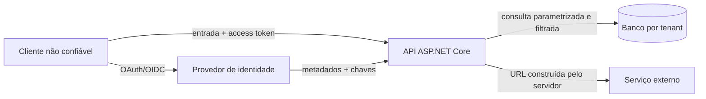

# C26 — Segurança nas fronteiras da aplicação

> **Nível:** Intermediário
>
> **Objetivo:** projetar, implementar e verificar fronteiras seguras em aplicações
> .NET, da identidade e dos dados ao pipeline de entrega e às integrações com IA.
>
> **Pré-requisitos:**
> [C06 — Composição e pipeline no ASP.NET Core](../aplicacoes-e-dados/c06-composicao-pipeline-aspnet-core.md),
> [C07 — APIs HTTP e integrações resilientes](../aplicacoes-e-dados/c07-apis-http-integracoes-resilientes.md)
> e [C23 — Testes orientados a comportamento e risco](c23-testes-comportamento-risco.md).
>
> **Última revisão:** 2026-11-18

Segurança não é um middleware isolado nem uma lista encerrada de vulnerabilidades.
É a preservação de propriedades do sistema diante de erro, abuso e agentes
adversários. Uma API pode validar perfeitamente um JWT e ainda expor o documento
de outro cliente; um cofre pode guardar o segredo e o processo imprimir seu valor;
uma consulta parametrizada pode ser segura contra SQL injection e retornar dados
demais. A proteção nasce da composição de controles independentes e verificáveis.

Este capítulo trata fundamentos, autenticação e autorização, APIs, vulnerabilidades,
segredos, dados, dependências, pipelines e a conexão com sistemas de IA. Ele não
substitui análise jurídica, pentest autorizado, resposta corporativa a incidentes
nem o desenho do provedor de identidade. Idempotência, persistência e agentes são
referenciados em seus capítulos canônicos para não duplicar mecanismos.

## O que precisa permanecer verdadeiro

A tríade CIA oferece perguntas melhores do que “a aplicação é segura?”:

- **confidencialidade:** apenas sujeitos autorizados conhecem o dado;
- **integridade:** alterações são autorizadas, válidas, detectáveis e atribuíveis;
- **disponibilidade:** o serviço continua útil dentro dos limites assumidos.

Os objetivos competem. Criptografia e auditoria consomem recursos; um rate limit
muito agressivo remove disponibilidade do cliente legítimo; esconder todos os
erros dificulta diagnóstico. Registre quais ativos e propriedades importam, contra
quais ameaças e sob quais limites operacionais.

### Princípios que orientam decisões

| Princípio | Aplicação prática | Verificação |
|---|---|---|
| **Defense in depth** | identidade, autorização por objeto, filtro por tenant, constraint e auditoria protegem a mesma operação | remover mentalmente um controle não deve expor todo o ativo |
| **Least privilege** | processo, pessoa, token, workload e pipeline recebem somente ações, recursos e duração necessários | inventário de permissões e teste de negação |
| **Secure by default** | autenticação global, HTTPS, respostas mínimas e efeitos negados até configuração explícita | instalação nova nasce fechada |
| **Fail securely** | timeout, erro de policy ou cofre indisponível não liberam acesso | testes de falha e startup que rejeita configuração inválida |
| **Separação de responsabilidades** | provedor autentica; API autoriza; banco reforça isolamento | decisão tem autoridade e dono identificáveis |
| **Minimização** | coletar, processar, expor, registrar e reter somente o necessário | esquema, DTO, logs e política de retenção revisados |

Segurança por padrão não significa configuração universal. Uma API interna ainda
precisa de identidade entre workloads, autorização, criptografia de transporte e
inventário. “Está na rede privada” descreve topologia, não confiança.

## Threat modeling antes do controle

Threat modeling transforma arquitetura em hipóteses testáveis. Faça-o no início,
em mudanças de fluxo e após incidentes, não apenas antes de uma auditoria.

1. Liste ativos: dados, credenciais, dinheiro, disponibilidade, artefatos e ações.
2. Desenhe fluxo de dados, processos, armazenamentos e sistemas externos.
3. Marque **trust boundaries**: navegador/API, serviço/serviço, tenant/tenant,
   aplicação/banco, runner/nuvem, modelo/tool e dados confiáveis/não confiáveis.
4. Enumere abuso: falsificação, adulteração, repúdio, divulgação, negação de
   serviço e elevação de privilégio são categorias úteis, não uma checklist final.
5. Priorize por impacto, probabilidade, exposição e capacidade de detecção.
6. Associe prevenção, detecção, resposta, responsável e evidência de teste.
7. Registre risco residual e condição para rever a decisão.



Cada seta atravessa uma fronteira e amplia a **superfície de ataque**: endpoints,
formatos, bibliotecas, portas, callbacks, arquivos, filas, ferramentas de IA e
identidades operacionais. Reduza o que existe antes de tentar proteger tudo:
remova endpoint antigo, método HTTP desnecessário, claim sem uso, egress irrestrito,
permissão de escrita e parser redundante.

Um registro mínimo de ameaça contém ativo, fronteira, precondição, cenário,
impacto, controles, como testar, telemetria sem dados sensíveis e risco aceito. Um
diagrama sem decisões e testes vira decoração.

## Segurança no ciclo de desenvolvimento

O ciclo seguro combina atividades em momentos diferentes:

- requisitos de abuso, privacidade e disponibilidade junto aos funcionais;
- threat model e decisão arquitetural antes de consolidar interfaces;
- padrões seguros, análise estática, revisão e testes de negação no desenvolvimento;
- SCA, secret scanning, build reproduzível e revisão de dependências no pipeline;
- configuração endurecida, identidade de workload e validação antes da promoção;
- logs, métricas, alertas, rotação e exercícios de incidente em operação;
- correção da causa, atualização do modelo de ameaça e testes de regressão.

Automação encontra classes conhecidas, mas não sabe se `user-a` pode aprovar o
pedido de `user-b`. Revisão de regra de negócio, testes adversariais autorizados e
observação de produção continuam necessários.

## Autenticação não é autorização

**Autenticação** estabelece, com uma força conhecida, quem ou qual workload está
apresentando a requisição. **Autorização** decide se essa identidade pode executar
uma operação específica sobre um recurso específico naquele contexto. Um token
válido responde à primeira pergunta; nunca concede, sozinho, acesso a todo objeto
cujo ID chegou na URL.

Uma **identidade** é representada no ASP.NET Core por um `ClaimsPrincipal` com uma
ou mais identidades e **claims**. Claim é uma afirmação do emissor, como `sub`,
`tenant_id` ou `permission`; não é prova produzida pelo cliente. Normalize nomes,
emissor e semântica. Não autorize usando claim arbitrária que qualquer emissor
aceito possa criar.

- **roles** agrupam responsabilidades relativamente estáveis, mas tendem a ficar
  largas e ambíguas entre sistemas;
- **claims** carregam atributos; presença não garante que sirvam para a decisão;
- **policies** expressam requisitos testáveis e escondem do endpoint como claims,
  roles, contexto e serviços externos compõem a decisão;
- **autorização por recurso** avalia o objeto carregado e a operação, necessária
  quando o ID sozinho não revela proprietário, tenant ou estado.

Use deny by default. No laboratório, uma fallback policy exige usuário autenticado
em todo endpoint, e uma policy nomeada requer permissão:

<!-- snippet-csharp: id=c26-01; categoria=contexto -->
```csharp
builder.Services.AddAuthorizationBuilder()
    .SetFallbackPolicy(new AuthorizationPolicyBuilder()
        .RequireAuthenticatedUser()
        .Build())
    .AddPolicy("relatorios:ler", policy =>
        policy.RequireClaim("permission", "relatorios:ler"));

app.MapGet("/relatorios", ObterRelatorios)
    .RequireAuthorization("relatorios:ler");
```

Evite espalhar comparações de strings pelos endpoints. Policies e handlers dão um
vocabulário único, permitem testes de negação e deixam explícita a operação.

### OAuth 2.0, OpenID Connect e JWT

Os termos resolvem problemas diferentes:

- **OAuth 2.0** é um framework de autorização delegada para obter acesso limitado
  a recursos; não é, por si, protocolo de login;
- **OpenID Connect (OIDC)** adiciona autenticação sobre OAuth 2.0 e define ID Token,
  UserInfo, descoberta e semântica de claims de identidade;
- **JWT** é um formato compacto de claims assinadas ou protegidas; pode representar
  access token, ID Token ou outro artefato. O formato não define finalidade nem
  torna o conteúdo secreto: o payload usual é apenas codificado.

Uma API recebe **access token** destinado a ela. Não aceite ID Token como access
token. Clientes modernos devem seguir o Authorization Code Flow com PKCE e a
Security BCP do OAuth; o password grant não deve ser usado e o implicit grant deve
ser evitado. Prefira biblioteca madura e provedor de identidade a implementar
emissão, descoberta, rotação e revogação artesanalmente.

### Validar um JWT corretamente

Validação local precisa verificar em conjunto:

1. algoritmo permitido e assinatura com chave confiável do emissor;
2. `iss` exatamente entre emissores esperados;
3. `aud` contendo a API esperada;
4. `exp` e, quando aplicável, `nbf`, com clock skew pequeno e deliberado;
5. tipo/finalidade e claims exigidas pelo perfil adotado;
6. policy e autorização do objeto depois de autenticar.

<!-- snippet-csharp: id=c26-02; categoria=contexto -->
```csharp
options.MapInboundClaims = false;
options.TokenValidationParameters = new TokenValidationParameters
{
    ValidateIssuer = true,
    ValidIssuer = configuration["Identity:Issuer"],
    ValidateAudience = true,
    ValidAudience = configuration["Identity:Audience"],
    ValidateLifetime = true,
    RequireExpirationTime = true,
    RequireSignedTokens = true,
    ValidateIssuerSigningKey = true,
    ClockSkew = TimeSpan.FromSeconds(30),
    NameClaimType = "sub",
    RoleClaimType = "role"
};
```

Em produção, `Authority`/metadata OIDC e JWKS sobre HTTPS normalmente fornecem as
chaves públicas e sua rotação. Fixar uma chave simétrica no repositório troca o
problema por um segredo compartilhado de alto impacto. Restrinja algoritmos quando
o perfil exigir, valide metadados, planeje cache/rotação e não use
`ValidateIssuer = false` para “resolver” ambiente.

Expiração curta reduz a janela de roubo, mas não equivale a revogação imediata.
Sessões críticas podem exigir tokens sender-constrained, introspecção, lista de
sessão/revogação ou reautenticação. Isso custa disponibilidade e estado. Refresh
tokens pertencem ao cliente autorizado, requerem armazenamento protegido, rotação
e detecção de reuse; não devem chegar à API de recurso.

Retorne `401` quando a autenticação está ausente ou inválida e `403` quando uma
identidade válida não tem permissão. Em recursos enumeráveis, `404` pode evitar
confirmar a existência, desde que a decisão seja consistente e auditável.

## Autorização por usuário e tenant

Broken Object Level Authorization (BOLA) ocorre quando alguém troca um identificador
e acessa objeto que não lhe pertence. UUID dificulta adivinhação, mas não autoriza.
Proteja leitura, alteração, exclusão, exportação e operações em lote.

O fluxo defensivo do laboratório é:

1. comparar o tenant confiável do token com a rota;
2. consultar por chave composta `tenant_id + id`, nunca apenas por `id`;
3. carregar o recurso mínimo;
4. chamar `IAuthorizationService` com recurso e operação;
5. projetar um DTO de saída mínimo;
6. retornar `404` para recurso ausente ou invisível.

<!-- snippet-csharp: id=c26-03; categoria=contexto -->
```csharp
var documento = await repositorio.ObterAsync(tenantId, id, cancellationToken);
if (documento is null)
    return Results.NotFound();

var resultado = await authorizationService.AuthorizeAsync(
    user, documento, DocumentoOperacoes.Ler);

return resultado.Succeeded
    ? Results.Ok(new DocumentoResponse(documento.Id, documento.Titulo))
    : Results.NotFound();
```

Filtrar no repositório reduz exposição acidental e volume, mas não elimina o
handler. O banco pode reforçar isolamento com chaves compostas, Row-Level Security
e credenciais separadas; cada mecanismo deve ser testado porque contexto de tenant
ausente ou pooling mal configurado pode inverter a proteção. Administradores também
precisam de escopo, justificativa, auditoria e, para ações críticas, aprovação.

## APIs: ameaça, decisão e controle

| Risco | Modo de falha | Controles principais |
|---|---|---|
| BOLA | trocar ID acessa objeto alheio | filtro por tenant, handler por recurso/operação, teste horizontal e vertical |
| Mass Assignment | JSON altera `Role`, `OwnerId`, preço ou estado interno | DTOs específicos, allowlist de campos, invariantes e autorização por propriedade |
| entrada inválida | payload enorme, estado impossível ou parser ambíguo | limite de corpo, tipo/schema, tamanho, intervalo e regra de domínio |
| consumo irrestrito | CPU, memória, conexões ou custo de terceiro se esgotam | rate/concurrency limit, paginação máxima, timeout, quota e budget externo |
| exposição excessiva | entidade serializada revela segredo ou dado interno | projeção explícita e contrato de resposta mínimo |
| CORS amplo | origem web não confiável lê resposta com credenciais | origins/métodos/headers exatos; nunca tratar CORS como autorização |
| transporte inseguro | token ou dado é observado/alterado | HTTPS, HSTS onde aplicável, TLS até o terminador confiável e headers de proxy corretos |
| erro detalhado | stack trace, SQL, caminho ou segredo vazam | Problem Details estável, correlação e detalhe apenas no log protegido |
| abuso de negócio | automação explora cupom, cadastro, busca ou recuperação | limites por identidade/risco, antifraude, detecção e desafio proporcional |

### Entrada, binding e saída

Validação sintática não substitui autorização nem invariantes. Faça binding em DTO
de caso de uso, não na entidade persistida:

<!-- snippet-csharp: id=c26-04; categoria=isolado -->
```csharp
public sealed record AtualizarDocumentoRequest(string Titulo);
```

Campos extras como `tenantId`, `ownerId` e `role` não existem no contrato e não
são copiados. Para contratos públicos, considere rejeitar propriedades desconhecidas
quando isso não quebrar compatibilidade. Limite profundidade, coleções, upload,
descompressão e paginação antes de alocar trabalho caro.

Saída merece o mesmo cuidado. Projete `DocumentoResponse`; não conte com atributo
de serialização esquecido em uma propriedade futura da entidade.

### Rate limiting e proteção contra abuso

Rate limiting no ASP.NET Core é uma camada de disponibilidade, não defesa completa
contra DDoS. Escolha partição por usuário, cliente, tenant, IP confiável ou operação;
um NAT pode concentrar usuários legítimos e IP pode ser forjado se headers de proxy
não forem validados. Limite também concorrência, fila, tamanho, tempo, chamadas a
terceiros e custo financeiro. O edge absorve volume; a aplicação conhece identidade
e regra de negócio. Observe rejeições e devolva `429` com orientação de retry quando
seguro.

### CORS, HTTPS e erros

CORS é uma política de navegador, não firewall. Clientes fora do navegador ignoram
CORS. Não combine origem curinga com credenciais e permita somente origens exatas
necessárias. Proteção CSRF continua relevante para autenticação baseada em cookies.

Use HTTPS em todo salto que transporta credenciais ou dados, configure forwarded
headers apenas para proxies conhecidos e não derive links/segurança de header
forjado. HSTS instrui navegadores após uma resposta segura; não protege o primeiro
acesso e requer planejamento de domínio.

O `IExceptionHandler` do laboratório registra a exceção no canal protegido e entrega
ao cliente apenas título estável e `traceId`. Nunca retorne stack trace ou mensagem
bruta em produção. Também não registre corpo, token, cookie, connection string ou
dados pessoais por conveniência.

### Idempotência

Idempotência reduz efeitos repetidos quando há retry, timeout ou duplicação; não
é controle de autenticação. Chave deve ser vinculada à identidade/tenant, operação
e hash do payload, com retenção e concorrência definidas. O mecanismo completo está
no [C16 — Idempotência e entrega confiável](../sistemas-distribuidos/c16-idempotencia-entrega-confiavel.md).

## Vulnerabilidades comuns em .NET

| Vulnerabilidade | Padrão inseguro | Mitigação defensiva |
|---|---|---|
| SQL Injection | concatenar entrada em SQL, `FromSqlRaw` ou nome dinâmico | LINQ traduzido, parâmetros, allowlist para identificadores e conta do banco mínima |
| XSS | inserir texto não confiável como HTML/JS/URL | encoding contextual padrão do Razor, sanitizador mantido quando HTML for requisito, CSP em camadas e evitar `Html.Raw` |
| SSRF | `HttpClient.GetAsync(urlDoUsuario)` | destinos/portas/protocolos permitidos, URL construída no servidor, DNS/redirect revalidados, egress e metadata bloqueados |
| Path Traversal | `Path.Combine(base, nomeDoUsuario)` e confiar no resultado | ID opaco/allowlist; canonicalizar, confirmar raiz e considerar symlink; nome gerado pelo servidor em upload |
| Insecure Deserialization | desserializar tipo arbitrário ou payload com metadados de tipo | tipos concretos/DTOs, schema e limites; não habilitar resolução polimórfica não confiável; evitar formatos nativos perigosos |
| Command Injection | montar shell com entrada em string | preferir API gerenciada; executável fixo, argumentos separados/validados, sem shell e identidade de processo mínima |
| falha de autorização | apenas `[Authorize]` em endpoint com `{id}` | policy de função mais autorização por objeto, operação e tenant em todo caminho |
| configuração insegura | debug, endpoint legado, CORS `*`, default credentials | baseline, validação no startup, inventário, varredura e diferença por ambiente revisada |
| dependência vulnerável | pacote direto atualizado com transitivo antigo | inventário, SCA transitiva, lock/restore determinístico, atualização e exceção com prazo |

### Consulta segura e parametrizada

Valores nunca devem virar sintaxe SQL:

<!-- snippet-csharp: id=c26-05; categoria=contexto -->
```csharp
await using var command = connection.CreateCommand();
command.CommandText = """
    SELECT id, tenant_id, proprietario_id, titulo
    FROM documentos
    WHERE tenant_id = $tenantId AND id = $id
    """;
command.Parameters.AddWithValue("$tenantId", tenantId);
command.Parameters.AddWithValue("$id", id);
```

Parâmetros protegem **valores**, não nomes de tabela, coluna ou direção de ordenação.
Para esses identificadores, traduza uma enumeração fechada do contrato para SQL
conhecido. Stored procedure não é automaticamente segura se concatena SQL. A conta
da aplicação não deve administrar schema nem acessar bases alheias.

O [C08 — Consultas eficientes com EF Core](../aplicacoes-e-dados/c08-consultas-ef-core.md)
aprofunda tradução, projeção e inspeção do SQL. `FromSqlInterpolated` parametriza
valores; interpolação passada a `FromSqlRaw` pode reintroduzir injeção.

### XSS

Razor codifica texto por padrão para o contexto HTML. Preserve essa garantia e
evite `Html.Raw` com conteúdo não confiável. Encoding HTML não serve para JavaScript,
CSS, URL ou atributo sem considerar o contexto. Se usuários puderem escrever HTML,
sanitize no servidor com biblioteca mantida e policy explícita; CSP limita impacto,
mas não corrige o sink. APIs JSON ainda podem alimentar um frontend vulnerável.

### SSRF

Bloquear apenas `localhost` é insuficiente: existem IPs privados, link-local,
IPv6, representação alternativa, DNS rebinding e redirects. Prefira selecionar um
destino por ID e montar a URL a partir de base confiável. Quando URLs arbitrárias
forem requisito, normalize e valide esquema/host/porta, resolva e filtre todos os
endereços, revalide redirects, limite resposta e tempo, use proxy de egress e
bloqueie metadata de nuvem na rede. `HttpClient` não fornece esses controles sozinho.

### Path traversal e arquivos

O melhor nome externo é um ID que o servidor mapeia. Se um segmento for necessário,
rejeite caminhos absolutos, normalize uma vez, obtenha o caminho completo e confirme
que permanece sob a raiz com comparação adequada ao sistema. Ainda trate symlinks,
TOCTOU, permissões e nomes reservados. Em uploads, valide tamanho e tipo pelo conteúdo,
gere nome novo, armazene fora da raiz pública e faça varredura compatível com o risco.

### Desserialização e comandos

`System.Text.Json` com DTO concreto reduz superfície, mas conversores, polimorfismo,
profundidade e tamanhos precisam de revisão. Nunca aceite um nome de tipo para
instanciar classe arbitrária. Formato assinado prova origem/integridade apenas se a
chave e a verificação forem corretas; ainda pode conter operação perigosa autorizada.

Não chame shell para tarefa que possui API .NET. Quando um processo for inevitável,
fixe o executável, use `ProcessStartInfo.ArgumentList`, valide cada argumento contra
allowlist, desabilite shell, limite tempo/recursos e execute com usuário isolado.
Escapar uma string para múltiplas camadas de shell é frágil.

## Gestão de segredos é um ciclo de vida

Segredo é informação que concede capacidade: senha, client secret, chave, token,
certificado privado, connection string ou webhook. O objetivo é reduzir quantidade,
alcance, cópias e duração.

| Ambiente | Mecanismo | Limite |
|---|---|---|
| desenvolvimento local | .NET User Secrets/Secret Manager | fica fora do repositório, mas não é criptografado nem cofre confiável |
| processo/contêiner | variável de ambiente ou arquivo montado | costuma ser texto legível ao processo e pode vazar em dump/diagnóstico |
| produção | vault/secret manager com identidade de workload | exige policy mínima, auditoria, cache e estratégia de indisponibilidade |
| CI/CD | OIDC federado e segredo de ambiente quando inevitável | logs, forks, actions e permissões do runner ampliam exposição |

Exemplo local, com marcador sem valor válido:

```powershell
dotnet user-secrets init --project exemplos/c26-seguranca/C26.Seguranca.csproj
dotnet user-secrets set "Identity:ClientSecret" "<valor-local-nao-real>" `
  --project exemplos/c26-seguranca/C26.Seguranca.csproj
```

Em variável, `Identity__ClientSecret` mapeia para `Identity:ClientSecret`. Isso
remove o valor do código, mas não o criptografa nem o protege de administradores,
processos privilegiados ou diagnóstico. Criptografar uma senha no `appsettings`
também não resolve automaticamente: a aplicação precisa da chave de decriptação,
que se torna o novo segredo.

Prefira identidade gerenciada/workload e credenciais de curta duração. No vault:
conceda leitura apenas ao caminho necessário, separe ambientes, audite acesso,
planeje renovação e mantenha a aplicação capaz de trocar versão sem rebuild.
Rotação só termina quando consumidores usam o novo valor; revogação encerra o
antigo. Teste ambos.

### CI/CD sem vazamento

- não passe segredo em argumento de linha de comando ou output;
- use masking como última camada, não como garantia: transformações escapam máscara;
- não exponha segredo a build de fork ou script não revisado;
- restrinja ambientes e exija aprovação para produção;
- evite artefato, cache, dump e relatório contendo configuração;
- gere credencial efêmera via OIDC quando o provedor suportar;
- rode secret scanning e bloqueie push, mas trate achado confirmado como incidente.

### Credencial comprometida

1. contenha e **revogue/rotacione imediatamente**; remover do Git não revoga;
2. identifique escopo, permissões, ambientes, cópias e janela de exposição;
3. preserve evidência e investigue logs de uso sem reutilizar a credencial;
4. troque credenciais derivadas e encerre sessões quando necessário;
5. remova o valor do estado atual e, após avaliar impacto, do histórico/caches;
6. comunique pelos canais de incidente e cumpra obrigações aplicáveis;
7. corrija a origem, acrescente detecção e teste o procedimento.

Reescrever histórico é disruptivo e não apaga clones, forks ou logs. A primeira
ação útil é revogar. Nunca cole o segredo em issue, chat ou relatório de incidente.

## Proteção de dados

Classifique antes de escolher criptografia:

- **dado pessoal** relaciona-se a pessoa identificada ou identificável;
- **dado pessoal sensível** recebe proteção especial na LGPD e inclui categorias
  como saúde, biometria e origem racial/étnica;
- **segredo técnico** concede capacidade, mesmo sem ser dado pessoal;
- **dado operacional sensível** inclui topologia, vulnerabilidade e lógica antifraude.

Minimize campos, granularidade, cópias, pessoas com acesso e tempo de retenção.
Pseudonimização reduz associação direta, mas não torna automaticamente o dado
anônimo. Hash de identificador previsível pode ser reidentificado.

### Em trânsito, em repouso e em uso

TLS protege saltos configurados, não o dado já entregue ao processo ou log. Em
repouso, use criptografia do serviço/disco/banco com gestão de chaves separada,
rotação, backup e teste de restauração. Para campos de alto impacto, criptografia
por aplicação pode reduzir exposição ao operador do banco, mas dificulta busca,
índice, rotação e recuperação. Controle de acesso continua obrigatório.

ASP.NET Core Data Protection é adequado a dados protegidos pela aplicação, como
cookies, não a qualquer requisito de criptografia durável sem planejar key ring,
purpose, persistência e rotação. Não invente algoritmo ou formato criptográfico.

### Senhas

Senha de usuário deve ser **hasheada**, não criptografada para recuperação. Use
ASP.NET Core Identity `PasswordHasher`, que incorpora salt e parâmetros e pode
indicar rehash. Não use SHA-256/MD5 puro, salt fixo nem implemente PBKDF artesanal
para uma aplicação nova. Proteja reset, MFA, enumeração de conta e credential
stuffing; armazenamento correto não corrige autenticação fraca.

### Acesso, logs, retenção e auditoria

Autorize leitura, exportação, correção e exclusão; separe suporte de administração.
Logs devem registrar evento de segurança, ator, decisão, recurso opaco, tempo e
correlação — nunca token, senha, cookie ou payload integral por padrão. Restrinja
acesso e integridade da trilha, monitore consultas privilegiadas e defina retenção
por finalidade e obrigação. Backup também entra no prazo e no procedimento de
eliminação.

Auditoria não é `ILogger` infinito. Ela precisa de eventos estáveis, relógio,
proteção contra alteração, acesso controlado, busca e procedimento de análise.
Registre decisões negadas sem permitir que o atacante gere custo ilimitado.

### LGPD

A LGPD traz princípios como finalidade, adequação, necessidade, segurança,
prevenção e responsabilização. Engenharia pode apoiar inventário de tratamento,
minimização, controles, retenção, evidências e resposta. Base legal, direitos dos
titulares, transferência, comunicação de incidente e prazo dependem do contexto:
envolva encarregado, privacidade e assessoria jurídica. Este capítulo não é parecer
jurídico.

## Dependências e cadeia de suprimentos

Inventário precisa incluir pacotes diretos e transitivos, SDK, runtime, imagem,
actions e ferramentas de build. Um **SBOM** registra componentes e versões; não
prova que estejam seguros, presentes no artefato final ou autorizados.

Use SCA continuamente e no pull request. Para .NET:

```powershell
dotnet list exemplos/EngenhariaDotnet.slnx package --vulnerable --include-transitive
dotnet list exemplos/EngenhariaDotnet.slnx package --outdated
```

Avalie explorabilidade no produto, alcance, severidade, ativo, exposição e
existência de correção. “Não há exploit conhecido” não é prova de segurança. Atualize
em lotes pequenos com testes; Dependabot/Renovate automatizam descoberta e proposta,
não a decisão de merge.

Política pode bloquear vulnerabilidade crítica/alta nova, pacote sem origem aprovada,
licença incompatível ou artefato sem integridade. Exceção precisa de proprietário,
justificativa, controles compensatórios, escopo, evidência, expiração e ticket de
correção. Supressão permanente sem prazo transforma dívida em invisibilidade.

Durante este capítulo, o restore detectou `SQLitePCLRaw.lib.e_sqlite3 2.1.11` com
vulnerabilidade alta `GHSA-2m69-gcr7-jv3q`. O laboratório fixa explicitamente o
bundle corrigido `2.1.14`; o alerta não foi suprimido. Isso demonstra por que versão
direta atual não garante grafo transitivo seguro.

Exporte SBOM do dependency graph ou gere no build, associe-o ao digest do artefato
e retenha-o conforme a política. Assinatura/proveniência responde quem construiu o
quê e como; não atesta ausência de vulnerabilidade.

## Pipeline com privilégios mínimos

Pipeline executa código e, portanto, é uma fronteira privilegiada. Pull request de
fork, script de instalação, gerador e action são código não confiável até revisão.
Nunca disponibilize segredo de produção a job que executa esse conteúdo.

Exemplo de verificação sem escrita no repositório:

```yaml
name: segurança

on:
  pull_request:

permissions:
  contents: read

jobs:
  validar:
    runs-on: ubuntu-latest
    timeout-minutes: 15
    steps:
      - uses: actions/checkout@<SHA_COMPLETO_REVISADO>
        with:
          persist-credentials: false
      - uses: actions/setup-dotnet@<SHA_COMPLETO_REVISADO>
        with:
          global-json-file: global.json
      - run: dotnet restore exemplos/EngenhariaDotnet.slnx
      - run: dotnet test exemplos/EngenhariaDotnet.slnx --no-restore --configuration Release
      - run: dotnet list exemplos/EngenhariaDotnet.slnx package --vulnerable --include-transitive
```

O marcador exige substituir por commit SHA verificado; não é credencial. Fixar SHA
reduz troca de tag, mas exige processo de atualização. Quando o repositório mantiver
lockfiles revisados, use `dotnet restore --locked-mode` para rejeitar mudança do
grafo durante o build. Defina `permissions` no nível
mais estreito; `contents: read` basta para checkout/teste. Jobs de publicação devem
ser separados, protegidos por environment e receber somente `packages: write`,
`id-token: write` ou outra capacidade realmente necessária.

Outros controles:

- branches protegidas, revisão obrigatória e CODEOWNERS para workflow/policies;
- impedir aprovação pelo próprio autor quando o risco exigir independência;
- runners efêmeros e isolados; não reutilizar workspace contaminado;
- lockfiles, fontes de pacote restritas, checksums e cache sem segredo;
- artefato imutável promovido entre ambientes, não rebuild por ambiente;
- attestations de build ligadas ao digest e verificação antes de deploy;
- proteção contra script injetado: valor de issue/branch vai por variável, não
  interpolado diretamente no `run`;
- retenção e acesso mínimos a logs e artefatos.

OIDC do GitHub permite trocar identidade do job por credencial curta no provedor de
nuvem. Restrinja o trust pelo repositório, branch/tag, workflow e environment; dar
`id-token: write` permite solicitar token, mas a policy externa decide o alcance.

## Sistemas de IA: aplique as mesmas fronteiras

Prompt, documento recuperado, página web, resposta de tool e saída do modelo são
dados não confiáveis. **Prompt injection** pode tentar mudar objetivo, obter dados
ou induzir ação; separar mensagem “system” não cria uma barreira de segurança.

Não replique aqui toda a arquitetura de IA:

- [C21 — Fundamentos de LLM, MCP e RAG](../ia-e-pratica-profissional/c21-fundamentos-llm-mcp-rag.md)
  detalha ACL na recuperação, proveniência, prompt injection, dados não confiáveis,
  permissões de tools, exfiltração, auditoria e avaliações;
- [C22 — Agentes, orquestração e SDD](../ia-e-pratica-profissional/c22-agentes-orquestracao-sdd.md)
  trata allowlist, policy/executor, orçamento, ações, confirmação humana e testes
  de agentes.

A integração segura preserva controles determinísticos:

1. recupere somente dados que a identidade já pode ler;
2. minimize contexto e marque origem/confiabilidade;
3. dê à tool permissão menor que a do processo orquestrador;
4. valide argumentos, recurso e operação fora do modelo;
5. limite rede, tempo, custo, chamadas e volume de saída;
6. exija human-in-the-loop para efeito irreversível, financeiro, externo ou de
   privilégio elevado — confirmação deve mostrar ação e alvo reais;
7. audite decisão, entrada derivada, tool call, resultado e aprovação sem registrar
   segredo ou dado desnecessário;
8. trate saída como proposta: encode, valide e autorize antes de executar.

Defesa em camadas combina ACL, isolamento, minimização, tool allowlist, autorização
por chamada, sandbox/egress, aprovação, limites, monitoramento e resposta. Nenhuma
dessas camadas “resolve” prompt injection isoladamente.

## Laboratório defensivo

O projeto [c26-seguranca](../../exemplos/c26-seguranca/) usa .NET 10, ASP.NET Core
TestServer, chave RSA efêmera e SQLite em memória. Não acessa rede, não contém
credencial e não emite tokens para uso externo.

| Exemplo solicitado | Implementação |
|---|---|
| A. policy-based authorization | fallback policy e `relatorios:ler` em `AplicacaoSegura.cs` |
| B. recurso por usuário/tenant | `DocumentoAuthorizationHandler`, filtro composto e resposta `404` |
| C. consulta parametrizada | `RepositorioDocumentos` com parâmetros SQLite |
| D. JWT | issuer, audience, lifetime, expiração e assinatura validados |
| E. configuração sensível | fluxo documentado com User Secrets, ambiente e vault, sem valor real |
| F. erros seguros | `TratadorSeguroDeExcecoes` com Problem Details e `traceId` |
| G. testes de autorização | autenticação, policy, BOLA, cross-tenant e mass assignment |
| H. GitHub Actions mínimo | workflow de referência acima com `contents: read` |

Execute:

```powershell
dotnet test exemplos/c26-seguranca/C26.Seguranca.Tests.csproj --configuration Release
```

Os testes verificam:

- endpoint sem token retorna `401`;
- usuário sem permission recebe `403`, e policy correta permite;
- proprietário lê apenas projeção mínima;
- outro usuário e outro tenant recebem `404`;
- campos extras não alteram proprietário/tenant (mass assignment);
- payload de SQL injection permanece dado e não retorna registro;
- issuer, audience, expiração e assinatura inválidos retornam `401`;
- exceção interna vira `500` sem mensagem sensível e com correlação.

O laboratório injeta chave pública diretamente para manter o teste offline. Em
produção, use metadata/JWKS do provedor, rotação e configuração externa. SQLite em
memória demonstra parametrização e filtro, não isolamento completo de um SGBD
multi-tenant. Rate limiting local não substitui proteção no edge nem coordena várias
réplicas.

## Diagnóstico e resposta

Quando houver suspeita:

1. contenha sem destruir evidência: revogue credencial, reduza permissão, bloqueie
   rota/egress ou isole workload conforme o cenário;
2. delimite identidades, objetos, tenants, versões, período e dados afetados;
3. correlacione logs de identidade, API, banco, pipeline, vault e nuvem;
4. verifique integridade e alcance, não apenas o alerta inicial;
5. corrija controle e causa sistêmica; acrescente teste de regressão;
6. restaure serviço gradualmente e monitore recorrência;
7. registre timeline, decisões, risco residual e obrigações de comunicação.

Não “teste” exploração destrutiva em produção. Diagnóstico deve usar autorização,
ambiente controlado, cópia sanitizada e procedimentos da organização.

## Trade-offs e decisões

| Decisão | Benefício | Custo/limite |
|---|---|---|
| token curto e validação local | baixa latência e menor janela de roubo | revogação não é imediata; rotação de chave precisa funcionar |
| introspecção/estado de sessão | revogação e contexto recentes | dependência síncrona, latência e disponibilidade do IdP |
| `404` para objeto invisível | reduz enumeração | diagnóstico exige correlação e auditoria interna |
| RLS no banco | defesa adicional contra filtro esquecido | contexto/pooling complexos e testes específicos |
| vault e identidade de workload | reduz segredo estático | dependência operacional, bootstrap e cache |
| bloqueio de SCA | impede risco conhecido novo | falso senso de completude e necessidade de exceção governada |
| aprovação humana em IA | reduz ação indevida de alto impacto | latência e fadiga; confirmação genérica não ajuda |

Comece removendo superfície e negando por padrão. Adicione controle quando houver
ameaça, obrigação ou evidência correspondente, e registre como saber se funciona.
Complexidade de segurança não testada também cria vulnerabilidade.

## Checklist de revisão

- ativos, trust boundaries e abuso estão documentados;
- autenticação tem emissor, audience, assinatura e tempo validados;
- cada operação autoriza função **e** objeto/tenant;
- DTOs de entrada/saída são mínimos e limites de recursos são explícitos;
- SQL, comandos, caminhos, URLs e HTML não misturam dados com instruções;
- segredos não estão em código, log, artefato ou argumento; rotação foi testada;
- dados possuem classificação, acesso, retenção e auditoria proporcionais;
- transitivos, imagens, actions e ferramentas estão no inventário/SBOM;
- pipeline e workloads usam permissões e duração mínimas;
- testes cobrem negação horizontal, vertical, cross-tenant e falhas de token;
- IA não decide sua própria permissão nem executa saída sem validação;
- risco residual, responsável e prazo estão registrados.

## Relação com outros capítulos

- [C06](../aplicacoes-e-dados/c06-composicao-pipeline-aspnet-core.md) explica ordem
  de middleware, Options e tratamento de erros.
- [C07](../aplicacoes-e-dados/c07-apis-http-integracoes-resilientes.md) cobre HTTP,
  timeout, retry e clientes externos.
- [C08](../aplicacoes-e-dados/c08-consultas-ef-core.md) e
  [C09](../aplicacoes-e-dados/c09-fronteiras-concorrencia-ef-core.md) aprofundam
  consultas, unidade de trabalho e concorrência.
- [C16](../sistemas-distribuidos/c16-idempotencia-entrega-confiavel.md) é o capítulo
  canônico para idempotência, deduplicação e Outbox.
- [C20](../operacao-entrega-e-plataforma/c20-infraestrutura-como-codigo-drift.md)
  trata estado, drift e segredos em infraestrutura.
- [C23](c23-testes-comportamento-risco.md) e [C24](c24-integracao-real-testes-legado.md)
  orientam seleção de testes e infraestrutura real.
- [C21](../ia-e-pratica-profissional/c21-fundamentos-llm-mcp-rag.md) e
  [C22](../ia-e-pratica-profissional/c22-agentes-orquestracao-sdd.md) aprofundam
  segurança de RAG, MCP, tools e agentes.
- [C27](../operacao-entrega-e-plataforma/c27-telemetria-diagnostico-distribuido.md)
  aprofunda telemetria com proteção de dados; [C29](../operacao-entrega-e-plataforma/c29-entrega-compativel-risco-pipeline.md)
  aprofunda promoção, rollback e governança do pipeline.

## Referências

- [ASP.NET Core — policy-based authorization](https://learn.microsoft.com/aspnet/core/security/authorization/policies?view=aspnetcore-10.0)
  — policies, requirements, handlers e fallback policy, acesso em 18 novembro 2026.
- [ASP.NET Core — resource-based authorization](https://learn.microsoft.com/aspnet/core/security/authorization/resource-based?view=aspnetcore-10.0)
  — autorização imperativa após carregar o recurso, acesso em 18 novembro 2026.
- [ASP.NET Core — JWT bearer authentication](https://learn.microsoft.com/aspnet/core/security/authentication/configure-jwt-bearer-authentication?view=aspnetcore-10.0)
  — validação de assinatura, issuer, audience e expiração, acesso em 18 novembro 2026.
- [ASP.NET Core — safe storage of app secrets](https://learn.microsoft.com/aspnet/core/security/app-secrets?view=aspnetcore-10.0)
  — User Secrets, variáveis e limites de armazenamento local, acesso em 18 novembro 2026.
- [ASP.NET Core — rate limiting middleware](https://learn.microsoft.com/aspnet/core/performance/rate-limit?view=aspnetcore-10.0)
  — políticas e particionamento, acesso em 18 novembro 2026.
- [ASP.NET Core — CORS](https://learn.microsoft.com/aspnet/core/security/cors?view=aspnetcore-10.0)
  — política de same-origin e configuração, acesso em 18 novembro 2026.
- [ASP.NET Core — password hashing](https://learn.microsoft.com/aspnet/core/security/data-protection/consumer-apis/password-hashing)
  — recomendação de `PasswordHasher` para novas aplicações, acesso em 18 novembro 2026.
- [OAuth 2.0 Authorization Framework — RFC 6749](https://www.rfc-editor.org/rfc/rfc6749)
  — papéis e fluxos do framework, acesso em 18 novembro 2026.
- [OAuth 2.0 Security Best Current Practice — RFC 9700](https://www.rfc-editor.org/rfc/rfc9700)
  — PKCE, replay, grants obsoletos e recomendações atuais, acesso em 18 novembro 2026.
- [OpenID Connect Core 1.0](https://openid.net/specs/openid-connect-core-1_0.html)
  — autenticação sobre OAuth 2.0, ID Token e claims, acesso em 18 novembro 2026.
- [OWASP API Security Top 10 — 2023](https://owasp.org/API-Security/editions/2023/en/0x11-t10/)
  — BOLA, autorização por propriedade, consumo, SSRF e configuração, acesso em 18 novembro 2026.
- [OWASP Authorization Cheat Sheet](https://cheatsheetseries.owasp.org/cheatsheets/Authorization_Cheat_Sheet.html)
  — deny by default, validação por requisição e testes, acesso em 18 novembro 2026.
- [OWASP SQL Injection Prevention Cheat Sheet](https://cheatsheetseries.owasp.org/cheatsheets/SQL_Injection_Prevention_Cheat_Sheet.html)
  — consultas parametrizadas e privilégio mínimo, acesso em 18 novembro 2026.
- [OWASP Cross Site Scripting Prevention Cheat Sheet](https://cheatsheetseries.owasp.org/cheatsheets/Cross_Site_Scripting_Prevention_Cheat_Sheet.html)
  — encoding contextual e sinks seguros, acesso em 18 novembro 2026.
- [OWASP SSRF Prevention Cheat Sheet](https://cheatsheetseries.owasp.org/cheatsheets/Server_Side_Request_Forgery_Prevention_Cheat_Sheet.html)
  — allowlist e controles de rede, acesso em 18 novembro 2026.
- [OWASP Path Traversal Prevention Cheat Sheet](https://cheatsheetseries.owasp.org/cheatsheets/Path_Traversal_Prevention_Cheat_Sheet.html)
  — IDs, allowlists e canonicalização, acesso em 18 novembro 2026.
- [OWASP Deserialization Cheat Sheet](https://cheatsheetseries.owasp.org/cheatsheets/Deserialization_Cheat_Sheet.html)
  — riscos e alternativas a tipos arbitrários, acesso em 18 novembro 2026.
- [OWASP OS Command Injection Defense Cheat Sheet](https://cheatsheetseries.owasp.org/cheatsheets/OS_Command_Injection_Defense_Cheat_Sheet.html)
  — APIs seguras, argumentos e allowlists, acesso em 18 novembro 2026.
- [GitHub Actions — security hardening](https://docs.github.com/actions/security-for-github-actions/security-guides/security-hardening-for-github-actions)
  — permissões, pinning, scripts, secrets e runners, acesso em 18 novembro 2026.
- [GitHub — dependency review](https://docs.github.com/code-security/concepts/supply-chain-security/dependency-review)
  — revisão de mudanças e vulnerabilidades no pull request, acesso em 18 novembro 2026.
- [GitHub — export SBOM](https://docs.github.com/code-security/how-tos/secure-your-supply-chain/establish-provenance-and-integrity/export-dependencies-as-sbom)
  — SBOM SPDX do dependency graph, acesso em 18 novembro 2026.
- [GitHub — artifact attestations](https://docs.github.com/actions/how-tos/secure-your-work/use-artifact-attestations/use-artifact-attestations)
  — proveniência ligada ao artefato, acesso em 18 novembro 2026.
- [Lei nº 13.709/2018 — LGPD, texto compilado](https://www.planalto.gov.br/ccivil_03/_ato2015-2018/2018/lei/L13709compilado.htm)
  — princípios e regras de proteção de dados pessoais, acesso em 18 novembro 2026.
- [GitHub Advisory GHSA-2m69-gcr7-jv3q](https://github.com/advisories/GHSA-2m69-gcr7-jv3q)
  — vulnerabilidade transitiva encontrada durante a implementação, acesso em 18 novembro 2026.
