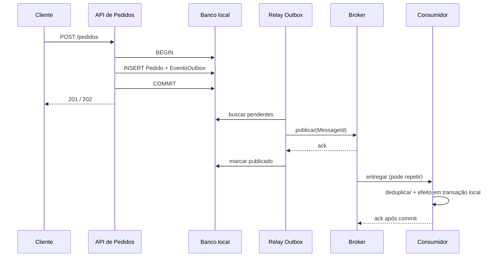
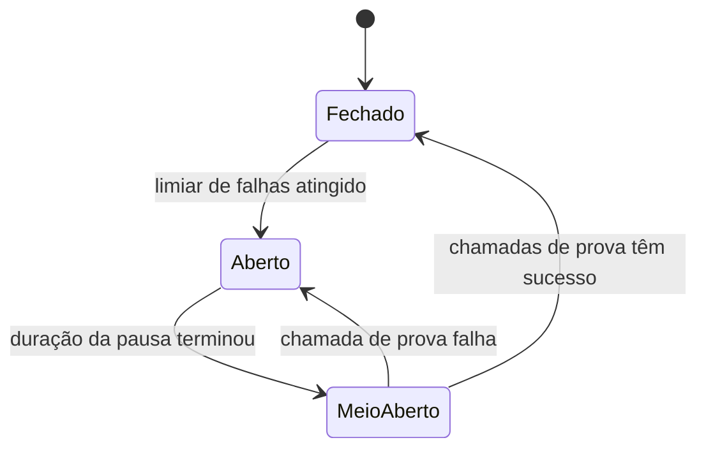

# C16 — Idempotência e entrega confiável

> **Nível:** Avançado
>
> **Objetivo:** eliminar a janela de dual write com Outbox, tolerar duplicidade
> com idempotência e conter dependências degradadas com circuit breaker.
>
> **Pré-requisitos:** [C09 — Fronteiras e concorrência no EF Core](../aplicacoes-e-dados/c09-fronteiras-concorrencia-ef-core.md),
> [C10 — Fundamentos de persistência SQL e NoSQL](../aplicacoes-e-dados/c10-fundamentos-persistencia-sql-nosql.md)
> e [C15 — Comunicação entre serviços e mensageria resiliente](c15-comunicacao-mensageria-resiliente.md).
>
> **Última revisão:** 2026-11-18

Salvar um pedido e publicar seu evento são duas escritas em sistemas diferentes.
Nenhuma ordem remove todas as janelas de falha: salvar primeiro pode perder o
evento; publicar primeiro pode criar um evento para estado que nunca foi
confirmado. Outbox transforma esse dual write em uma transação local e um relay
recuperável. O preço é consistência eventual, duplicidade possível e operação de
uma fila persistida pela aplicação.

## Outbox transacional

Na mesma transação do estado de negócio, a aplicação grava uma linha com
`MessageId`, tipo/versão, payload e instante. Um worker independente busca linhas
pendentes, publica e marca o resultado.



O `CriarPedidoHandler` do laboratório adiciona `Pedido` e `EventoOutbox` ao mesmo
`PedidosDbContext` e chama `SaveChangesAsync` uma vez. Para providers
relacionais, essa chamada é transacional por padrão. Uma aplicação com várias
chamadas deve controlar a transação e compatibilizá-la com a execution strategy
do EF Core.

### A janela que permanece

O relay pode publicar com sucesso e cair antes de marcar `PublicadoEm`. No
reinício ele publica outra vez. Tentar inverter a ordem perde mensagens. Uma
transação distribuída entre banco e broker teria disponibilidade, suporte e
operação próprios; normalmente Outbox aceita **at-least-once** e exige consumidor
idempotente.

Retries do relay devem ser limitados/backoff, mas uma indisponibilidade longa
mantém o registro durável para ciclos posteriores. Concorrência entre workers
exige claim/lease, `SKIP LOCKED` ou atualização otimista para reduzir publicação
simultânea; ainda assim, idempotência é a defesa final.

Ordem estrita pode causar head-of-line blocking: um evento impossível de
publicar impede os seguintes. Em geral, preserve ordem por agregado/chave e
isole falhas permanentes com alerta; ordem global sacrifica vazão e recuperação.

### Payload, evolução, limpeza e retenção

Gravar o evento serializado preserva o fato no instante do commit, mas duplica
dados e exige versionamento. Gravar apenas a identidade e reconstruir depois
pode publicar estado mais novo e perder a semântica original. Escolha consciente
e nunca serialize entidade inteira por conveniência.

Outbox sem retenção cresce indefinidamente e degrada varreduras/índices.
Particione ou indexe pendentes, arquive/remova publicados em lotes e mantenha
prazo suficiente para auditoria e investigação. Não remova pendentes por idade
sem processo explícito. Monitore idade do pendente mais antigo, backlog, taxa,
tentativas e tempo entre ocorrência e publicação.

## Consumidor idempotente

O consumidor do laboratório abre transação, verifica `MensagemProcessada`,
aplica a projeção e grava o identificador antes do commit. A chave primária em
`MessageId` protege corridas; em produção, trate violação única concorrente como
duplicata segura.

```csharp
await using var tx = await db.Database.BeginTransactionAsync(ct);
if (await db.MensagensProcessadas.AnyAsync(x => x.MensagemId == mensagemId, ct))
    return;

// efeito de negócio e registro de deduplicação no mesmo banco/transação
db.MensagensProcessadas.Add(new MensagemProcessada(mensagemId, relogio.GetUtcNow()));
await db.SaveChangesAsync(ct);
await tx.CommitAsync(ct);
```

Se o efeito for um e-mail ou chamada externa, o registro local não torna o
efeito atômico. Use chave idempotente aceita pelo provedor, uma segunda Outbox ou
reconciliação. Chave de deduplicação precisa representar a mesma intenção:
reutilizar `PedidoId` para eventos diferentes descartaria fatos legítimos.

Registros de deduplicação também precisam de retenção. O prazo deve superar a
maior janela possível de redelivery/replay; após a remoção, uma mensagem antiga
pode voltar a produzir efeito. Uma operação naturalmente idempotente, como
`UPDATE ... SET Status = 'Confirmado'` com versão, pode reduzir armazenamento,
mas efeitos incrementais exigem cuidado.

## Circuit breaker

Retry ajuda falhas breves. Quando a falha persiste, repetir consome threads,
conexões e o orçamento da dependência. Circuit breaker mede resultados numa
janela e falha rápido temporariamente.



- **Fechado:** chamadas passam e resultados são medidos.
- **Aberto:** chamadas são rejeitadas rapidamente; não são tentativas ao destino.
- **Meio aberto:** poucas chamadas de prova avaliam recuperação.
- Bibliotecas também podem expor isolamento manual; não o confunda com abertura
  automática por falhas.

O pacote atual `Microsoft.Extensions.Http.Resilience`, já compilado no laboratório
C06–C07, configura retry, circuit breaker e timeouts no handler padrão:

```csharp
clientBuilder.AddStandardResilienceHandler(options =>
{
    options.TotalRequestTimeout.Timeout = TimeSpan.FromSeconds(10);
    options.AttemptTimeout.Timeout = TimeSpan.FromSeconds(3);
    options.Retry.MaxRetryAttempts = 2;
    options.Retry.DisableForUnsafeHttpMethods();
    options.CircuitBreaker.FailureRatio = 0.5;
    options.CircuitBreaker.MinimumThroughput = 20;
    options.CircuitBreaker.SamplingDuration = TimeSpan.FromSeconds(30);
    options.CircuitBreaker.BreakDuration = TimeSpan.FromSeconds(15);
});
```

Valide os limites contra versão do pacote. Timeout por tentativa limita uma
chamada; timeout total inclui retries; retry deve ficar dentro do breaker ou
fora dele conforme o que se deseja contar. A composição padrão oferece uma ordem
testada, mas não substitui orçamento de ponta a ponta.

Falha transitória breve pode merecer retry. Falha persistente deve abrir o
circuito. Erro permanente de validação não deve contar como indisponibilidade.
Um breaker global pode bloquear tenants saudáveis por um endpoint ruim; um por
chave de alta cardinalidade consome memória e dilui amostras. Defina escopo por
dependência/operação com volume suficiente.

Métricas: estado/transições, taxa de falhas, throughput amostrado, chamadas
rejeitadas, duração aberta, probes e resultado final. Limiar baixo oscila e causa
indisponibilidade artificial; `MinimumThroughput` alto nunca abre em serviço de
baixo volume; pausa longa atrasa recuperação; pausa curta martela a dependência.
Circuit breaker não enfileira, não corrige falha e não substitui timeout,
backpressure ou fallback semanticamente seguro.

## Estudo de caso: pedidos sem perda silenciosa

### Cenário e falha

1. `POST /pedidos` chega à API HTTP.
2. A API persiste `Pedido` no banco.
3. Ela tenta publicar `PedidoCriado` para um serviço de notificações.
4. O broker fica indisponível ou o processo cai entre commit e publicação.
5. O pedido existe, mas o consumidor nunca é informado.

Fazer retry dentro da requisição aumenta latência e ainda não cobre queda do
processo. Publicar antes do commit pode notificar um pedido revertido.

### Recuperação controlada

Com Outbox, pedido e intenção de publicar confirmam juntos. A API pode responder
`201 Created` se o recurso já existe localmente ou `202 Accepted` se o contrato
representa processamento ainda pendente; essa é uma decisão HTTP, não do padrão.
O relay tenta depois. Durante indisponibilidade, timeout limita cada envio,
backoff reduz pressão e circuit breaker evita chamadas inúteis; o backlog
permanece observável.

Suponha que o broker aceite a mensagem, mas o ack se perca. O relay não marca a
linha e republica. O serviço consumidor recebe duas cópias com o mesmo
`MessageId`; sua transação de deduplicação aplica uma única notificação/projeção
e confirma ambas com segurança. Isso não é exactly-once universal: é efeito
idempotente dentro da fronteira transacional controlada.

Se a mensagem tiver schema inválido, C15 a encaminha à DLQ em vez de repetir.
Após correção, replay preserva a identidade. Se a Outbox acumular, a equipe mede
idade/backlog, restaura o broker, controla taxa do relay e só então limpa linhas
publicadas conforme retenção.

Não há Saga nesse cenário: há uma transação local e entrega de um fato para um
consumidor. Saga só se justifica se Pedido, Estoque e Pagamento executarem
transações locais distintas como um único processo de negócio de longa duração.

## Limitações e quando evitar

Outbox custa tabela/coleção, serialização, worker, polling ou change feed,
limpeza, versionamento e monitoramento. Evite se o efeito não precisa sobreviver
a falha, se tudo está na mesma transação/banco ou se a plataforma já fornece uma
primitiva equivalente compreendida pela equipe.

Não use circuit breaker em acesso local barato nem com amostra insuficiente. Não
envolva gravação não idempotente em retry automático. Não trate fallback stale
como dado atual sem comunicar semântica.

## Laboratório e testes

O laboratório usa EF Core 10 com SQLite em memória. Os testes demonstram estado
e Outbox atômicos, falha de publicação mantendo pendência e duplicata produzindo
um único efeito:

```bash
dotnet test exemplos/c13-c17-arquitetura/C13C17.Arquitetura.Tests.csproj
dotnet test exemplos/c06-c07-aspnet-core/C06C07.AspNetCore.Tests.csproj
```

Ele não prova locking concorrente do provider de produção nem semântica de um
broker real. Por limitação do SQLite com `DateTimeOffset`, ordena o lote carregado
em memória; produção deve paginar e ordenar no banco com tipo suportado. Um teste
de integração deve derrubar o relay depois do publish e antes da marcação,
executar dois workers e validar migração/índices.

## Relação com outros capítulos

- [C07](../aplicacoes-e-dados/c07-apis-http-integracoes-resilientes.md) é
  canônico para HTTP, timeout e pipeline oficial de resiliência.
- [C09](../aplicacoes-e-dados/c09-fronteiras-concorrencia-ef-core.md) e
  [C10](../aplicacoes-e-dados/c10-fundamentos-persistencia-sql-nosql.md) cobrem
  transações, locks e garantias de persistência.
- [C15](c15-comunicacao-mensageria-resiliente.md) cobre retry, poison message,
  DLQ, replay e ordenação; [C17](c17-consistencia-eventual-sagas.md) cobre
  processos distribuídos com compensações.

## Referências

- [Transactional Outbox with Azure Cosmos DB](https://learn.microsoft.com/azure/architecture/databases/guide/transactional-out-box-cosmos)
  — Azure Architecture Center, dual write, relay, duplicidade e ordem, acesso em
  18 novembro 2026.
- [EF Core transactions](https://learn.microsoft.com/ef/core/saving/transactions)
  — documentação EF Core, transação de `SaveChanges` e execution strategies,
  acesso em 18 novembro 2026.
- [Introduction to resilient app development](https://learn.microsoft.com/dotnet/core/resilience/)
  — documentação .NET, pipelines, retry, timeout e circuit breaker, acesso em 18
  novembro 2026.
- [HTTP resilience](https://learn.microsoft.com/dotnet/core/resilience/http-resilience)
  — documentação .NET, handler padrão e riscos de retry em métodos inseguros,
  acesso em 18 novembro 2026.
- [Duplicate detection](https://learn.microsoft.com/azure/service-bus-messaging/duplicate-detection)
  — documentação Azure Service Bus; deduplicação do broker é limitada por janela
  e não substitui consumidor idempotente, acesso em 18 novembro 2026.
