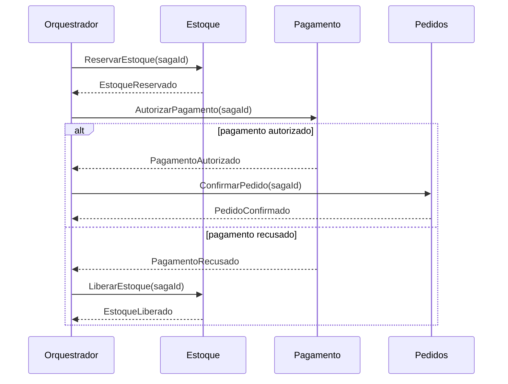

# C17 — Consistência eventual e sagas

> **Nível:** Avançado
>
> **Objetivo:** coordenar transações locais de um processo distribuído e tratar
> falhas parciais sem chamar compensação de rollback.
>
> **Pré-requisitos:** [C11 — Entidades, value objects e agregados](../dominio-e-arquitetura/c11-entidades-value-objects-agregados.md)
> e [C16 — Idempotência e entrega confiável](c16-idempotencia-entrega-confiavel.md).
>
> **Última revisão:** 2026-11-18

Uma Saga coordena uma sequência de transações locais que, juntas, realizam um
processo de negócio distribuído. Se um passo não pode prosseguir, novas
transações compensatórias tentam reduzir ou neutralizar efeitos anteriores. Elas
não restauram o tempo, não apagam observações externas e podem falhar.

## Quando existe uma transação distribuída de negócio

Criar Pedido no banco local e publicar seu evento via Outbox não exige Saga: o
commit local encerra a transação do pedido; a mensagem propaga um fato. Saga
passa a ser candidata quando confirmar o pedido exige reservar Estoque e
autorizar Pagamento, cada qual proprietário de banco e invariantes próprios, e o
negócio precisa acompanhar o resultado conjunto.

Evite transação distribuída criando primeiro um limite coeso. Se os dados podem
estar no mesmo serviço/banco e precisam mudar atomicamente, uma transação ACID é
mais simples. Saga não corrige decomposição que separou operações fortemente
acopladas.

## Orquestração

Um orquestrador persiste o estado do processo, envia comandos, recebe resultados
e decide o próximo passo. O fluxo é explícito e observável, mas o orquestrador
pode concentrar conhecimento demais.



Cada comando e resposta precisa de `SagaId`, identidade idempotente e
correlação. O estado `EstoqueReservado` deve ser confirmado no armazenamento do
orquestrador antes de avançar, idealmente com Inbox/Outbox locais para sobreviver
a quedas.

## Coreografia

Na coreografia, serviços reagem a eventos e emitem os próximos sem coordenador
central. Há menor controle central e serviços podem permanecer autônomos. Porém o
fluxo de negócio fica distribuído entre subscriptions, ordem e contratos; saber
“onde a saga parou” exige correlação e visão agregada.

Coreografia funciona para poucos passos, dependências claras e reações que já
são fatos independentes. Quando condicionais, timeouts e compensações crescem,
orquestração costuma tornar o estado explícito. Não misture os estilos sem
definir quem decide cada transição.

## Compensação não é rollback

Rollback ocorre antes do commit e restaura atomicamente o estado daquela
transação. Compensação é outra transação, executada depois que o primeiro efeito
já foi durável e possivelmente observado.

- estornar pagamento não apaga uma cobrança do extrato;
- liberar estoque pode falhar ou não recuperar uma venda perdida;
- e-mail enviado não pode ser “desenviado”;
- preço/câmbio pode ter mudado antes da ação inversa.

Modele compensações semânticas e idempotentes. Algumas etapas são compensáveis,
outras reexecutáveis, e uma etapa pivot marca o ponto após o qual o fluxo precisa
seguir adiante em vez de desfazer. Uma falha de compensação deve virar estado
persistido com retry seguro ou intervenção manual, não exceção perdida.

## Estado, concorrência e falhas parciais

O laboratório representa `SagaPedido` com estados `Iniciada`,
`EstoqueReservado`, `PagamentoAutorizado`, `Concluida`, `Compensando`,
`Compensada` e `FalhaManual`. A máquina rejeita transições inválidas e mantém o
último erro. Em produção, persista também versão otimista, timestamps, passos,
tentativas e deadlines.

Resultados podem chegar duplicados, atrasados ou fora de ordem. Use identificador
do comando para idempotência e versão do estado para concorrência. Timeout não
prova falha: o serviço remoto pode ter concluído e perdido a resposta. Antes de
compensar, consulte/reconcilie quando o contrato permitir; senão, ambos os lados
devem aceitar comandos idempotentes que convirjam.

Outbox resolve envio confiável de cada participante; Inbox/deduplicação resolve
redelivery. Nenhum deles decide a política de compensação — essa é regra do
processo.

## Observabilidade e operação

Métricas úteis incluem sagas por estado/idade, duração por passo, timeouts,
retries, compensações, falhas manuais e comandos sem resposta. Traces carregam
`SagaId`, `PedidoId`, `MessageId` e causação sem colocar dados sensíveis em tags
de alta cardinalidade inadequadas para métricas.

Um painel precisa distinguir “aguardando dentro do prazo”, “degradada em retry”,
“compensando” e “requer ação”. Runbooks devem permitir consultar histórico,
reenviar comando idempotente, confirmar estado remoto e resolver manualmente com
auditoria. Alterações de versão precisam preservar instâncias antigas em curso.

## Custos e quando evitar

Saga traz máquina de estados, persistência, timers, mensagens, idempotência,
compensações, reconciliação, testes de falha e suporte humano. É complexidade
excessiva quando:

- há apenas uma transação local e notificação eventual;
- um único serviço pode possuir a invariante;
- o fluxo pode falhar inteiro antes de qualquer commit externo;
- compensações não têm significado ou risco aceitável;
- a equipe não consegue observar e operar instâncias presas.

Para dois passos simples, um application service síncrono com timeout e
reconciliação pode bastar, desde que a falha parcial seja tratada. Para processos
longos e críticos, engine de workflow pode oferecer timers e persistência, mas
introduz plataforma e modelo próprios. Compare build versus buy e portabilidade.

## Como testar

Além do caminho feliz, injete queda antes/depois de cada commit e publish,
mensagem duplicada/fora de ordem, timeout com sucesso remoto, compensação falha,
reinício do orquestrador e concorrência sobre a mesma saga. Teste upgrade com
instâncias antigas e runbook de intervenção.

O laboratório verifica que compensação pode falhar e leva a `FalhaManual`:

```bash
dotnet test exemplos/c13-c17-arquitetura/C13C17.Arquitetura.Tests.csproj
```

A máquina em memória é didática; não demonstra durabilidade, broker ou timers.

## Relação com outros capítulos

- [C11](../dominio-e-arquitetura/c11-entidades-value-objects-agregados.md)
  define limites e invariantes locais; [C12](../dominio-e-arquitetura/c12-servicos-dominio-integracao-modelos.md)
  separa orquestração e política.
- [C15](c15-comunicacao-mensageria-resiliente.md) cobre retries, DLQ e ordenação;
  [C16](c16-idempotencia-entrega-confiavel.md) cobre Outbox e idempotência.
- [C10](../aplicacoes-e-dados/c10-fundamentos-persistencia-sql-nosql.md) é
  canônico para transações ACID e consistência.

## Referências

- [Saga distributed transactions pattern](https://learn.microsoft.com/azure/architecture/patterns/saga)
  — Azure Architecture Center, transações locais, compensações, pivot e estilos,
  acesso em 18 novembro 2026.
- [Data consistency primer](https://learn.microsoft.com/azure/architecture/data-guide/relational-data/data-consistency)
  — Azure Architecture Center, modelos de consistência, acesso em 18 novembro
  2026.
