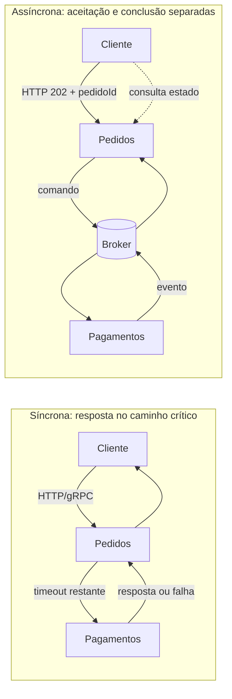
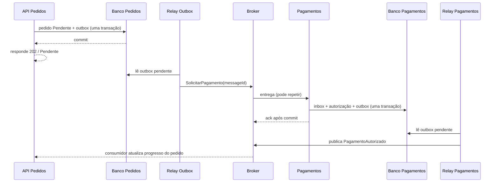
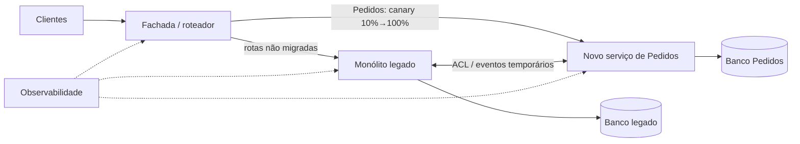

# C18 — Limites de microserviços e evolução de monólitos

> **Nível:** Avançado
>
> **Objetivo:** avaliar quando limites de serviço produzem autonomia real e
> evoluir um sistema sem trocar um monólito modular por um monólito distribuído.
>
> **Pré-requisitos:** [C12 — Serviços de domínio e integração entre modelos](../dominio-e-arquitetura/c12-servicos-dominio-integracao-modelos.md),
> [C13 — Dependências, abstrações e padrões com propósito](../dominio-e-arquitetura/c13-dependencias-abstracoes-padroes.md),
> [C15 — Comunicação entre serviços e mensageria resiliente](c15-comunicacao-mensageria-resiliente.md),
> [C16 — Idempotência e entrega confiável](c16-idempotencia-entrega-confiavel.md)
> e [C17 — Consistência eventual e sagas](c17-consistencia-eventual-sagas.md).
>
> **Última revisão:** 2026-11-18

Microserviços trocam chamadas locais e transações únicas por rede, contratos,
falhas parciais e operação de vários componentes. Essa troca pode permitir que
capacidades de negócio evoluam e sejam implantadas de forma independente. Ela
não é uma evolução obrigatória do monólito, não corrige limites de domínio
incertos e não torna uma organização autônoma por decreto.

Este capítulo aplica comunicação, idempotência, Outbox e Saga a um sistema de
pedidos. Os mecanismos canônicos permanecem nos C15–C17; aqui interessam suas
consequências para limites, operação, diagnóstico e migração.

## Um limite de serviço é uma decisão econômica

Um microserviço possui uma responsabilidade coerente, controla seu modelo e
seus dados e expõe contratos para colaborar. “Pequeno” não define um limite. O
critério é se uma capacidade pode ser entendida, alterada, implantada e operada
sem coordenação constante com outras.

No sistema de pedidos, três limites candidatos têm razões próprias para mudar:

| Capacidade | Decisões e invariantes locais | Dados sob autoridade |
| --- | --- | --- |
| Pedidos | total aceito, estados permitidos, confirmação única | pedido e progresso do processo |
| Pagamentos | autorização única por intenção, recusa, estorno | tentativa, autorização e ledger |
| Estoque | saldo não negativo, reserva e liberação únicas | item, saldo e reserva |

Separá-los pode ser justificável quando equipes, escala, risco regulatório ou
cadência de mudança também diferem. Se cada alteração ainda exige modificar e
implantar os três, o desenho criou distribuição sem autonomia.

### Coesão, acoplamento e capacidade de negócio

Alta coesão mantém juntos dados e regras que mudam pelo mesmo motivo. Baixo
acoplamento permite alterar um lado sem conhecer sua implementação. A quantidade
de endpoints não mede nenhum dos dois. Sinais de uma fronteira ruim incluem:

- conversas síncronas muito frequentes para concluir uma operação elementar;
- joins entre bancos ou leitura direta de tabelas alheias;
- vocabulário e objetos compartilhados como modelo universal;
- releases coordenados para mudanças rotineiras;
- transações distribuídas usadas para recompor uma invariante que foi separada.

Organize por capacidades como “autorizar pagamento”, não por camadas como
“serviço de controllers” e “serviço de persistência”. Um *bounded context* pode
orientar a descoberta, mas não determina mecanicamente um processo por contexto:
um limite lógico pode começar como módulo e só virar serviço quando houver
benefício operacional demonstrável.

### Autonomia e independência de deploy

Independência de deploy exige mais do que pipelines separados:

- propriedade exclusiva dos dados e migrations compatíveis;
- contratos retrocompatíveis durante a convivência de versões;
- capacidade de testar consumidores e produtores sem release conjunto;
- orçamento de disponibilidade e latência que suporte dependências;
- equipe com autoridade e responsabilidade operacional pelo serviço.

Autonomia não significa isolamento. Contratos, identidade, segurança e
telemetria exigem padrões mínimos. A plataforma deve reduzir trabalho repetido
sem transformar uma biblioteca compartilhada ou um gateway central em ponto de
coordenação para toda mudança.

## Monólito modular antes de distribuição

Um monólito modular preserva chamadas locais e transação ACID, mas impõe módulos
com APIs internas explícitas, propriedade de dados e dependências verificáveis.
É frequentemente a opção de menor risco quando o domínio ainda muda, a equipe é
pequena, a escala cabe em um processo ou a operação não sustenta dezenas de
unidades implantáveis.

Um **monólito distribuído** tem vários processos, porém mantém acoplamento de um
único programa: banco compartilhado, chamadas em cadeia, contratos frágeis e
deploys coordenados. Ele acumula custo de rede sem obter autonomia. Antes de
extrair, meça frequência de mudança conjunta, tráfego entre módulos, ownership,
latência aceitável e invariantes. Se a maioria aponta para união, mantenha a
capacidade no mesmo processo.

Custos adicionais de microserviços incluem descoberta e balanceamento,
certificados e autorização entre serviços, broker, bancos, pipelines,
compatibilidade, telemetria, ambientes, capacidade ociosa, resposta a incidentes
e conhecimento para operar tudo isso. “Escalar partes diferentes” só compensa
quando a diferença existe e seu custo supera a complexidade introduzida.

## Comunicação síncrona e assíncrona

Escolha o estilo pela necessidade do fluxo, não pela tecnologia disponível. Se
o chamador precisa da resposta agora para decidir, a comunicação síncrona pode
ser honesta, mas cria **acoplamento temporal**: chamador e chamado precisam estar
disponíveis ao mesmo tempo. Se transmite uma intenção que pode terminar depois
ou um fato para consumidores independentes, a mensagem assíncrona pode separar
disponibilidade e ritmo.



### HTTP, REST e gRPC

HTTP oferece semântica padronizada de métodos, status, headers e cache. REST é
um estilo arquitetural sobre recursos e representações, não sinônimo de “JSON
via HTTP”. Modele recursos e use a semântica do protocolo; não esconda comandos
mutáveis em `GET`. Um `POST` pode ser repetido pela rede ou pelo usuário e
precisa de política explícita quando seu efeito não é naturalmente idempotente.

gRPC define operações e mensagens tipadas, normalmente com Protocol Buffers,
e suporta streaming. É útil para comunicação interna com contratos rigorosos e
clientes gerados, mas não remove falhas de rede. Configure deadlines: por padrão,
um cliente gRPC pode aguardar indefinidamente. Propague o orçamento restante e
o cancelamento; uma deadline expirada não desfaz efeitos já confirmados no
servidor.

Uma cadeia `API → Pedidos → Pagamentos → Antifraude → Banco` soma latências e
probabilidades de falha. Se cada dependência tem 99,9% de disponibilidade
independente, quatro dependências obrigatórias em série oferecem no máximo cerca
de 99,6% antes de considerar a própria API. Isso é ilustração matemática, não
SLO medido: falhas correlacionadas podem tornar o resultado pior.

Defina timeouts por orçamento ponta a ponta, não um valor completo em cada salto.
Cancelar trabalho sem interesse conserva recursos; não pressupõe rollback.
Retries em várias camadas multiplicam carga e podem produzir uma *retry storm*.
Escolha uma camada responsável, limite tentativas, aplique backoff com jitter e
repita apenas operações cuja reexecução seja segura.

### Contratos e convivência de versões

Contrato inclui schema, semântica, erros, autorização, ordenação, idempotência e
expectativas de tempo — não apenas DTO. Evolução segura costuma:

- adicionar campos opcionais e tolerar campos desconhecidos;
- preservar significado de campos existentes;
- fazer produtor e consumidor conviverem em versões diferentes;
- usar *expand-migrate-contract* para dados e APIs;
- validar compatibilidade no pipeline e observar uso antes de remover;
- versionar apenas quando a mudança incompatível for realmente necessária.

Campos opcionais sem semântica de ausência continuam incompatíveis. Um enum novo
pode quebrar consumidor que assume conjunto fechado. Em Protobuf, não reutilize
números de campos removidos. Em eventos, retenção e replay prolongam a vida das
versões: o consumidor atualizado pode receber mensagem antiga meses depois.

## Mensagens, comandos e eventos

Um **comando** pede que um destinatário execute uma ação e pode ser recusado:
`SolicitarPagamento`. Um **evento** afirma algo que já aconteceu:
`PagamentoAutorizado`. Nomear um desejo como evento esconde ownership; nomear um
fato como comando centraliza coordenação.

Filas normalmente distribuem cada mensagem entre consumidores concorrentes de
uma assinatura. Pub/Sub entrega o mesmo fato a assinaturas independentes. O
broker fornece armazenamento e entrega conforme configuração, mas não decide se
o efeito de negócio é correto.

Em arquitetura orientada a eventos, consumidores independentes podem reagir sem
o produtor conhecer cada um. O preço é fluxo menos visível, contratos de longa
vida e consistência ao longo do tempo. Use envelope com `messageId`, tipo,
versão, instante, correlação e causação; padronizações como CloudEvents podem
ajudar interoperabilidade, sem substituir o contrato do payload.

### Entrega, ordenação e particionamento

Na prática, escolha explicitamente qual risco aceita:

| Semântica observável | Consequência | Proteção necessária |
| --- | --- | --- |
| no máximo uma vez | pode perder, não redeliver | aceitar perda ou reconciliar na origem |
| pelo menos uma vez | pode duplicar | consumidor idempotente |
| “exactly-once” do broker | escopo limitado ao produto/transação | ainda provar efeito externo e fronteiras |

Não prometa exactly-once ponta a ponta quando broker e banco confirmam em
transações diferentes. Uma garantia pode ser exatamente uma gravação no log do
broker e ainda haver duas cobranças externas após timeout.

Ordenação global reduz paralelismo e raramente corresponde à invariante. Use
chave de partição como `PedidoId` quando a ordem por agregado basta. Mesmo assim,
redelivery, múltiplos produtores, DLQ e replay exigem versão/sequence e política
para lacunas. Reparticionar altera distribuição e pode afetar ordem e hot keys.

Retentativa deve distinguir falha transitória, mensagem inválida, rejeição de
negócio e indisponibilidade prolongada. Consumidores precisam de concorrência
limitada, backpressure, DLQ operada e replay com a mesma identidade. O
[C15](c15-comunicacao-mensageria-resiliente.md) detalha esses mecanismos.

## Consistência eventual com invariantes explícitas

Transações distribuídas com coordenador podem existir em ambientes controlados,
mas aumentam acoplamento de disponibilidade, locks e complexidade operacional;
nem todos os bancos, brokers ou APIs externas participam. Não as adote como
solução padrão para limites mal escolhidos.

O **dual write** ocorre quando o processo grava seu banco e publica diretamente
no broker. Uma queda entre as operações perde a mensagem ou publica sem o estado
correspondente. Outbox torna estado e intenção de publicação atômicos no banco
local; um relay publica depois. Inbox registra recepção e efeito na transação do
consumidor. Esses padrões reduzem janelas, mas redelivery e reconciliação
continuam necessários.



Consistência eventual não é ausência de consistência. Ela define quais
invariantes são imediatas dentro de cada autoridade e como o sistema converge
entre autoridades. Estoque nunca negativo é local ao Estoque; autorização única
por intenção é local a Pagamentos; “pedido confirmado somente com pagamento e
reserva” é preservada pela máquina de estados do processo. Durante a convergência,
o pedido exibe um estado intermediário verdadeiro, não uma confirmação otimista.

Disponibilidade e consistência são dimensões diferentes. Aceitar a criação de um
pedido enquanto Pagamentos está indisponível aumenta disponibilidade da entrada,
mas atrasa a decisão. Recusar imediatamente pode oferecer resposta mais atual,
mas reduz disponibilidade. A escolha depende de prazo, risco e expectativa do
usuário.

Reprocessamento é operação normal, não exceção. Mantenha mensagem original,
identidade, versão e histórico de tentativas. Reconciliação compara autoridades
— por exemplo, pedidos `PagamentoPendente` antigos contra autorizações — e emite
comandos idempotentes ou abre intervenção auditada. Ela detecta perdas que retry
sozinho não detecta.

Na experiência do usuário, use estados como `AguardandoPagamento`, prazo e ação
possível. Notificação assíncrona e consulta por `PedidoId` evitam spinner longo.
Não apresente “erro” quando a conclusão é desconhecida; “ainda processando” e
“não foi possível confirmar” têm consequências diferentes.

## Idempotência como propriedade de negócio

Idempotência significa que repetir a mesma intenção não repete o efeito de
negócio. Em APIs, uma `Idempotency-Key` identifica a intenção, não a conexão.
Associe a chave ao cliente/escopo, hash do payload, estado e resultado. A mesma
chave com payload diferente deve ser rejeitada; requisição concorrente precisa
de decisão explícita (`em processamento`, espera ou conflito).

```mermaid
sequenceDiagram
    participant C as Cliente/Broker
    participant S as Serviço
    participant DB as Banco local
    C->>S: mensagem M / idempotency-key K
    S->>DB: BEGIN; INSERT inbox(K) UNIQUE
    alt primeira execução
        DB-->>S: inseriu
        S->>DB: aplica efeito de negócio
        S->>DB: COMMIT
        S-->>C: resultado/ack
    else duplicata
        DB-->>S: conflito ou 0 linhas
        S->>DB: lê resultado anterior
        S-->>C: mesmo resultado/ack sem novo efeito
    end
```

Consumidores usam `MessageId` ou uma chave de negócio estável. A deduplicação e
o efeito devem compartilhar a transação local; “consultar, executar, registrar”
tem corrida entre consumidores. Uma restrição `UNIQUE` arbitra concorrência no
banco. Para efeitos externos, grave a intenção local antes e projete um protocolo
idempotente com o provedor; a Inbox não desfaz uma cobrança já realizada fora da
transação.

Chaves não podem crescer para sempre. A expiração deve superar todos os prazos
de retry, retenção, replay e disputa, ou uma duplicata antiga volta a parecer
nova. Para dinheiro, uma chave de negócio durável pode ser melhor que TTL. Cache
sozinho é insuficiente: pode evictar, expirar, reiniciar, sofrer concorrência e
não participa da transação do efeito. Use-o como otimização após uma fonte de
verdade durável, não como garantia exclusiva.

## Diagnóstico distribuído

Um **Correlation ID** agrupa uma jornada de negócio escolhida pela aplicação. Um
**Trace ID** identifica um trace técnico; cada operação tem seu `SpanId`. Eles podem
coincidir em fluxos curtos, mas pedidos longos podem atravessar múltiplos traces
e continuar ligados por `PedidoId`, `SagaId`, `MessageId` e links de trace.

Propague o contexto W3C `traceparent`/`tracestate` em HTTP, gRPC e metadados de
mensagem. Não confie em payload de negócio para isso. OpenTelemetry padroniza
instrumentação e exportação de traces, métricas e logs; não é backend de
armazenamento nem elimina a necessidade de modelar bons atributos.


Logs estruturados devem registrar campos consultáveis (`service.name`, ambiente,
estado, tentativa, `trace_id`, `span_id`, IDs de negócio permitidos), sem dados
sensíveis. Métricas mostram amplitude e tendência: taxa, erro, duração,
saturação, backlog e idade da mensagem. Traces reconstroem amostras do caminho e
localizam o tempo. Logs explicam eventos discretos. Um sinal complementa o outro.

Logs centralizados sem correlação formam uma coleção de linhas, não uma jornada.
Busca por timestamp falha com concorrência, relógios, buffers e processamento
assíncrono. Sampling também limita reconstrução: preserve traces de erro ou use
política informada pelo risco, consciente de custo e privacidade. Não use IDs de
alta cardinalidade como dimensões irrestritas de métricas.

Na investigação, comece pelo sintoma e intervalo, encontre o identificador,
percorra relações pai/filho e links, compare duração com métricas de dependência
e só então leia logs dos spans anormais. Um trace lento isolado não prova a causa;
correlacione com saturação, locks, deploy e backlog.

## Estudo de caso: pedido, pagamento e estoque

Considere API de Pedidos, Pagamentos, Estoque, broker e um banco exclusivo por
serviço. As invariantes orientam o fluxo:

1. Pedidos aceita `CriarPedido` com chave idempotente e persiste
   `AguardandoPagamento` mais Outbox local. Responde com identidade e estado.
2. O broker entrega `SolicitarPagamento`; Pagamentos deduplica e autoriza uma
   vez por `PedidoId`/intenção. Publica `PagamentoAutorizado` ou
   `PagamentoRejeitado` por sua Outbox.
3. Em autorização, o processo pede `ReservarEstoque`. Estoque garante saldo não
   negativo e uma reserva por pedido, mesmo sob concorrência.
4. Em reserva confirmada, Pedidos transita para `Confirmado` e publica
   `PedidoConfirmado`. Em falta, inicia compensação semântica de pagamento e
   mantém estado `Compensando` até resultado comprovado.
5. Em rejeição de pagamento, o pedido termina `Rejeitado`; estoque nem é tocado.

O C17 explica a Saga. A decisão relevante aqui é não distribuir uma invariante
sem dono: Pagamentos decide autorização, Estoque decide disponibilidade e
Pedidos decide quando o conjunto permite confirmar.

### Falhas parciais e estado desconhecido

Se Pagamentos confirma no banco e cai antes do ack, o broker redelivera. Inbox e
chave da autorização retornam o resultado sem nova cobrança. Se o evento de
autorização não chega, a Outbox continua pendente; alerta por idade e
reconciliação cobrem falhas persistentes.

Se a reserva falha por falta real, compensar significa solicitar estorno, não
rollback global. Se o estorno dá timeout, o resultado é desconhecido: não marque
automaticamente `Compensado`. Reconsulte por chave ou aguarde evento; após prazo,
encaminhe a intervenção manual. Compensação também é idempotente e pode falhar.

Mensagens podem duplicar em qualquer seta. Cada serviço deduplica localmente e
transições repetidas retornam o estado já alcançado. Eventos fora de ordem usam
versão do pedido; um evento futuro pode ser adiado/DLQ, e um antigo ignorado com
registro observável. Não use timestamp como prova de causalidade.

Publicar `PedidoConfirmado` somente após o estado local correspondente preserva
a verdade do evento. Consumidores independentes, como notificação e analytics,
não entram no caminho crítico e possuem suas próprias assinaturas, retries e
deduplicação.

Para investigar P-42, procure `PedidoId`/correlação no serviço de Pedidos,
obtenha `TraceId` e `MessageId`, siga spans `producer`/`consumer`, confirme
Outbox/Inbox e compare com backlog, idade, retries e DLQ. A linha do tempo deve
distinguir “publicado”, “entregue”, “commitado” e “acknowledged”; um log
“processando” não prova efeito durável.

### Matriz de decisão do fluxo

| Situação | Estado honesto | Ação automática segura | Evidência necessária |
| --- | --- | --- | --- |
| pagamento recusado | `Rejeitado` | finalizar | resultado durável de Pagamentos |
| timeout após solicitar pagamento | `AguardandoPagamento` | reentrega/reconciliação | consulta pela mesma chave |
| estoque insuficiente após autorização | `Compensando` | solicitar estorno idempotente | reserva rejeitada durável |
| estorno com timeout | `Compensando` | consultar/repetir com mesma chave | resultado do provedor |
| mensagem duplicada | estado inalterado | responder/ack | Inbox ou chave de negócio |
| mensagem inválida | estado anterior | DLQ, sem retry cego | erro de contrato e payload original |

## Strangler Fig: modernização incremental

Strangler Fig introduz uma fachada que encaminha capacidades ainda legadas ao
monólito e capacidades migradas ao novo componente. A unidade de migração é uma
capacidade observável, não uma tabela isolada. O objetivo pode ser um módulo novo
dentro do monólito; microserviço não é obrigatório.



Um percurso seguro:

1. caracterize comportamento, tráfego, invariantes e dependências da capacidade;
2. crie uma fronteira e Anti-Corruption Layer antes de mover código;
3. defina fonte de verdade e estratégia de dados para cada fase;
4. introduza roteamento por operação, tenant ou percentual com rollback;
5. compare resultados, erros, latência e divergências;
6. transfira escrita e depois leitura, quando compatibilidade permitir;
7. remova chamadas e dados legados comprovadamente sem uso.

Migração de dados é a parte mais arriscada. Dual write ingênuo cria divergência.
Prefira snapshot mais Change Data Capture/eventos, escrita por uma única
autoridade e reconciliação. Se houver coexistência, documente quem é fonte de
verdade e como conflitos convergem. *Expand-migrate-contract* permite que
versões antigas e novas convivam.

Dependências compartilhadas prolongam o estrangulamento: banco, stored procedure,
biblioteca de domínio ou release comum podem manter o novo serviço preso ao
legado. Trate cada dependência como dívida temporária com owner, métrica e critério
de remoção. Sem isso, a fachada vira arquitetura permanente e mais complexa.

Observe taxa roteada, equivalência funcional, divergência de dados, erros e
latência por caminho. Correlation/Trace ID deve atravessar fachada, legado e novo
serviço. Canary reduz raio de impacto, mas só há rollback seguro enquanto dados e
contratos continuam compatíveis. A migração incremental evita um *big bang*;
não elimina planejamento nem custo de coexistência.

## Anti-patterns e seus sintomas

| Anti-pattern | Sintoma observável | Correção de limite |
| --- | --- | --- |
| monólito distribuído | release coordenado e indisponibilidade em cascata | reagrupar capacidade ou desacoplar contrato/dados |
| síncrono em excesso | cauda de latência e timeout em cadeia | remover dependência do caminho crítico ou assíncrono honesto |
| banco compartilhado | migrations e joins atravessam ownership | API/evento e migração gradual de autoridade |
| acoplamento de deploy | produtor só funciona com consumidor novo | evolução aditiva e testes de compatibilidade |
| eventos sem contrato | consumidores interpretam fatos de modo diferente | schema, semântica, owner, versão e catálogo |
| ausência de observabilidade | incidente reproduzido por suposição | instrumentação e correlação antes da extração |
| retry storm | pico de falha aumenta QPS e duração | orçamento único, backoff/jitter, limites e circuit breaker |
| concorrência sem controle | saldo negativo, dupla autorização, lost update | constraint, versão, lock/serialização no owner |
| complexidade operacional gratuita | mais plantão e custo sem lead time melhor | monólito modular e extração baseada em evidência |

Circuit breaker protege recursos diante de falha persistente, mas não garante
correção do efeito nem substitui timeout. Cache não corrige ownership. Service
mesh pode aplicar transporte e telemetria, mas não conhece idempotência ou
invariantes. Ferramenta operacional não repara um limite de negócio ruim.

## Exemplos C# verificáveis

O laboratório em `exemplos/c18-microservicos/` contém exemplos conceituais
compiláveis:

- `IPublicadorEventos` torna a publicação e o `CancellationToken` explícitos;
- `ConsumidorPedidoCriado` usa Inbox, `PRIMARY KEY` e efeito na mesma transação;
- `RetryControlado` repete somente falha classificada, com limite e cancelamento;
- `ContextoTrace` injeta e extrai `traceparent`/`tracestate` com `Activity`.

O contrato de publicação permanece pequeno:

```csharp
public interface IPublicadorEventos
{
    Task PublicarAsync<TEvento>(TEvento evento, CancellationToken cancellationToken)
        where TEvento : IEventoIntegracao;
}
```

Uma abstração explícita permite testar intenção e cancelamento, mas **não** torna
o envio atômico com o banco. Em produção, a implementação normalmente grava uma
Outbox na transação local e um relay instrumentado conversa com o broker. O
exemplo não inclui broker e não valida locks, particionamento ou redelivery real.

O consumidor usa SQLite real em memória para verificar constraint e transação.
Isso prova deduplicação sequencial no banco usado pelo teste; produção precisa
testar concorrência, nível de isolamento, queda antes/depois de commit e replay
no banco e broker escolhidos. `DateTimeOffset.UtcNow` seria substituído por
`TimeProvider` e a política de retenção da Inbox seria explícita.

`ContextoTrace` demonstra W3C Trace Context sem coletor. Uma implementação de
produção configura OpenTelemetry, propagadores, sampling, exportação, atributos
semânticos e proteção de dados. O retry didático recebe atrasos determinísticos;
produção adiciona jitter, orçamento total, métricas e integração com a política
do cliente/broker, evitando retries sobrepostos.

### Como executar

O SDK está fixado pelo `global.json`. O único recurso externo do laboratório é o
SQLite embutido; não há broker ou container.

```bash
dotnet restore exemplos/EngenhariaDotnet.slnx
dotnet build exemplos/EngenhariaDotnet.slnx --no-restore
dotnet test exemplos/c18-microservicos/C18.Microservicos.Tests.csproj --no-build
```

## Critérios de decisão

Microserviços são candidatos quando capacidades estáveis precisam de cadência,
escala, isolamento de falha ou controles diferentes; há equipes responsáveis de
ponta a ponta; contratos toleram evolução; e a organização consegue observar e
operar falhas parciais.

Evite ou adie quando o domínio ainda não revelou limites, transações locais são
centrais, a equipe e o tráfego são pequenos, deploy independente não ocorre na
prática, ou broker/telemetria/on-call seriam novos riscos maiores que o problema.
Comece com monólito modular, meça atrito e extraia pela fronteira que já provou
necessidade.

Antes de aprovar uma extração, responda:

- qual capacidade e quais invariantes terão um único owner?
- qual mudança ficará realmente independente?
- qual dependência sai do caminho crítico e qual entra?
- qual estado intermediário o usuário verá?
- como duplicidade, perda, atraso e ordem serão detectados e tratados?
- como versões coexistirão e dados serão migrados?
- quais SLIs, traces, alertas e runbooks existirão antes do corte?
- qual alternativa modular mais simples foi descartada e por quê?

## Relação com outros capítulos

- [C12](../dominio-e-arquitetura/c12-servicos-dominio-integracao-modelos.md)
  cobre integração de modelos e Anti-Corruption Layer; [C13](../dominio-e-arquitetura/c13-dependencias-abstracoes-padroes.md)
  trata custo de abstrações.
- [C15](c15-comunicacao-mensageria-resiliente.md) é canônico para retries, DLQ,
  ordering e broker; [C16](c16-idempotencia-entrega-confiavel.md) para
  idempotência, Inbox/Outbox e entrega; [C17](c17-consistencia-eventual-sagas.md)
  para coordenação e compensação.
- [C07](../aplicacoes-e-dados/c07-apis-http-integracoes-resilientes.md) detalha
  contratos HTTP, timeout e resiliência; [C10](../aplicacoes-e-dados/c10-fundamentos-persistencia-sql-nosql.md)
  é canônico para transações e consistência local.
- C27 — Telemetria e diagnóstico distribuído aprofundará instrumentação,
  cardinalidade e proteção de dados quando publicado.

## Referências

- [Use domain analysis to model microservices](https://learn.microsoft.com/azure/architecture/microservices/model/domain-analysis)
  — Azure Architecture Center, capacidades, coesão e limites iterativos, acesso
  em 18 novembro 2026.
- [Identifying domain-model boundaries for each microservice](https://learn.microsoft.com/dotnet/architecture/microservices/architect-microservice-container-applications/identify-microservice-domain-model-boundaries)
  — documentação .NET, autonomia e tamanho orientado ao domínio, acesso em 18
  novembro 2026.
- [RFC 9110 — HTTP Semantics](https://www.rfc-editor.org/rfc/rfc9110.html)
  — IETF, semântica HTTP, segurança e idempotência de métodos, acesso em 18
  novembro 2026.
- [gRPC deadlines](https://grpc.io/docs/guides/deadlines/) e
  [gRPC cancellation](https://grpc.io/docs/guides/cancellation/) — documentação
  oficial, deadline e propagação de cancelamento, acesso em 18 novembro 2026.
- [CloudEvents specification](https://github.com/cloudevents/spec/blob/v1.0.2/cloudevents/spec.md)
  — CNCF, envelope interoperável de eventos versão 1.0.2, acesso em 18 novembro
  2026.
- [Trace Context](https://www.w3.org/TR/trace-context/) — Recomendação W3C para
  `traceparent` e `tracestate`, acesso em 18 novembro 2026.
- [OpenTelemetry context propagation](https://opentelemetry.io/docs/concepts/context-propagation/)
  — documentação oficial, correlação de sinais entre serviços, acesso em 18
  novembro 2026.
- [Strangler Fig pattern](https://learn.microsoft.com/azure/architecture/patterns/strangler-fig)
  — Azure Architecture Center, migração incremental, fachada e coexistência,
  acesso em 18 novembro 2026.
